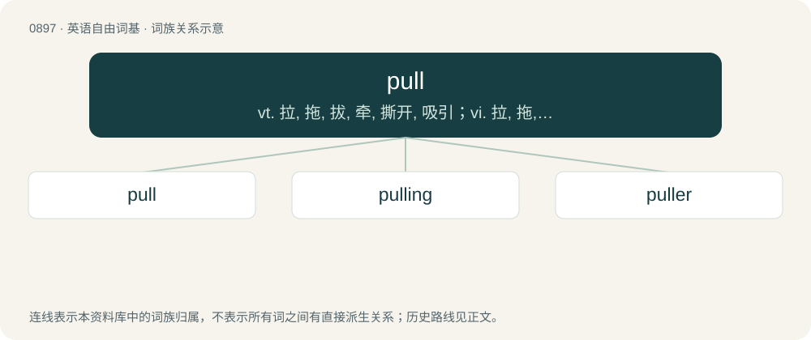

# 0972 · pull — vt. 拉, 拖, 拔, 牵, 撕开, 吸引；vi. 拉, 拖, 拔, 有吸引力；n. 拉, 拖, 拔, 拉力, 牵引力, 划船, 吸引

[总目录](../00_总目录_按常用程度.md)

**类型**：英语自由词基　｜　**来源语言**：见词源记录

## 核心含义与来源

- 核心含义：vt. 拉, 拖, 拔, 牵, 撕开, 吸引；vi. 拉, 拖, 拔, 有吸引力；n. 拉, 拖, 拔, 拉力, 牵引力, 划船, 吸引
- 英文含义：To apply a force to (an object) so that it comes toward the person or thing applying the force.
- 词形：pull

**来源记录 1**（动词；To apply a force to (an object) so that it comes toward the person or thing applying the force.）

Verb from Middle English pullen, from Old English pullian (“to pull, draw, tug, pluck off”), of uncertain ultimate origin. Related to West Frisian pûlje (“to shell, husk”), Middle Dutch pullen (“to drink”), Middle Dutch polen (“to peel, strip”), Low German pulen (“to pick, pluck, pull, tear, strip off husks”), Icelandic púla (“to work hard, beat”). Noun from Middle English pul, pull, pulle, from the verb pullen (“to pull”).

## 词族图

## 单词速览（常用到不常用）

| 单词 | 音标 | 释义 |
|---|---|---|
| [pull](#w-1) | 英 /pʊl/；/puːl/ | vt. 拉, 拖, 拔, 牵, 撕开, 吸引；vi. 拉, 拖, 拔, 有吸引力；n. 拉, 拖, 拔, 拉力, 牵引力, 划船, 吸引 |
| [pulling](#w-2) | /ˈpʊlɪŋ/ | \[计\] 拉单晶的 |
| [puller](#w-3) | 美 /ˈpʊlɚ/ | n. 拉的人, 拔具, 拉出器；\[化\] 拔出器; 拔具; 拆卸器 |

## 逐词详解

### 1. pull

**词性**：动词　｜　**音标**：英 /pʊl/；/puːl/

**中文释义**：vt. 拉, 拖, 拔, 牵, 撕开, 吸引；vi. 拉, 拖, 拔, 有吸引力；n. 拉, 拖, 拔, 拉力, 牵引力, 划船, 吸引

**英文义项**：To apply a force to (an object) so that it comes toward the person or thing applying the force. / To gather with the hand, or by drawing toward oneself; to pluck or pick (flowers, fruit, etc.).

**词源与演化**：

Verb from Middle English pullen, from Old English pullian (“to pull, draw, tug, pluck off”), of uncertain ultimate origin. Related to West Frisian pûlje (“to shell, husk”), Middle Dutch pullen (“to drink”), Middle Dutch polen (“to peel, strip”), Low German pulen (“to pick, pluck, pull, tear, strip off husks”), Icelandic púla (“to work hard, beat”). Noun from Middle English pul, pull, pulle, from the verb pullen (“to pull”).

**例句**：

> It's the contractor's responsibility to pull the necessary permits before starting work.

该用例对应义项：To obtain (a permit) from a regulatory authority.

### 2. pulling

**词性**：名词　｜　**音标**：/ˈpʊlɪŋ/

**中文释义**：\[计\] 拉单晶的

**英文义项**：The act by which something is pulled.

**构词拆分**：pull + -ing

**词源与演化**：

From Middle English pulling, pullyng, pullynge, equivalent to pull + -ing.

**例句**：

> His strenuous pulling strained his back.

该用例对应义项：the act of pulling; applying force to move something toward or with you

### 3. puller

**词性**：名词　｜　**音标**：美 /ˈpʊlɚ/

**中文释义**：n. 拉的人, 拔具, 拉出器；\[化\] 拔出器; 拔具; 拆卸器

**英文义项**：Anything that pulls, but especially a hoist in which a cable is attached to a lever and a ratchet mechanism. / A tool for pulling, such as a bearing puller.

**构词拆分**：pull + -er

**词源与演化**：

From Middle English puller, pullere, equivalent to pull + -er.

**例句**：

> But the job of a rickshaw puller is not easy.
