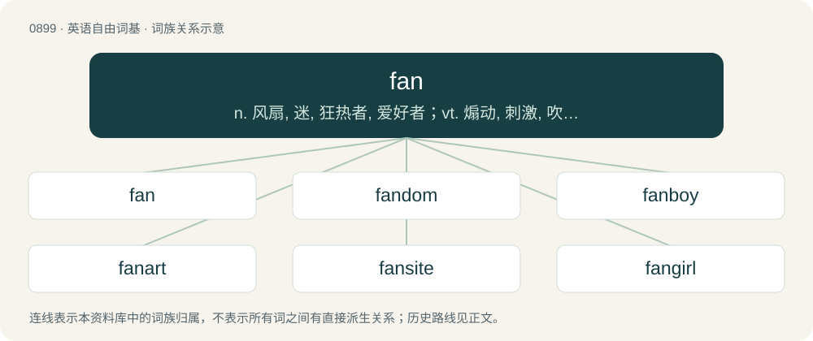

# 0973 · fan — n. 风扇, 迷, 狂热者, 爱好者；vt. 煽动, 刺激, 吹拂；vi. 飘动, 成扇形散开

[总目录](../00_总目录_按常用程度.md)

**类型**：英语自由词基　｜　**来源语言**：见词源记录

## 核心含义与来源

- 核心含义：n. 风扇, 迷, 狂热者, 爱好者；vt. 煽动, 刺激, 吹拂；vi. 飘动, 成扇形散开
- 英文含义：A hand-held device consisting of concertinaed material, or slats of material, gathered together at one end, that may be opened out into the shape of a sector of a circle and waved back and forth in order to move air towards oneself and cool oneself.
- 词形：fan

**多个词源／构词路径**：同一拼写可能有不同来源；以下按词性和含义分别列出。

**来源记录 1**（名词；A hand-held device consisting of concertinaed material, or slats of material, gathered together at one end, that may be opened out into the shape of a sector of a circle and waved back and forth in order to move air towards oneself and cool oneself.）

Inherited from Middle English fan, inherited from Old English fann (“a winnowing, fan”), derived from Latin vannus (“fan for winnowing grain”), derived from Proto-Indo-European \*h₂weh₁- (“to blow”). Cognates \* Latin ventus (“wind”) \* Dutch wan (“winnowing basket”) \* German Wanne (“winnowing basket”) \* Swedish vanna (“a fan for winnowing”) \* Old English windwian (“to fan, winnow”). More at winnow.

**来源记录 2**（名词；A person who is fond of something or someone, especially an admirer of a performer or aficionado of a sport.）

Clipping of fanatic, originally in US baseball slang. Possibly influenced by fancy (“group of sport or hobby enthusiasts”), i.e. fancy boy (“fan”).

**来源记录 3**（名词；A unit of length, equivalent to 0.1 tsun (0.01 chek), or 0.00371475 metres.）

From Cantonese 分. Doublet of fen and hoon.

## 词族图

## 单词速览（常用到不常用）

| 单词 | 音标 | 释义 |
|---|---|---|
| [fan](#w-1) | 英 /fæn/ | n. 风扇, 迷, 狂热者, 爱好者；vt. 煽动, 刺激, 吹拂；vi. 飘动, 成扇形散开 |
| [fandom](#w-2) | /ˈfændəm/ | n. 运动迷, 影迷 |
| [fanboy](#w-3) | 美 /ˈfænˌbɔɪ/ | n. （某种游戏、高科技产品、动漫等的）极端痴迷者, 狂热粉丝 |
| [fanart](#w-4) | 英 /ˈfænˌɑːt/；美 /ˈfænˌɑɹt/ | 【英文】Artwork created unofficially by fans of a media work and based on that work. |
| [fansite](#w-5) |  | 【英文】A website aimed at fans of something, such as a singer or football team. |
| [fangirl](#w-6) | 美 /ˈfænˌɡɝl/ | 脑残粉; 指的是那些极度痴迷于某事物或某明星的粉丝，甚至狂热到失去理智的地步 |
| [superfan](#w-7) |  | 【英文】An extremely dedicated fan (enthusiast). |
| [turbofan](#w-8) | /ˈtəːbəu,fæn/ | \[机\] 轮机式鼓风机 |

## 逐词详解

### 1. fan

**词性**：名词　｜　**音标**：英 /fæn/

**中文释义**：n. 风扇, 迷, 狂热者, 爱好者；vt. 煽动, 刺激, 吹拂；vi. 飘动, 成扇形散开

**英文义项**：A hand-held device consisting of concertinaed material, or slats of material, gathered together at one end, that may be opened out into the shape of a sector of a circle and waved back and forth in order to move air towards oneself and cool oneself. / An electrical or mechanical device for moving air, used for cooling people, machinery, etc.

**词源与演化**：

Inherited from Middle English fan, inherited from Old English fann (“a winnowing, fan”), derived from Latin vannus (“fan for winnowing grain”), derived from Proto-Indo-European \*h₂weh₁- (“to blow”). Cognates \* Latin ventus (“wind”) \* Dutch wan (“winnowing basket”) \* German Wanne (“winnowing basket”) \* Swedish vanna (“a fan for winnowing”) \* Old English windwian (“to fan, winnow”). More at winnow.

**例句**：

> He didn't switch on the fan because the temperature was 15 degrees Celsius.

该用例对应义项：An electrical or mechanical device for moving air, used for cooling people, machinery, etc.

### 2. fandom

**词性**：名词　｜　**音标**：/ˈfændəm/

**中文释义**：n. 运动迷, 影迷

**英文义项**：The fans of a sport, activity, work, person etc., taken as a group. / The subculture of enthusiasts, especially of TV shows.

**构词拆分**：fan + -dom

**词源与演化**：

From fan + -dom.

**例句**：

> The furry fandom, like many other fandoms, has its own slang.

### 3. fanboy

**词性**：名词　｜　**音标**：美 /ˈfænˌbɔɪ/

**中文释义**：n. （某种游戏、高科技产品、动漫等的）极端痴迷者, 狂热粉丝

**英文义项**：A male fan who is obsessive about a particular subject (especially, something or someone in popular entertainment media).

**构词拆分**：fan + boy

**词源与演化**：

From fan + boy.

**例句**：

> John is a certified Apple fanboy.

### 4. fanart

**词性**：名词　｜　**音标**：英 /ˈfænˌɑːt/；美 /ˈfænˌɑɹt/

**英文义项**：Artwork created unofficially by fans of a media work and based on that work.

**构词拆分**：fan + art

**词源与演化**：

From fan + art.

### 5. fansite

**词性**：名词

**英文义项**：A website aimed at fans of something, such as a singer or football team.

**构词拆分**：fan + site

**词源与演化**：

From fan + site.

### 6. fangirl

**词性**：名词　｜　**音标**：美 /ˈfænˌɡɝl/

**中文释义**：脑残粉; 指的是那些极度痴迷于某事物或某明星的粉丝，甚至狂热到失去理智的地步

**英文义项**：A female fan who is obsessive about a particular subject (especially, someone or something in popular entertainment media).

**构词拆分**：fan + girl

**词源与演化**：

From fan + girl.

### 7. superfan

**词性**：名词

**英文义项**：An extremely dedicated fan (enthusiast).

**构词拆分**：super- + fan

**词源与演化**：

From super- + fan.

### 8. turbofan

**词性**：名词　｜　**音标**：/ˈtəːbəu,fæn/

**中文释义**：\[机\] 轮机式鼓风机

**英文义项**：A turbojet engine having a (usually ducted) fan that drives a stream of air that partly bypasses the turbojet portion; in high-bypass-ratio types, most of the thrust comes from the bypass portion rather than the turbojet portion, and this can be thought of in simplistic terms as that the turbojet portion drives the fan and the fan propels the aircraft. / An aircraft with such engines.

**构词拆分**：turbo- + fan

**词源与演化**：

From turbo- + fan.

**例句**：

> A turbofan engine is the most modern variation of the basic gas turbine engine.
