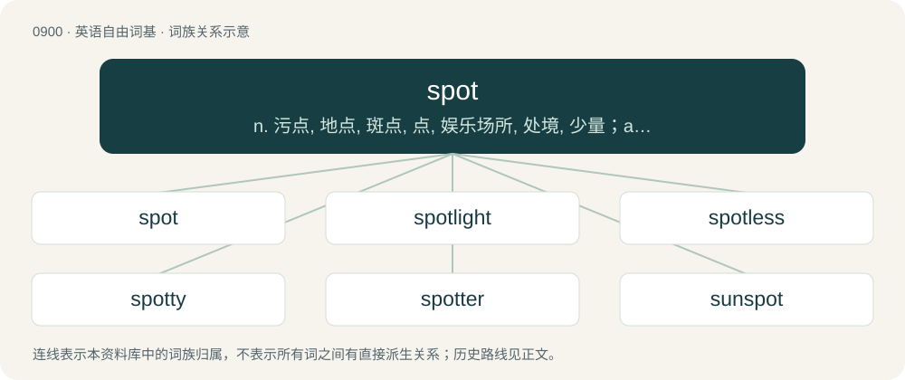

# 0974 · spot — n. 污点, 地点, 斑点, 点, 娱乐场所, 处境, 少量；a. 当场的, 现场的, 现货买卖的, 现金交易的, 抽样的；vt. 点缀, 玷污, 认出, 准确定...的位, 用灯光照射

[总目录](../00_总目录_按常用程度.md)

**类型**：英语自由词基　｜　**来源语言**：见词源记录

## 核心含义与来源

- 核心含义：n. 污点, 地点, 斑点, 点, 娱乐场所, 处境, 少量；a. 当场的, 现场的, 现货买卖的, 现金交易的, 抽样的；vt. 点缀, 玷污, 认出, 准确定...的位, 用灯光照射
- 英文含义：A round or irregular patch on the surface of a thing having a different color, texture etc. and generally round in shape.
- 词形：spot

**来源记录 1**（名词；A round or irregular patch on the surface of a thing having a different color, texture etc. and generally round in shape.）

From Middle English spot, spotte, partially from Middle Dutch spotte (“spot, speck”), and partially merging with Middle English splot, from Old English splott (“spot, plot of land”), from Proto-West Germanic \*splott, from Proto-Germanic \*spluttaz (“segment”), from Proto-Indo-European \*splt-no- (“an off-split, segment”), from Proto-Indo-European \*(s)pel- (“to split”). Cognate with North Frisian spot (“speck, piece of ground”), Low German spot (“speck”), Old Norse spotti (“small piece”). See also splot, splotch.

## 词族图

## 单词速览（常用到不常用）

| 单词 | 音标 | 释义 |
|---|---|---|
| [spot](#w-1) | 英 /spɒt/；美 /spɑt/ | n. 污点, 地点, 斑点, 点, 娱乐场所, 处境, 少量；a. 当场的, 现场的, 现货买卖的, 现金交易的, 抽样的；vt. 点缀, 玷污, 认出, 准确定...的位, 用灯光照射 |
| [spotlight](#w-2) | 英 /ˈspɒtˌlaɪt/；美 /ˈspɑtˌlaɪt/ | n. 照明灯, 反光灯, 聚光灯 |
| [spotless](#w-3) | 美 /spɑtlɪs/ | a. 无脏污的, 无缺点的, 无可挑剔的 |
| [spotty](#w-4) | /ˈspɒti/ | a. 有斑点的, 有污点的, 质量不一的, 发疹的 |
| [spotter](#w-5) | 英 /ˈspɒt.ə/；美 /ˈspɑ.tɚ/ | n. 私家侦探, 着弹点观察员；\[法\] 私家侦探, 秘密监视人 |
| [sunspot](#w-6) | 英 /ˈsʌnspɒt/；美 /ˈsʌnspɑt/ | n. 太阳黑子, 雀斑 |

## 逐词详解

### 1. spot

**词性**：名词　｜　**音标**：英 /spɒt/；美 /spɑt/

**中文释义**：n. 污点, 地点, 斑点, 点, 娱乐场所, 处境, 少量；a. 当场的, 现场的, 现货买卖的, 现金交易的, 抽样的；vt. 点缀, 玷污, 认出, 准确定...的位, 用灯光照射

**英文义项**：A round or irregular patch on the surface of a thing having a different color, texture etc. and generally round in shape. / A stain or disfiguring mark.

**词源与演化**：

From Middle English spot, spotte, partially from Middle Dutch spotte (“spot, speck”), and partially merging with Middle English splot, from Old English splott (“spot, plot of land”), from Proto-West Germanic \*splott, from Proto-Germanic \*spluttaz (“segment”), from Proto-Indo-European \*splt-no- (“an off-split, segment”), from Proto-Indo-European \*(s)pel- (“to split”). Cognate with North Frisian spot (“speck, piece of ground”), Low German spot (“speck”), Old Norse spotti (“small piece”). See also splot, splotch.

**例句**：

> She was in a real spot when she ran into her separated husband while on a date.

该用例对应义项：A difficult situation.

### 2. spotlight

**词性**：名词　｜　**音标**：英 /ˈspɒtˌlaɪt/；美 /ˈspɑtˌlaɪt/

**中文释义**：n. 照明灯, 反光灯, 聚光灯

**英文义项**：A bright, directional light or lamp, especially one used to illuminate the focus or center of attention on a stage. / The circle of light shed by a spotlight.

**构词拆分**：spot + light

**词源与演化**：

From spot + light.

**例句**：

> Some people enjoy the spotlight.

该用例对应义项：The center of attention; the highlight or most important part.

### 3. spotless

**词性**：形容词　｜　**音标**：美 /spɑtlɪs/

**中文释义**：a. 无脏污的, 无缺点的, 无可挑剔的

**英文义项**：Exceptionally clean. / Impeccable and free from blemish.

**构词拆分**：spot + -less

**词源与演化**：

From Middle English spotles, equivalent to spot + -less.

**用法示例／搭配（非完整句）**：

> spotless nature

该用例对应义项：Impeccable and free from blemish.

### 4. spotty

**词性**：形容词　｜　**音标**：/ˈspɒti/

**中文释义**：a. 有斑点的, 有污点的, 质量不一的, 发疹的

**英文义项**：Having spots; spotted. / Occurring in non-contiguous positions or locations.

**构词拆分**：spot + -y

**词源与演化**：

From Middle English spotty, equivalent to spot + -y.

**例句**：

> Many of the low-cost accessories (cords, chargers, etc) sold in the dollar store had spotty quality.

该用例对应义项：Inconsistent: not reliably good, sometimes bad.

### 5. spotter

**词性**：名词　｜　**音标**：英 /ˈspɒt.ə/；美 /ˈspɑ.tɚ/

**中文释义**：n. 私家侦探, 着弹点观察员；\[法\] 私家侦探, 秘密监视人

**英文义项**：A person who observes something. / A member of a sniper team who in addition to this function is responsible for providing additional information about targets from a different point of view.

**构词拆分**：spot + -er

**词源与演化**：

From spot + -er.

**例句**：

> Use a spotter for heavy lifting exercises.

### 6. sunspot

**词性**：名词　｜　**音标**：英 /ˈsʌnspɒt/；美 /ˈsʌnspɑt/

**中文释义**：n. 太阳黑子, 雀斑

**英文义项**：A region on the sun's surface with a lower temperature than its surroundings and intense magnetic activity. / A random shock in the foreign exchange currency market.

**构词拆分**：sun + spot

**词源与演化**：

From sun + spot.
