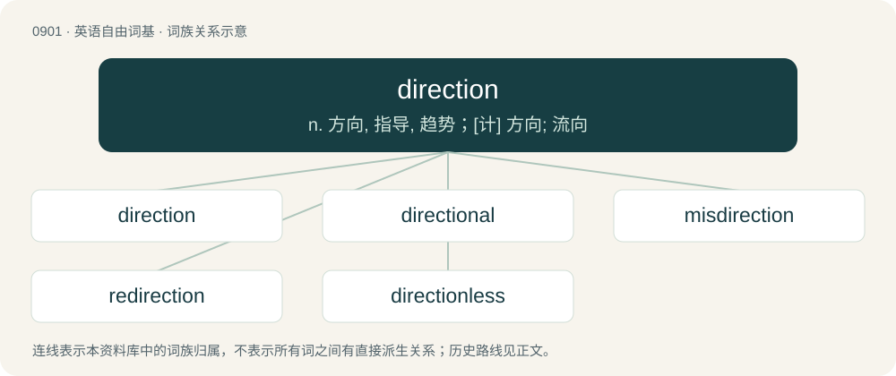

# 0975 · direction — n. 方向, 指导, 趋势；\[计\] 方向; 流向

[总目录](../00_总目录_按常用程度.md)

**类型**：英语自由词基　｜　**来源语言**：见词源记录

## 核心含义与来源

- 核心含义：n. 方向, 指导, 趋势；\[计\] 方向; 流向
- 英文含义：A theoretical line (physically or mentally) followed from a point of origin or towards a destination. May be relative (e.g. up, left, outbound, dorsal), geographical (e.g. north), rotational (e.g. clockwise), or with respect to an object or location (e.g. toward Boston).
- 词形：direction

**来源记录 1**（名词；A theoretical line (physically or mentally) followed from a point of origin or towards a destination. May be relative (e.g. up, left, outbound, dorsal), geographical (e.g. north), rotational (e.g. clockwise), or with respect to an object or location (e.g. toward Boston).）

From Middle English direccioun, from Old French direccion, from Latin dīrēctiō. Equivalent to direct + -ion.

## 词族图

## 单词速览（常用到不常用）

| 单词 | 音标 | 释义 |
|---|---|---|
| [direction](#w-1) | 英 /dɪˈɹɛk.ʃən/ | n. 方向, 指导, 趋势；\[计\] 方向; 流向 |
| [directional](#w-2) | /dɪˈɹɛk.ʃə.nəl/ | a. 方向的 |
| [misdirection](#w-3) | /,misdiˈrekʃən,-dai-/ | \[法\] 错误指示, 错误指导 |
| [redirection](#w-4) | /ɹiːdəˈɹɛkʃən/ | n. 更改收信人地址；\[计\] 重定向 |
| [directionless](#w-5) | /dəˈrekʃnləs/ | a. 漫无目的的；无目标的；无计划的 |

## 逐词详解

### 1. direction

**词性**：名词　｜　**音标**：英 /dɪˈɹɛk.ʃən/

**中文释义**：n. 方向, 指导, 趋势；\[计\] 方向; 流向

**英文义项**：A theoretical line (physically or mentally) followed from a point of origin or towards a destination. May be relative (e.g. up, left, outbound, dorsal), geographical (e.g. north), rotational (e.g. clockwise), or with respect to an object or location (e.g. toward Boston). / A general trend for future action.

**构词拆分**：direct + -ion

**词源与演化**：

From Middle English direccioun, from Old French direccion, from Latin dīrēctiō. Equivalent to direct + -ion.

**例句**：

> The trombonist looked to the bandleader for direction.

该用例对应义项：Guidance, instruction.

### 2. directional

**词性**：形容词　｜　**音标**：/dɪˈɹɛk.ʃə.nəl/

**中文释义**：a. 方向的

**英文义项**：Indicating direction. / Of or relating to guidance or help.

**构词拆分**：From direction + -al.

**词源与演化**：

From direction + -al.

**例句**：

> He tried to explain the directional trends of modern science.

该用例对应义项：relating to direction toward a (nonspatial) goal

### 3. misdirection

**词性**：名词　｜　**音标**：/,misdiˈrekʃən,-dai-/

**中文释义**：\[法\] 错误指示, 错误指导

**英文义项**：An act of misleading, of convincing someone to concentrate in an incorrect direction. / Movement or tendency in the wrong direction.

**构词拆分**：mis- + direction

**词源与演化**：

From mis- + direction.

**例句**：

> The magician used misdirection to get us to watch his left hand while he did something with his right hand.

该用例对应义项：An act of misleading, of convincing someone to concentrate in an incorrect direction.

### 4. redirection

**词性**：名词　｜　**音标**：/ɹiːdəˈɹɛkʃən/

**中文释义**：n. 更改收信人地址；\[计\] 重定向

**英文义项**：The act of setting a new direction. / The automated process of taking a user to a location other than the one selected.

**构词拆分**：re- + direction

**词源与演化**：

From re- + direction.

### 5. directionless

**词性**：形容词　｜　**音标**：/dəˈrekʃnləs/

**中文释义**：a. 漫无目的的；无目标的；无计划的

**英文义项**：Lacking direction; aimless.

**构词拆分**：direction + -less

**词源与演化**：

From direction + -less.
