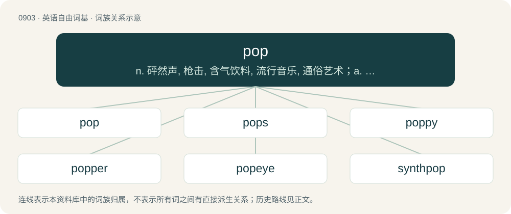

# 0976 · pop — n. 砰然声, 枪击, 含气饮料, 流行音乐, 通俗艺术；a. 流行的, 热门的, 通俗的；vt. 使发出爆裂声, 开枪打, 突然伸出

[总目录](../00_总目录_按常用程度.md)

**类型**：英语自由词基　｜　**来源语言**：见词源记录

## 核心含义与来源

- 核心含义：n. 砰然声, 枪击, 含气饮料, 流行音乐, 通俗艺术；a. 流行的, 热门的, 通俗的；vt. 使发出爆裂声, 开枪打, 突然伸出
- 英文含义：A loud, sharp sound, as of a cork coming out of a bottle, especially when the contents are pressurized by fizziness.
- 词形：pop

**多个词源／构词路径**：同一拼写可能有不同来源；以下按词性和含义分别列出。

**来源记录 1**（名词；A loud, sharp sound, as of a cork coming out of a bottle, especially when the contents are pressurized by fizziness.）

From Middle English pop, poppe (“a blow; strike; buffet”) (&gt; Middle English poppen (“to strike; thrust”, verb)), of onomatopoeic origin – used to describe the sound, or short, sharp actions. The physics sense is part of a facetious sequence "snap, crackle, pop", after the mascots of Rice Krispies cereal.

**来源记录 2**（名词；One's father or sometimes one's grandfather.）

From papa or poppa.

**来源记录 3**（形容词；Popular.）

Clipping of popular.

**来源记录 4**（名词；Population.）

Clipping of population.

**来源记录 5**（名词；A Russian Orthodox parish priest.）

From colloquial Russian поп (pop) and Попъ (Pop), from Old Church Slavonic попъ (popŭ), from Byzantine Greek πάπας (pápas) (see pope). Doublet of pope.

## 词族图

## 单词速览（常用到不常用）

| 单词 | 音标 | 释义 |
|---|---|---|
| [pop](#w-1) | 英 /pɒp/；美 /pɑp/ | n. 砰然声, 枪击, 含气饮料, 流行音乐, 通俗艺术；a. 流行的, 热门的, 通俗的；vt. 使发出爆裂声, 开枪打, 突然伸出 |
| [pops](#w-2) | 美 /pɑps/ | abbr. 流行曲调（popular tunes）；大众音乐会（popular concerts） |
| [poppy](#w-3) | 英 /ˈpɒpi/；美 /ˈpɑpi/ | n. 罂粟；\[医\] 罂粟 |
| [popper](#w-4) | 英 /ˈpɒp.ə/；美 /ˈpɑ.pɚ/ | n. 发出砰的响声的人 |
| [popeye](#w-5) | /ˈpɒp.aɪ/ | 【英文】Exophthalmia. |
| [synthpop](#w-6) |  | 【英文】A style of pop music in which the synthesizer is the dominant musical instrument. |

## 逐词详解

### 1. pop

**词性**：名词　｜　**音标**：英 /pɒp/；美 /pɑp/

**中文释义**：n. 砰然声, 枪击, 含气饮料, 流行音乐, 通俗艺术；a. 流行的, 热门的, 通俗的；vt. 使发出爆裂声, 开枪打, 突然伸出

**英文义项**：A loud, sharp sound, as of a cork coming out of a bottle, especially when the contents are pressurized by fizziness. / An effervescent or fizzy drink, most frequently nonalcoholic; soda pop.

**词源与演化**：

From Middle English pop, poppe (“a blow; strike; buffet”) (&gt; Middle English poppen (“to strike; thrust”, verb)), of onomatopoeic origin – used to describe the sound, or short, sharp actions. The physics sense is part of a facetious sequence "snap, crackle, pop", after the mascots of Rice Krispies cereal.

**例句**：

> The man with the gun took a pop at the rabbit.

该用例对应义项：A pop shot: a quick, possibly unaimed, shot with a firearm.

### 2. pops

**词性**：名词　｜　**音标**：美 /pɑps/

**中文释义**：abbr. 流行曲调（popular tunes）；大众音乐会（popular concerts）

**英文义项**：Father, dad. / A man old enough to be the speaker's father.

**构词拆分**：From pop (“dad”) + -s (hypocoristic suffix).

**词源与演化**：

From pop (“dad”) + -s (hypocoristic suffix).

**例句**：

> Hey, pops, I'm home.

该用例对应义项：Father, dad.

### 3. poppy

**词性**：形容词　｜　**音标**：英 /ˈpɒpi/；美 /ˈpɑpi/

**中文释义**：n. 罂粟；\[医\] 罂粟

**英文义项**：Having a popping or bursting sound. / Of a beverage: resembling soda pop; effervescent, fizzy.

**构词拆分**：pop (“loud, sharp sound; fizzy drink; to make or burst with a loud, sharp sound; to stand out”) + -y (suffix forming adjectives with the sense ‘having the quality of’)

**词源与演化**：

From pop (“loud, sharp sound; fizzy drink; to make or burst with a loud, sharp sound; to stand out”) + -y (suffix forming adjectives with the sense ‘having the quality of’).

**例句**：

> We made a cake and we put poppy seeds inside.

### 4. popper

**词性**：名词　｜　**音标**：英 /ˈpɒp.ə/；美 /ˈpɑ.pɚ/

**中文释义**：n. 发出砰的响声的人

**英文义项**：One who or that which pops. / A short piece of twisted string tied to the end of a whip that creates the distinctive sound when the whip is thrown or cracked.

**构词拆分**：pop + -er (suffix forming agent noun)

**词源与演化**：

From Middle English poppere, equivalent to pop + -er (suffix forming agent noun). Etymology 1 sense 8 ("capsule of amyl nitrite") is derived from the popping sound when the capsule is broken open; from which etymology 1 sense 9 also derives.

**例句**：

> My wizard friend's name is Larry Popper.

### 5. popeye

**词性**：名词　｜　**音标**：/ˈpɒp.aɪ/

**英文义项**：Exophthalmia. / Coryphaenoides cinereus (syn. Macrurus cinereus), a deep sea fish.

**构词拆分**：pop + eye

**词源与演化**：

From pop + eye.

**例句**：

> When Popeye eats spinach, he can do what seems impossible.

### 6. synthpop

**词性**：名词

**英文义项**：A style of pop music in which the synthesizer is the dominant musical instrument.

**构词拆分**：synth (“synthesizer”) + pop

**词源与演化**：

From synth (“synthesizer”) + pop.

**例句**：

> Have you ever heard of synthpop music?
