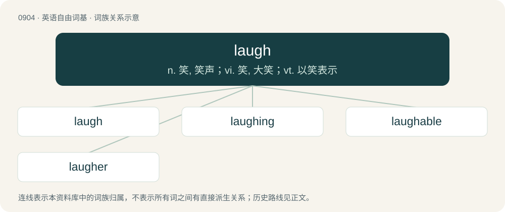

# 0979 · laugh — n. 笑, 笑声；vi. 笑, 大笑；vt. 以笑表示

[总目录](../00_总目录_按常用程度.md)

**类型**：英语自由词基　｜　**来源语言**：见词源记录

## 核心含义与来源

- 核心含义：n. 笑, 笑声；vi. 笑, 大笑；vt. 以笑表示
- 英文含义：An expression of mirth particular to the human species; the sound heard in laughing; laughter.
- 词形：laugh

**来源记录 1**（名词；An expression of mirth particular to the human species; the sound heard in laughing; laughter.）

From Middle English laughen, laghen, from (Anglian) Old English hlæhhan, hlehhan, (West Saxon) hliehhan, from Proto-West Germanic \*hlahhjan, from Proto-Germanic \*hlahjaną. Cognates Germanic: Scots lauch (“to laugh”), Yola leeigh, leigh (“to laugh”), North Frisian laache, lachi, laake, loache, lååke (“to laugh”), Saterland Frisian laachje (“to laugh”), West Frisian laitsje (“to laugh”), Alemannic German lache (“to laugh”), Cimbrian lachan (“to laugh”), Dutch, German, and Low German lachen (“to laugh”), Luxembourgish laachen (“to laugh”), Yiddish לאַכן (lakhn, “to laugh”), Danish, Norwegian Bokmål, Norwegian Nynorsk, and Swedish le (“to laugh”), Elfdalian läa (“to laugh”), Faroese læa (“to laugh”), Icelandic hlæja (“to laugh”), Norwegian Nynorsk le, læ, læja (“to laugh”), Crimean Gothic lachen (“to laugh”), Gothic 𐌷𐌻𐌰𐌷𐌾𐌰𐌽 (hlahjan, “to laugh”). Indo-European: Breton kloc'h (“bell”), Irish clog (“bell; clock”), Manx and Scottish Gaelic clag (“bell”), Welsh cloch (“bell”), Russian клекота́ть (klekotátʹ), клокота́ть (klokotátʹ), клохта́ть (kloxtátʹ, “to cluck, cackle”).

## 词族图

## 单词速览（常用到不常用）

| 单词 | 音标 | 释义 |
|---|---|---|
| [laugh](#w-1) | 英 /lɑːf/；美 /læf/ | n. 笑, 笑声；vi. 笑, 大笑；vt. 以笑表示 |
| [laughing](#w-2) | /ˈlɑːfɪŋ/ | a. 一笑置之的, 高兴的；n. 笑 |
| [laughable](#w-3) | 英 /ˈlɑːfəbl̩/；美 /ˈlæfəbl̩/ | a. 可笑的, 有趣的 |
| [laugher](#w-4) | 英 /ˈlɑːfə/；美 /ˈlæfɚ/ | n. 笑者,哄笑者, 好笑的一边倒比赛 |

## 逐词详解

### 1. laugh

**词性**：名词　｜　**音标**：英 /lɑːf/；美 /læf/

**中文释义**：n. 笑, 笑声；vi. 笑, 大笑；vt. 以笑表示

**英文义项**：An expression of mirth particular to the human species; the sound heard in laughing; laughter. / Something that provokes mirth or scorn.

**词源与演化**：

From Middle English laughen, laghen, from (Anglian) Old English hlæhhan, hlehhan, (West Saxon) hliehhan, from Proto-West Germanic \*hlahhjan, from Proto-Germanic \*hlahjaną. Cognates Germanic: Scots lauch (“to laugh”), Yola leeigh, leigh (“to laugh”), North Frisian laache, lachi, laake, loache, lååke (“to laugh”), Saterland Frisian laachje (“to laugh”), West Frisian laitsje (“to laugh”), Alemannic German lache (“to laugh”), Cimbrian lachan (“to laugh”), Dutch, German, and Low German lachen (“to laugh”), Luxembourgish laachen (“to laugh”), Yiddish לאַכן (lakhn, “to laugh”), Danish, Norwegian Bokmål, Norwegian Nynorsk, and Swedish le (“to laugh”), Elfdalian läa (“to laugh”), Faroese læa (“to laugh”), Icelandic hlæja (“to laugh”), Norwegian Nynorsk le, læ, læja (“to laugh”), Crimean Gothic lachen (“to laugh”), Gothic 𐌷𐌻𐌰𐌷𐌾𐌰𐌽 (hlahjan, “to laugh”). Indo-European: Breton kloc'h (“bell”), Irish clog (“bell; clock”), Manx and Scottish Gaelic clag (“bell”), Welsh cloch (“bell”), Russian клекота́ть (klekotátʹ), клокота́ть (klokotátʹ), клохта́ть (kloxtátʹ, “to cluck, cackle”).

**例句**：

> His deep laughs boomed through the room.

该用例对应义项：An expression of mirth particular to the human species; the sound heard in laughing; laughter.

### 2. laughing

**词性**：形容词　｜　**音标**：/ˈlɑːfɪŋ/

**中文释义**：a. 一笑置之的, 高兴的；n. 笑

**英文义项**：verbal adjective of laugh: the action of the verb to laugh.

**构词拆分**：laugh + -ing

**词源与演化**：

From Middle English laughynge; equivalent to laugh + -ing.

**例句**：

> When I entered the room, Tom and Mary were laughing at something.

### 3. laughable

**词性**：形容词　｜　**音标**：英 /ˈlɑːfəbl̩/；美 /ˈlæfəbl̩/

**中文释义**：a. 可笑的, 有趣的

**英文义项**：Worthless; worthy of contempt or derision.

**构词拆分**：laugh + -able

**词源与演化**：

From laugh + -able.

**例句**：

> The idea that he is going to make a speech is laughable.

### 4. laugher

**词性**：名词　｜　**音标**：英 /ˈlɑːfə/；美 /ˈlæfɚ/

**中文释义**：n. 笑者,哄笑者, 好笑的一边倒比赛

**英文义项**：One who laughs. / A game in which an opponent is defeated by a sizable margin; a blowout.

**构词拆分**：laugh + -er

**词源与演化**：

From Middle English lawȝar, lawher(e); equivalent to laugh + -er.
