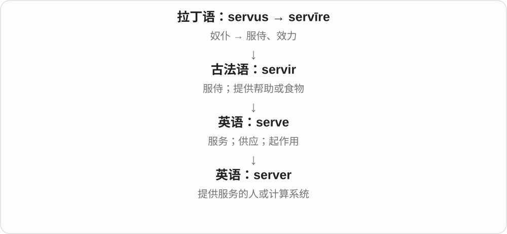

# 0980 · serve — 服务；提供；履行作用

[逐词精讲目录](../00_逐词精讲目录.md) · [总目录](../00_总目录_按常用程度.md)

## 核心词根与来源

serve 经法语来自拉丁 servire 服务，联系 servus 仆从一支。server 可是人也可是设备；servant 多指仆人或受雇服务者；servitude 强调受役使的状态。

**SERVE：为人做事，或让某物发挥用途**

端上饭菜、服务客户、一台机器提供数据，都是不同对象的服务。

- **动作与执行者**：serve · server
- **身份与受役状态**：servant · servitude
- **servant → servants：服务、服侍的人**：serve · servant · servants
- **餐巾名 serviette 与 serve 的候选历史联系**：serve · serviette · serviettes

## 词形与演化规律

serve + -er → server；servant、servitude 有自己的法语、拉丁借入历史。serve as 是充当，serve food 是端上。

古法语 servant 是 servir 的分词，职业名有独立借入史。

serviette 借法语，远源不清；常联系 servir，但不能把这条推测写成已证实的唯一构词。

## 单词速览（按词族由简到繁）

同一基础词的相关扩展放在一起，先读基础形式，再读扩展；各组之间优先读常用的。具体词源关系见各词讲解。

| 单词 | 音标 | 核心意思 |
|---|---|---|
| [serve](#w-1) | 英 /sɜːv/；美 /sɜːrv/ | 服务；端上；供给；起作用；发球 |
| [server](#w-2) | 英 /ˈsɜːvə/；美 /ˈsɜːrvər/ | 服务员；服务器；发球者 |
| [servant](#w-3) | 英 /ˈsɜːvənt/；美 /ˈsɜːrvənt/ | 仆人；服务者 |
| [servants](#w-5) | 英 /ˈsɜːvənts/；美 /ˈsɜːrvənts/ | 仆人、服务者；特定表达中的公职人员〔复数〕 |
| [servitude](#w-4) | 英 /ˈsɜːvɪtjuːd/；美 /ˈsɜːrvɪtuːd/ | 奴役状态；受束缚的服役 |
| [serviette](#w-6) | 英 /ˌsɜːviˈet/；美 /ˌsɜːrviˈet/ | 餐巾〔部分地区常用，与 napkin 相近〕 |
| [serviettes](#w-7) | 英 /ˌsɜːviˈets/；美 /ˌsɜːrviˈets/ | 餐巾〔复数〕 |

## 逐词讲解

### 1. serve — 服务；端上；供给；起作用；发球

**音标**：英 /sɜːv/；美 /sɜːrv/

**先抓住这个画面**

把自己的行动、食物或功能提供出去，满足别人或某项任务的需要。

**怎么拆**

经古法语 servir 来自拉丁语 servīre“服侍”，与 servus“奴仆”相连。现代服务义不含被奴役的意思。

**怎么变成今天的意思**

服务顾客、端菜、服役都能连到为某人或某事效力。A box serves as a table 是箱子临时起桌子的作用；球类中还指发球。

**常见搭配与例句**

serve customers；serve dinner；serve as；serve a purpose。

> This room serves as both an office and a library.

这个房间既当办公室，也当书房。

> Dinner will be served at seven.

晚饭七点上桌。

**别混淆**

serve someone 是为某人提供服务；serve as something 是充当某种角色。不能把所有 serve 都译成服侍。

### 2. server — 服务员；服务器；发球者

**音标**：英 /ˈsɜːvə/；美 /ˈsɜːrvər/

**先抓住这个画面**

谁把你请求的东西送过来，谁就是这一环节里的 server：餐厅送餐，网络送数据。

**怎么拆**

serve + -er，原指提供服务的人，后来扩展到提供计算服务的程序或机器。

**怎么变成今天的意思**

技术语境中的 server 可以指软件，也可以指运行软件的计算机；不一定是一台巨大的独立机器。

**常见搭配与例句**

a restaurant server；a web server；connect to a server。

> The server brought us a jug of water.

服务员给我们端来一壶水。

> The app sends the request to a server.

应用把请求发送到服务器。

**别混淆**

client 发出请求、使用服务；server 接收请求并提供服务。这是角色区别，不只看设备大小。

### 3. servant — 仆人；服务者

**音标**：英 /ˈsɜːvənt/；美 /ˈsɜːrvənt/

**先抓住这个画面**

传统家庭中专门替主人做家务、服侍起居的人；某些固定搭配里则是为公众办事的人。

**怎么拆**

来自古法语 servant，即 servir“服侍”的现在分词；现代能看出 serve 与 -ant。

**怎么变成今天的意思**

普通 servant 带旧式主仆关系的色彩。civil servant 是公务员，不是私人家仆。现代职业名称通常用更具体的职位。

**常见搭配与例句**

a household servant；a civil servant；a public servant。

> The novel describes the daily life of a household servant.

小说描写了一名家仆的日常生活。

> She worked as a civil servant for many years.

她做了多年公务员。

**别混淆**

employee 是受雇员工的通称；servant 不适合随便称呼所有员工。

### 4. servants — 仆人、服务者；特定表达中的公职人员〔复数〕

**音标**：英 /ˈsɜːvənts/；美 /ˈsɜːrvənts/

**先抓住这个画面**

为别人服务、服侍的人，是 servant 的角色画面。旧家庭里的仆人、公职称呼里的服务者，都保留这层关系。

**怎么拆**

servant + -s，/t/ 后读 /s/。servant 借古法语 servant，即 servir 服侍的现在分词，远接拉丁 servire、servus 词族。

**怎么变成今天的意思**

**拉丁 servire → 古法语 servant → 英语 servant**  
服侍 → 服侍、服务的人

↓

**servant + -s → servants**  
多位仆人、服务者；进入固定公职称呼

household servants 家仆；civil servants 公务员；public servants 公职服务人员。

**常见搭配与例句**

servants in a historical novel 历史小说里的仆人；loyal servants 忠实仆人。

> The novel describes the lives of household servants.

小说描写了家仆的生活。

> Several civil servants attended the training session.

几位公务员参加了培训。

**别混淆**

servants 不能普遍代替现代所有 employees 员工。civil servants 是固定职业类别，表达的是公共服务关系，不按家庭仆人理解。

### 5. servitude — 奴役状态；受束缚的服役

**音标**：英 /ˈsɜːvɪtjuːd/；美 /ˈsɜːrvɪtuːd/

**先抓住这个画面**

工作不只是辛苦，而是人失去自由，长期被迫为别人效力。

**怎么拆**

经法语 servitude 来自拉丁语 servitūdō，来自 servus“奴仆”。

**怎么变成今天的意思**

通常用于历史、社会或法律讨论。不是给所有忙碌工作起的普通名称；修辞中也可比喻长期受某物支配。

**常见搭配与例句**

forced servitude；escape servitude；a life of servitude。

> The book describes people struggling to escape servitude.

这本书描写人们努力摆脱奴役的经历。

> The exhibition traces the history of forced servitude.

展览梳理了被迫服役与奴役的历史。

**别混淆**

service 可以是自愿、专业、有报酬的服务；servitude 突出自由被剥夺或严重受支配。

### 6. serviette — 餐巾〔部分地区常用，与 napkin 相近〕

**音标**：英 /ˌsɜːviˈet/；美 /ˌsɜːrviˈet/

**先抓住这个画面**

吃饭时放在膝上、擦嘴擦手的小巾，可以叫 serviette。先把它当作餐桌用品，和 napkin 对应认识。

**怎么拆**

借法语 serviette 餐巾、毛巾；更远来源不清，常联系 servir 服务、侍候的分词材料。不能把 serve + ette 的字面拼法当作已证实的唯一历史。

**怎么变成今天的意思**

**法语 serviette → 英语 serviette**  
餐巾名称的借入；更远联系仍有讨论

↓

**可能联系法语 servir**  
服务、餐桌侍候材料为候选，不是确定的逐字组合

a paper serviette 纸餐巾；a cloth serviette 布餐巾。

**常见搭配与例句**

fold a serviette 叠餐巾；a serviette beside the plate 盘旁的餐巾。

> A folded serviette lay beside the plate.

盘子旁放着叠好的餐巾。

> She wiped her hands on a paper serviette.

她用纸餐巾擦了擦手。

**别混淆**

napkin 在国际英语里更普遍；serviette 在一些地区也很常见。认读时知道二者通常指同类餐巾即可。

### 7. serviettes — 餐巾〔复数〕

**音标**：英 /ˌsɜːviˈets/；美 /ˌsɜːrviˈets/

**先抓住这个画面**

餐桌上一张张、块块餐巾，是 serviettes。可以是纸，也可以是布，前面的修饰词说明材料。

**怎么拆**

serviette 借法语，较远与 servir 服务的联系有争议；现代整个词加 -s，/t/ 后读 /s/，借词同样可按英语规则变复数。

**怎么变成今天的意思**

**法语 serviette → 英语 serviette**  
餐巾名的借入

↓

**serviette + -s → serviettes**  
多张、多块餐巾

paper serviettes 纸餐巾；cloth serviettes 布餐巾。

**常见搭配与例句**

fold the serviettes 叠餐巾；a packet of serviettes 一包餐巾。

> She put paper serviettes beside the plates.

她把纸餐巾放在盘子旁。

> The cupboard held glasses and serviettes.

柜子里放着玻璃杯和餐巾。

**别混淆**

这个 s 是英语复数形式。法语借词里的旧构词背景与英语今天的复数变化，是两件不同的事。

## 这一组要分清什么

server 不一定是人，servitude 也不是普通优质 service；词根共同不代表语气相同。

## 串起来练习

The server serves the files, while the article discusses servants and servitude in history.

服务器提供文件，而文章讨论历史中的仆人和受役状态。
