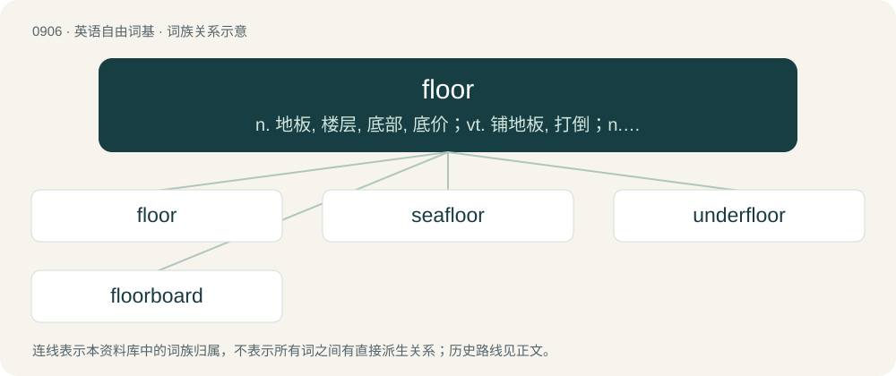

# 0981 · floor — n. 地板, 楼层, 底部, 底价；vt. 铺地板, 打倒；n. 地面, 地板, 基底

[总目录](../00_总目录_按常用程度.md)

**类型**：英语自由词基　｜　**来源语言**：见词源记录

## 核心含义与来源

- 核心含义：n. 地板, 楼层, 底部, 底价；vt. 铺地板, 打倒；n. 地面, 地板, 基底
- 英文含义：The interior bottom or surface of a house or building; the supporting surface of a room.
- 词形：floor

**来源记录 1**（名词；The interior bottom or surface of a house or building; the supporting surface of a room.）

Inherited from Middle English floor, floour, flor, flore, flour, flur, vlor, from Old English flōr (“floor, pavement; deck; gangplank”), from Proto-West Germanic \*flōr, from Proto-Germanic \*flōraz (“ground; floor”), from Proto-Indo-European \*pleh₂ros (“floor”), from Proto-Indo-European \*pleh₂- (“flat”). Cognates Cognate with Scots flair, fluir (“floor”), Saterland Frisian Floor (“floor”), Dutch vloer (“floor”), German Flur (“corridor, hall, hallway, stairwell”), Limburgish Vlǫǫr (“floor”), Low German Floor (“hallway or entrance to a house”), Luxembourgish Flouer (“countryside, farmland”); also Breton and Cornish leur (“floor, ground, surface”), Irish lár (“floor, ground”), Scottish Gaelic làr (“earth, floor, ground”), Manx laare (“bottom, deck, floor; level, storey”), Welsh llawr (“floor, ground”), Latin plānus (“even, flat, level”), Greek απαλάμη (apalámi), παλάμη (palámi, “hand, palm”), Albanian pëllëmbë (“palm”), Latgalian pluons (“thin”), Latvian plāns (“thin”), Lithuanian plonas (“fine, slender, thin”), Belarusian, Macedonian, Russian, and Ukrainian по́ле (póle, “field”), Bulgarian поле́ (polé, “field”), Czech, Polish, and Slovak pole (“field”), Serbo-Croatian по̏ље, pȍlje (“field”), Slovene polje (“field”), Hittite 𒁄𒄭𒅖 (palḫis, “broad, wide”). Related to flat.

## 词族图

## 单词速览（常用到不常用）

| 单词 | 音标 | 释义 |
|---|---|---|
| [floor](#w-1) | 英 /flɔː/；美 /floɹ/ | n. 地板, 楼层, 底部, 底价；vt. 铺地板, 打倒；n. 地面, 地板, 基底 |
| [seafloor](#w-2) | /ˈsiːflɔː/ | n. 海底 |
| [underfloor](#w-3) |  | \[计\] 地板下 |
| [floorboard](#w-4) | /ˈflɔːbɔːd/ | n. 一块地板, 汽车底部板 |

## 逐词详解

### 1. floor

**词性**：名词　｜　**音标**：英 /flɔː/；美 /floɹ/

**中文释义**：n. 地板, 楼层, 底部, 底价；vt. 铺地板, 打倒；n. 地面, 地板, 基底

**英文义项**：The interior bottom or surface of a house or building; the supporting surface of a room. / The bottom surface of a natural structure, entity, or space (e.g. cave, forest, ocean, desert, etc.); the ground (surface of the Earth).

**词源与演化**：

Inherited from Middle English floor, floour, flor, flore, flour, flur, vlor, from Old English flōr (“floor, pavement; deck; gangplank”), from Proto-West Germanic \*flōr, from Proto-Germanic \*flōraz (“ground; floor”), from Proto-Indo-European \*pleh₂ros (“floor”), from Proto-Indo-European \*pleh₂- (“flat”). Cognates Cognate with Scots flair, fluir (“floor”), Saterland Frisian Floor (“floor”), Dutch vloer (“floor”), German Flur (“corridor, hall, hallway, stairwell”), Limburgish Vlǫǫr (“floor”), Low German Floor (“hallway or entrance to a house”), Luxembourgish Flouer (“countryside, farmland”); also Breton and Cornish leur (“floor, ground, surface”), Irish lár (“floor, ground”), Scottish Gaelic làr (“earth, floor, ground”), Manx laare (“bottom, deck, floor; level, storey”), Welsh llawr (“floor, ground”), Latin plānus (“even, flat, level”), Greek απαλάμη (apalámi), παλάμη (palámi, “hand, palm”), Albanian pëllëmbë (“palm”), Latgalian pluons (“thin”), Latvian plāns (“thin”), Lithuanian plonas (“fine, slender, thin”), Belarusian, Macedonian, Russian, and Ukrainian по́ле (póle, “field”), Bulgarian поле́ (polé, “field”), Czech, Polish, and Slovak pole (“field”), Serbo-Croatian по̏ље, pȍlje (“field”), Slovene polje (“field”), Hittite 𒁄𒄭𒅖 (palḫis, “broad, wide”). Related to flat.

**例句**：

> The leaves covering the forest floor provide many hiding-places for small animals.

该用例对应义项：The bottom surface of a natural structure, entity, or space (e.g. cave, forest, ocean, desert, etc.); the ground (surface of the Earth).

### 2. seafloor

**词性**：名词　｜　**音标**：/ˈsiːflɔː/

**中文释义**：n. 海底

**英文义项**：Synonym of seabed.

**构词拆分**：sea + floor

**词源与演化**：

From sea + floor.

**例句**：

> The seafloor is often covered with sediment.

该用例对应义项：Synonym of seabed.

### 3. underfloor

**词性**：形容词

**中文释义**：\[计\] 地板下

**英文义项**：Located beneath the floor.

**构词拆分**：under- + floor

**词源与演化**：

From under- + floor.

**例句**：

> This photo shows underfloor heating during its installation.

### 4. floorboard

**词性**：名词　｜　**音标**：/ˈflɔːbɔːd/

**中文释义**：n. 一块地板, 汽车底部板

**英文义项**：Any of the long boards laid over joists to make a floor. / The floor of a vehicle.

**构词拆分**：floor + board

**词源与演化**：

From floor + board.

**例句**：

> Tom turned around when he heard the floorboard creak.
