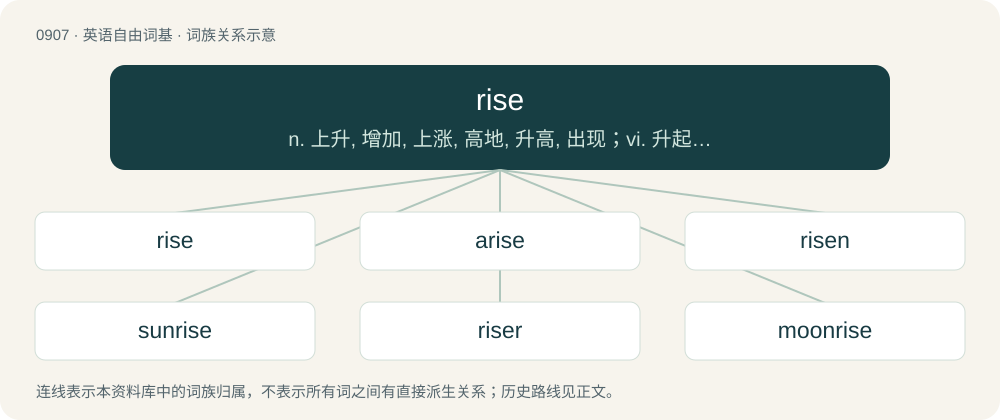

# 0982 · rise — n. 上升, 增加, 上涨, 高地, 升高, 出现；vi. 升起, 起身, 起立, 上升, 上涨, 增长, 高耸, 起义, 浮现；vt. 使飞起

[总目录](../00_总目录_按常用程度.md)

**类型**：英语自由词基　｜　**来源语言**：见词源记录

## 核心含义与来源

- 核心含义：n. 上升, 增加, 上涨, 高地, 升高, 出现；vi. 升起, 起身, 起立, 上升, 上涨, 增长, 高耸, 起义, 浮现；vt. 使飞起
- 英文含义：To move upwards.
- 词形：rise

**来源记录 1**（动词；To move upwards.）

From Middle English risen, from Old English rīsan, from Proto-West Germanic \*rīsan, from Proto-Germanic \*rīsaną (“to rise”), from Proto-Indo-European \*h₁rey- (“to arise, rise”). According to Kroonen (2013), from Proto-Indo-European \*h₃er- (“to rise, spring”). See also raise. Cognates Cognate with Dutch rijzen (“to rise”), German reisen (“to fall”), Limburgish rieze (“to rise”), Faroese and Icelandic rísa (“to rise”), Norwegian Nynorsk risa, rise (“to rise”), Gothic \*𐍂𐌴𐌹𐍃𐌰𐌽 (\*reisan, “to rise”) (whence 𐌿𐍂𐍂𐌴𐌹𐍃𐌰𐌽 (urreisan, “to arise”)). Non-Germanic cognates include Cornish ardh (“height”), Irish arad, ard, árd (“high, tall”), Manx ard (“high, tall”), Scottish Gaelic àrd (“high”), Welsh ardd (“hill, upland”), Latin orior (“to rise”), Ancient Greek ἔρις (éris, “quarell, strife; contention, rivalry”) (whence Greek έριδα (érida, “feud”)), Albanian rashë (“to have fallen; to have flopped”), Bulgarian ръст (răst, “size; stature; growth”), Czech růst (“growth”), Macedonian раст (rast, “growth, height”), Polish rost, wzrost (“growth”), Russian рост (rost, “growth”), Serbo-Croatian ра̑ст, rȃst (“growth”), Slovene rȃst (“growth”), Old Armenian յառնեմ (yaṙnem, “to arise, rise”) (whence Armenian հառնել (haṙnel, “to rise up”)), Persian رمبیدن (rombidan, “to collapse”), Tocharian A ar- (“to evoke”), Tocharian B er- (“to evoke”), Hittite 𒀀𒊏𒀀𒄑𒍣 (arāwanzi, “to rise”), Sanskrit ऋ (ṛ, “to rise”).

## 词族图

## 单词速览（常用到不常用）

| 单词 | 音标 | 释义 |
|---|---|---|
| [rise](#w-1) | /ɹaɪz/ | n. 上升, 增加, 上涨, 高地, 升高, 出现；vi. 升起, 起身, 起立, 上升, 上涨, 增长, 高耸, 起义, 浮现；vt. 使飞起 |
| [arise](#w-2) | 英 /əˈɹaɪz/ | vi. 站立, 出现, 起来 |
| [risen](#w-3) | /ˈɹɪ.zən/ | a. 升起的, 复活的；rise的过去分词 |
| [sunrise](#w-4) | 美 /ˈsʌnɹaɪz/ | n. 日出, 黎明, 拂晓 |
| [riser](#w-5) | 英 /ˈɹaɪ.zə(ɹ)/ | n. 起床者, 叛徒, 起义者, 竖板；\[化\] 上升管 |
| [moonrise](#w-6) | 美 /ˈmunˌɹaɪz/ | n. 月光, 月出时分 |

## 逐词详解

### 1. rise

**词性**：动词　｜　**音标**：/ɹaɪz/

**中文释义**：n. 上升, 增加, 上涨, 高地, 升高, 出现；vi. 升起, 起身, 起立, 上升, 上涨, 增长, 高耸, 起义, 浮现；vt. 使飞起

**英文义项**：To move upwards. / To grow upward; to attain a certain height.

**词源与演化**：

From Middle English risen, from Old English rīsan, from Proto-West Germanic \*rīsan, from Proto-Germanic \*rīsaną (“to rise”), from Proto-Indo-European \*h₁rey- (“to arise, rise”). According to Kroonen (2013), from Proto-Indo-European \*h₃er- (“to rise, spring”). See also raise. Cognates Cognate with Dutch rijzen (“to rise”), German reisen (“to fall”), Limburgish rieze (“to rise”), Faroese and Icelandic rísa (“to rise”), Norwegian Nynorsk risa, rise (“to rise”), Gothic \*𐍂𐌴𐌹𐍃𐌰𐌽 (\*reisan, “to rise”) (whence 𐌿𐍂𐍂𐌴𐌹𐍃𐌰𐌽 (urreisan, “to arise”)). Non-Germanic cognates include Cornish ardh (“height”), Irish arad, ard, árd (“high, tall”), Manx ard (“high, tall”), Scottish Gaelic àrd (“high”), Welsh ardd (“hill, upland”), Latin orior (“to rise”), Ancient Greek ἔρις (éris, “quarell, strife; contention, rivalry”) (whence Greek έριδα (érida, “feud”)), Albanian rashë (“to have fallen; to have flopped”), Bulgarian ръст (răst, “size; stature; growth”), Czech růst (“growth”), Macedonian раст (rast, “growth, height”), Polish rost, wzrost (“growth”), Russian рост (rost, “growth”), Serbo-Croatian ра̑ст, rȃst (“growth”), Slovene rȃst (“growth”), Old Armenian յառնեմ (yaṙnem, “to arise, rise”) (whence Armenian հառնել (haṙnel, “to rise up”)), Persian رمبیدن (rombidan, “to collapse”), Tocharian A ar- (“to evoke”), Tocharian B er- (“to evoke”), Hittite 𒀀𒊏𒀀𒄑𒍣 (arāwanzi, “to rise”), Sanskrit ऋ (ṛ, “to rise”).

**例句**：

> to rise in force of expression; to rise in eloquence; a story rises in interest.

该用例对应义项：To become more and more dignified or forcible; to increase in interest or power; said of style, thought, or discourse.

### 2. arise

**词性**：动词　｜　**音标**：英 /əˈɹaɪz/

**中文释义**：vi. 站立, 出现, 起来

**英文义项**：To come up from a lower to a higher position. / To come up from one's bed or place of repose; to get up.

**构词拆分**：a- + rise

**词源与演化**：

From Middle English arisen, from Old English ārīsan (“to arise, get up; rise; spring from, originate; spring up, ascend”), from Proto-Germanic \*uzrīsaną (“to rise up, arise”), equivalent to a- + rise. Cognate with Scots arise, aryse (“to arise, rise up, come into existence”), Middle Low German errīsen (“to stand up, arise”), Old High German irrīsan (“to rise up, fall”), Gothic 𐌿𐍂𐍂𐌴𐌹𐍃𐌰𐌽 (urreisan, “to arise”). Eclipsed Middle English sourden, sorden, borrowed from Old French sordre, sourdre (“to arise, originate, fly up”).

**例句**：

> A new challenge will arise every time you think you've solved the last one.

该用例对应义项：To spring up; to come into action, being, or notice; to become operative, sensible, or visible; to begin to act a part; to present itself.

### 3. risen

**词性**：形容词　｜　**音标**：/ˈɹɪ.zən/

**中文释义**：a. 升起的, 复活的；rise的过去分词

**英文义项**：Having risen.

**构词拆分**：rise + -n

**词源与演化**：

Morphologically rise + -n.

**用法示例／搭配（非完整句）**：

> the scent of newly risen bread

该用例对应义项：Having risen.

### 4. sunrise

**词性**：名词　｜　**音标**：美 /ˈsʌnɹaɪz/

**中文释义**：n. 日出, 黎明, 拂晓

**英文义项**：The time of day when the sun appears above the eastern horizon. / The change in color of the sky at dawn.

**构词拆分**：sun + rise

**词源与演化**：

From Middle English sonne-rys, sunne ryse, equivalent to sun + rise. Compare Middle English son risyng, sunne rijsyng, sonne-rysing (“sunrise”, literally “sun rising”).

**例句**：

> Did you see the beautiful sunrise this morning?

该用例对应义项：The change in color of the sky at dawn.

### 5. riser

**词性**：名词　｜　**音标**：英 /ˈɹaɪ.zə(ɹ)/

**中文释义**：n. 起床者, 叛徒, 起义者, 竖板；\[化\] 上升管

**英文义项**：Someone or something which rises. / A platform or stand used to lift or elevate something.

**构词拆分**：rise + -er

**词源与演化**：

From Middle English ryser, risere, equivalent to rise + -er.

**例句**：

> The choir stood on risers for the performance.

该用例对应义项：A platform or stand used to lift or elevate something.

### 6. moonrise

**词性**：名词　｜　**音标**：美 /ˈmunˌɹaɪz/

**中文释义**：n. 月光, 月出时分

**英文义项**：The time of day or night when the moon begins to rise over the horizon.

**构词拆分**：moon + rise

**词源与演化**：

From moon + rise.
