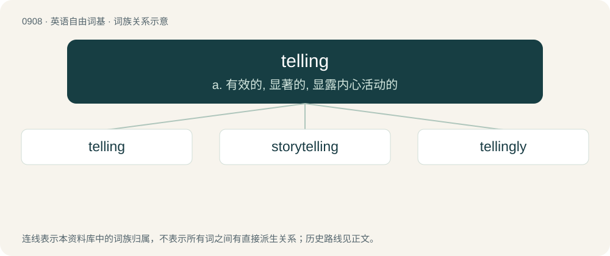

# 0983 · telling — a. 有效的, 显著的, 显露内心活动的

[总目录](../00_总目录_按常用程度.md)

**类型**：英语自由词基　｜　**来源语言**：见词源记录

## 核心含义与来源

- 核心含义：a. 有效的, 显著的, 显露内心活动的
- 英文含义：The act of narration.
- 词形：telling

**来源记录 1**（名词；The act of narration.）

Gerund from the verb tell, from tell + -ing.

## 词族图

## 单词速览（常用到不常用）

| 单词 | 音标 | 释义 |
|---|---|---|
| [telling](#w-1) | /ˈtɛlɪŋ/ | a. 有效的, 显著的, 显露内心活动的 |
| [storytelling](#w-2) | /ˈstɒːriteliŋ/ | n. 说故事, 说谎话 |
| [tellingly](#w-3) | /ˈteliŋli/ | adv. 有效地；显著地 |

## 逐词详解

### 1. telling

**词性**：名词　｜　**音标**：/ˈtɛlɪŋ/

**中文释义**：a. 有效的, 显著的, 显露内心活动的

**英文义项**：The act of narration. / The disclosure of information.

**构词拆分**：tell + -ing

**词源与演化**：

Gerund from the verb tell, from tell + -ing.

**例句**：

> There is no telling what would happen if she doesn't show up.

### 2. storytelling

**词性**：名词　｜　**音标**：/ˈstɒːriteliŋ/

**中文释义**：n. 说故事, 说谎话

**英文义项**：The act and skills of presenting stories and tales.

**构词拆分**：story + telling

**词源与演化**：

From story + telling.

**例句**：

> His Italian heritage influences his passion for art, music, and storytelling.

### 3. tellingly

**词性**：副词　｜　**音标**：/ˈteliŋli/

**中文释义**：adv. 有效地；显著地

**英文义项**：In a telling manner.

**构词拆分**：telling + -ly

**词源与演化**：

From telling + -ly.

**例句**：

> The plain manner of its style all the more tellingly points up the horror of the case.

该用例对应义项：in a telling manner
