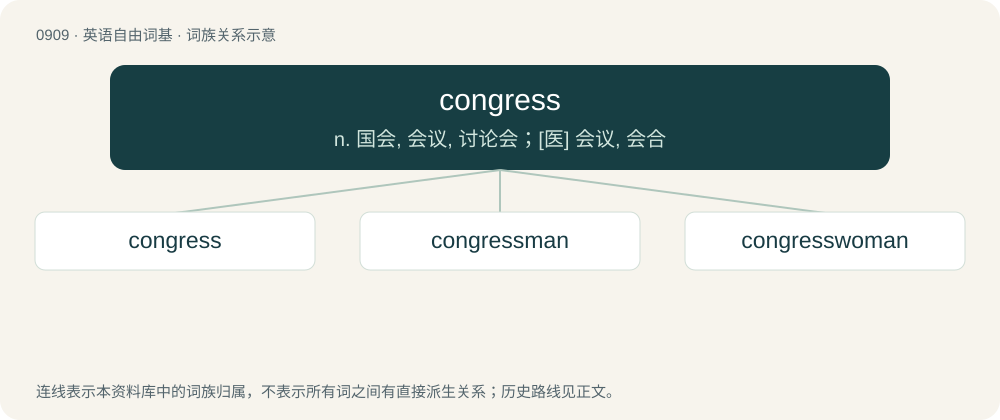

# 0985 · congress — n. 国会, 会议, 讨论会；\[医\] 会议, 会合

[总目录](../00_总目录_按常用程度.md)

**类型**：英语自由词基　｜　**来源语言**：见词源记录

## 核心含义与来源

- 核心含义：n. 国会, 会议, 讨论会；\[医\] 会议, 会合
- 英文含义：A formal gathering or assembly of persons; a conference held to discuss or decide on a specific question.
- 词形：congress

**来源记录 1**（名词；A formal gathering or assembly of persons; a conference held to discuss or decide on a specific question.）

From Latin congress(um), the past participle of congredior (“to go, come together”), itself from con- + gradior (“to go, step”). The verb is from the noun. Compare typologically coven, convent, convention, omitting several steps, from con- + veniō, Russian сход (sxod), схо́дка (sxódka), akin to сходи́ться (sxodítʹsja), ходи́ть (xodítʹ). Also compare Czech sjezd, Russian съезд (sʺjezd), akin to съезжа́ться (sʺjezžátʹsja), е́здить (jézditʹ). Also compare conference.

## 词族图

## 单词速览（常用到不常用）

| 单词 | 音标 | 释义 |
|---|---|---|
| [congress](#w-1) | 英 /ˈkɒŋˌɡɹɛs/；美 /ˈkɑŋɡɹəs/ | n. 国会, 会议, 讨论会；\[医\] 会议, 会合 |
| [congressman](#w-2) | /ˈkɒŋgresmən/ | n. 国会议员, 众议院议员；\[法\] 国会议会 |
| [congresswoman](#w-3) | /ˈkɒŋgreswumən/ | n. 国会女议员, 众议院女议员 |

## 逐词详解

### 1. congress

**词性**：名词　｜　**音标**：英 /ˈkɒŋˌɡɹɛs/；美 /ˈkɑŋɡɹəs/

**中文释义**：n. 国会, 会议, 讨论会；\[医\] 会议, 会合

**英文义项**：A formal gathering or assembly of persons; a conference held to discuss or decide on a specific question. / A legislative body of a state, originally the bicameral legislature of the United States of America.

**词源与演化**：

From Latin congress(um), the past participle of congredior (“to go, come together”), itself from con- + gradior (“to go, step”). The verb is from the noun. Compare typologically coven, convent, convention, omitting several steps, from con- + veniō, Russian сход (sxod), схо́дка (sxódka), akin to сходи́ться (sxodítʹsja), ходи́ть (xodítʹ). Also compare Czech sjezd, Russian съезд (sʺjezd), akin to съезжа́ться (sʺjezžátʹsja), е́здить (jézditʹ). Also compare conference.

**用法示例／搭配（非完整句）**：

> the National Congress of American Indians

该用例对应义项：An association, especially one consisting of other associations or representatives of interest groups.

### 2. congressman

**词性**：名词　｜　**音标**：/ˈkɒŋgresmən/

**中文释义**：n. 国会议员, 众议院议员；\[法\] 国会议会

**英文义项**：A male member of congress. / A male member of the House of Representatives.

**构词拆分**：From congress + -man.

**词源与演化**：

From congress + -man.

**例句**：

> The congressman has been in the spotlight ever since his untoward remarks about African Americans.

### 3. congresswoman

**词性**：名词　｜　**音标**：/ˈkɒŋgreswumən/

**中文释义**：n. 国会女议员, 众议院女议员

**英文义项**：A female member of congress. / A female member of the House of Representatives.

**构词拆分**：congress + -woman

**词源与演化**：

From congress + -woman.

**例句**：

> The Arizona congresswoman was shot at a 2011 event in Tucson.
