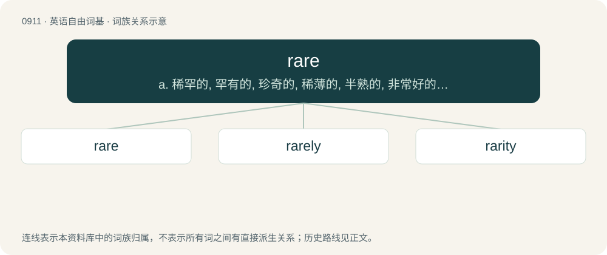

# 0986 · rare — a. 稀罕的, 罕有的, 珍奇的, 稀薄的, 半熟的, 非常好的；adv. 非常

[总目录](../00_总目录_按常用程度.md)

**类型**：英语自由词基　｜　**来源语言**：见词源记录

## 核心含义与来源

- 核心含义：a. 稀罕的, 罕有的, 珍奇的, 稀薄的, 半熟的, 非常好的；adv. 非常
- 英文含义：Very uncommon; scarce.
- 词形：rare

**多个词源／构词路径**：同一拼写可能有不同来源；以下按词性和含义分别列出。

**来源记录 1**（形容词；Very uncommon; scarce.）

From Middle English rare, from Old French rare, rere (“rare, uncommon”), from Latin rārus (“loose, spaced apart, thin, infrequent”), from Proto-Indo-European \*h₁reh₁- (“friable, thin”). Displaced native English geason (“rare, scarce”) (from Middle English gesen, from Old English gǣsne); and largely displaced Middle English seld (“rare, uncommon”) (from Old English selden) and Middle English seldscene (“rare, rarely seen, infrequent”) (from Old English seldsēne) hence modern English seld

**来源记录 2**（形容词；Particularly of meat, especially beefsteak: cooked very lightly, so the meat is still red.）

From a dialectal variant of rear, from Middle English rere, from Old English hrēr, hrēre (“not thoroughly cooked, underdone, lightly boiled”), from hrēran (“to move, shake, agitate”), from Proto-Germanic \*hrōzijaną (“to stir”), from Proto-Indo-European \*ḱroHs- (“to mix, stir, cook”). Related to Old English hrōr (“stirring, busy, active, strong, brave”). More at rear.

**来源记录 3**（动词；To rear, rise up, start backwards.）

Variant of rear.

## 词族图

## 单词速览（常用到不常用）

| 单词 | 音标 | 释义 |
|---|---|---|
| [rare](#w-1) | 英 /ɹɛə/；美 /ɹɛɚ/ | a. 稀罕的, 罕有的, 珍奇的, 稀薄的, 半熟的, 非常好的；adv. 非常 |
| [rarely](#w-2) | 英 /ˈɹɛːli/；美 /ˈɹɛəɹli/ | adv. 很少地, 罕有地 |
| [rarity](#w-3) | 英 /ˈɹɛəɹəti/；/ˈɹeɹəti/ | n. 稀罕, 罕有, 珍奇, 稀薄 |

## 逐词详解

### 1. rare

**词性**：形容词　｜　**音标**：英 /ɹɛə/；美 /ɹɛɚ/

**中文释义**：a. 稀罕的, 罕有的, 珍奇的, 稀薄的, 半熟的, 非常好的；adv. 非常

**英文义项**：Very uncommon; scarce. / Small in number (but not unusual); infrequent; sparse.

**词源与演化**：

From Middle English rare, from Old French rare, rere (“rare, uncommon”), from Latin rārus (“loose, spaced apart, thin, infrequent”), from Proto-Indo-European \*h₁reh₁- (“friable, thin”). Displaced native English geason (“rare, scarce”) (from Middle English gesen, from Old English gǣsne); and largely displaced Middle English seld (“rare, uncommon”) (from Old English selden) and Middle English seldscene (“rare, rarely seen, infrequent”) (from Old English seldsēne) hence modern English seld

**例句**：

> Black pearls are very rare and therefore very valuable.

该用例对应义项：Very uncommon; scarce.

### 2. rarely

**词性**：副词　｜　**音标**：英 /ˈɹɛːli/；美 /ˈɹɛəɹli/

**中文释义**：adv. 很少地, 罕有地

**英文义项**：Not occurring at a regular interval; seldom; not often. / Unusually well; excellently.

**构词拆分**：rare + -ly

**词源与演化**：

From rare + -ly.

**例句**：

> I became a rarely good judge of the best in modern painting.

该用例对应义项：To a rare degree; very.

### 3. rarity

**词性**：名词　｜　**音标**：英 /ˈɹɛəɹəti/；/ˈɹeɹəti/

**中文释义**：n. 稀罕, 罕有, 珍奇, 稀薄

**英文义项**：A measure of the scarcity of an object. / Thinness; the property of having low density

**构词拆分**：rare + -ity

**词源与演化**：

From rare + -ity, borrowed from Middle French rarité, from Latin rāritās; compare French rareté. See also rare.

**例句**：

> Being in the south of England, snow is a rarity for us.
