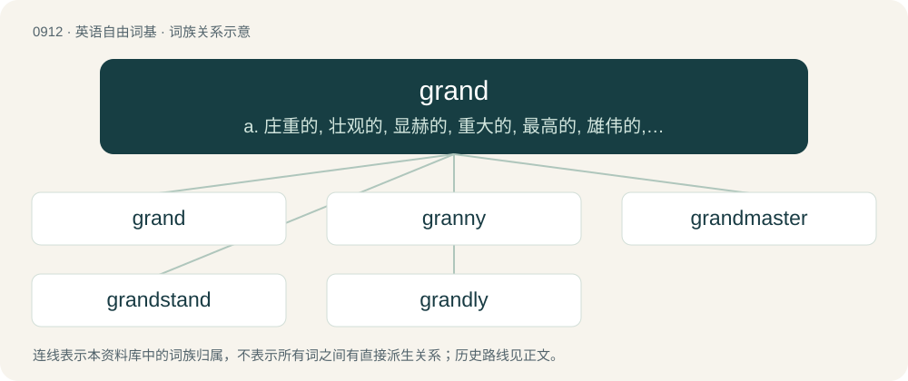

# 0988 · grand — a. 庄重的, 壮观的, 显赫的, 重大的, 最高的, 雄伟的, 宏大的, 豪华的, 傲慢的；\[法\] 重大的, 主要的, 伟大的

[总目录](../00_总目录_按常用程度.md)

**类型**：英语自由词基　｜　**来源语言**：见词源记录

## 核心含义与来源

- 核心含义：a. 庄重的, 壮观的, 显赫的, 重大的, 最高的, 雄伟的, 宏大的, 豪华的, 傲慢的；\[法\] 重大的, 主要的, 伟大的
- 英文含义：Large, senior (high-ranking), intense, extreme, or exceptional
- 词形：grand

**多个词源／构词路径**：同一拼写可能有不同来源；以下按词性和含义分别列出。

**来源记录 1**（形容词；Large, senior (high-ranking), intense, extreme, or exceptional）

From Middle English grand, grond, graund, graunt, from Anglo-Norman graunt, from Old French grant, from Latin grandis. Doublet of grande and grandee.

**来源记录 2**（名词；A grandparent or grandchild.）

From granddaughter, grandfather, grandmother, grandson, etc.

## 词族图

## 单词速览（常用到不常用）

| 单词 | 音标 | 释义 |
|---|---|---|
| [grand](#w-1) | 英 /ˈɡɹænd/；美 /ˈɡɹænd/ | a. 庄重的, 壮观的, 显赫的, 重大的, 最高的, 雄伟的, 宏大的, 豪华的, 傲慢的；\[法\] 重大的, 主要的, 伟大的 |
| [granny](#w-2) | /ˈ^ræni/ | 【英文】A grand final. |
| [grandmaster](#w-3) | /ɡˈrændmˈɑːstə/ | 大师（最高棋手等的称号） |
| [grandstand](#w-4) | /ˈɡɹæn(d)stænd/ | n. 正面看台, 观众 |
| [grandly](#w-5) | /ˈgrændli/ | adv. 宏伟地, 盛大地 |

## 逐词详解

### 1. grand

**词性**：形容词　｜　**音标**：英 /ˈɡɹænd/；美 /ˈɡɹænd/

**中文释义**：a. 庄重的, 壮观的, 显赫的, 重大的, 最高的, 雄伟的, 宏大的, 豪华的, 傲慢的；\[法\] 重大的, 主要的, 伟大的

**英文义项**：Large, senior (high-ranking), intense, extreme, or exceptional / Of a large size or extent; great.

**词源与演化**：

From Middle English grand, grond, graund, graunt, from Anglo-Norman graunt, from Old French grant, from Latin grandis. Doublet of grande and grandee.

**例句**：

> His simple vision has transformed into something far more grand.

该用例对应义项：Great in size, and fine or imposing in appearance or impression; illustrious, dignified, magnificent.

### 2. granny

**词性**：名词　｜　**音标**：/ˈ^ræni/

**英文义项**：A grand final.

**构词拆分**：grand + -y

**词源与演化**：

From gran(d) + -y.

### 3. grandmaster

**词性**：名词　｜　**音标**：/ɡˈrændmˈɑːstə/

**中文释义**：大师（最高棋手等的称号）

**英文义项**：A master in a field, whose skills or accomplishments exceed those of other masters.

**构词拆分**：grand + master

**词源与演化**：

From grand + master.

**例句**：

> Deep Blue beat chess grandmaster Gary Kasparov in 1997.

### 4. grandstand

**词性**：动词　｜　**音标**：/ˈɡɹæn(d)stænd/

**中文释义**：n. 正面看台, 观众

**英文义项**：To behave dramatically or showily to impress an audience or observers; to pander to a crowd.

**构词拆分**：grand + stand

**词源与演化**：

From grand + stand.

**例句**：

> Many politicians prefer to grandstand on hot-button issues rather than enact tough policy changes.

该用例对应义项：To behave dramatically or showily to impress an audience or observers; to pander to a crowd.

### 5. grandly

**词性**：副词　｜　**音标**：/ˈgrændli/

**中文释义**：adv. 宏伟地, 盛大地

**英文义项**：In a grand manner. / To the greatest extent.

**构词拆分**：grand + -ly

**词源与演化**：

From grand + -ly.

**例句**：

> The mansion seemed grandly large by today's standards.

该用例对应义项：in a grand manner
