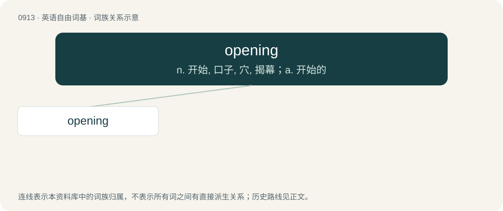

# 0989 · opening — n. 开始, 口子, 穴, 揭幕；a. 开始的

[总目录](../00_总目录_按常用程度.md)

**类型**：英语自由词基　｜　**来源语言**：见词源记录

## 核心含义与来源

- 核心含义：n. 开始, 口子, 穴, 揭幕；a. 开始的
- 英文含义：Pertaining to the start or beginning of a series of events.
- 词形：opening

**多个词源／构词路径**：同一拼写可能有不同来源；以下按词性和含义分别列出。

**来源记录 1**（形容词；Pertaining to the start or beginning of a series of events.）

From Middle English openynge, openande, openand, from Old English openiende, from Proto-West Germanic \*opanōndī, from Proto-Germanic \*upanōndz, present participle of \*upanōną (“to open”), equivalent to open + -ing. Cognate with West Frisian iepenjend, Dutch openend, German öffnend, Swedish öppnande, Icelandic opnandi.

**来源记录 2**（名词；An act or instance of making or becoming open.）

From Middle English openyng, openynge, openunge, from Old English openung (“an opening”), from Proto-West Germanic \*opanungu, from Proto-Germanic \*upanungō (“an opening”), equivalent to open + -ing. Cognate with Saterland Frisian Eepenge, Epenge (“an opening”), West Frisian iepening (“an opening”), Dutch opening (“an opening”), German Öffnung (“an opening”), Danish åbning (“an opening”), Swedish öppning (“an opening”).

## 词族图

## 单词速览（常用到不常用）

| 单词 | 音标 | 释义 |
|---|---|---|
| [opening](#w-1) | 英 /ˈəʊ.pə.nɪŋ/；美 /ˈoʊ.pə.nɪŋ/ | n. 开始, 口子, 穴, 揭幕；a. 开始的 |

## 逐词详解

### 1. opening

**词性**：形容词　｜　**音标**：英 /ˈəʊ.pə.nɪŋ/；美 /ˈoʊ.pə.nɪŋ/

**中文释义**：n. 开始, 口子, 穴, 揭幕；a. 开始的

**英文义项**：Pertaining to the start or beginning of a series of events. / Of the first period of play, usually up to the fall of the first wicket.

**构词拆分**：open + -ing

**词源与演化**：

From Middle English openynge, openande, openand, from Old English openiende, from Proto-West Germanic \*opanōndī, from Proto-Germanic \*upanōndz, present participle of \*upanōną (“to open”), equivalent to open + -ing. Cognate with West Frisian iepenjend, Dutch openend, German öffnend, Swedish öppnande, Icelandic opnandi.

**例句**：

> The opening theme of Beethoven's Fifth Symphony is, perhaps, the most recognizable in all of European art music.

该用例对应义项：Pertaining to the start or beginning of a series of events.
