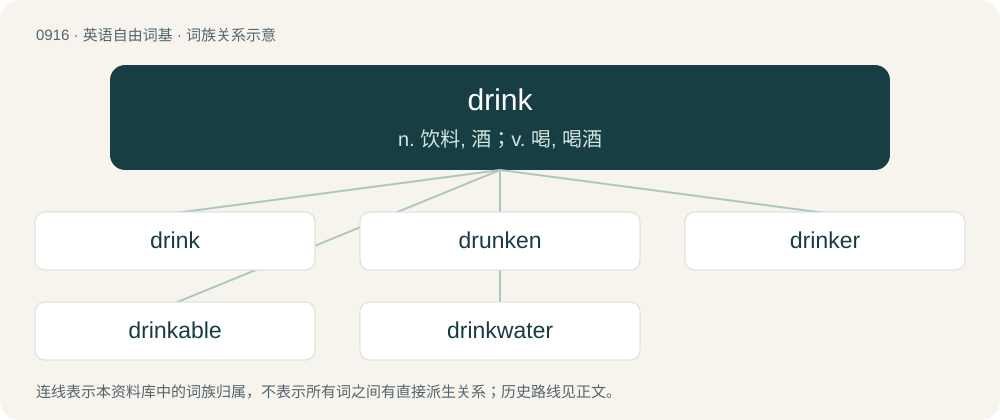

# 0990 · drink — n. 饮料, 酒；v. 喝, 喝酒

[总目录](../00_总目录_按常用程度.md)

**类型**：英语自由词基　｜　**来源语言**：见词源记录

## 核心含义与来源

- 核心含义：n. 饮料, 酒；v. 喝, 喝酒
- 英文含义：To consume (a liquid) through the mouth.
- 词形：drink

**多个词源／构词路径**：同一拼写可能有不同来源；以下按词性和含义分别列出。

**来源记录 1**（动词；To consume (a liquid) through the mouth.）

From Middle English drinken, from Old English drincan (“to drink, swallow up, engulf”), from Proto-West Germanic \*drinkan, from Proto-Germanic \*drinkaną (“to drink”), of uncertain origin; possibly from Proto-Indo-European \*dʰrenǵ- (“to draw into one's mouth, sip, gulp”), nasalised variant of \*dʰreǵ- (“to draw, glide”). Cognates include German trinken, Norwegian Bokmål drikke, and Italian trincare. Cognates Cognate with Yola drink (“to drink”), North Frisian drank, drainke, drink, drinke (“to drink”), West Frisian drinke (“to drink”), Alemannic German trénge, trenhu, trinche, tringhien, trinke (“to drink”), Bavarian dringa, trinckn, trinkhn, trinkn (“to drink”), Cimbrian trinkan, trinkhan (“to drink”), Dutch and Low German drinken (“to drink”), German and Mòcheno trinken (“to drink”), Luxembourgish drénken (“to drink”), Yiddish טרינקען (trinken, “to drink”), Danish and Norwegian Bokmål drikke (“to drink”), Elfdalian drikka (“to drink”), Faroese and Icelandic drekka (“to drink”), Jutish drenk (“to drink”), Norwegian Nynorsk drikka, drikke (“to drink”), Swedish dricka (“to drink”), Gothic 𐌳𐍂𐌹𐌲𐌺𐌰𐌽 (drigkan, “to drink”), Vandalic drincan (“to drink”), French trinquer (“to booze, drink alcohol”), Italian trincare (“to knock back (a drink)”), Spanish trincar (“to get drunk”).

**来源记录 2**（名词；A beverage.）

From Middle English drink, drinke (also as drinche, drunch), from Old English drynċ, from Proto-Germanic \*drunkiz, \*drankiz. Cognates Cognate with Saterland Frisian Dronk (“drink”), Cimbrian gatrànkh (“drink”), Dutch drank, dronk (“drink”), German Getränk, trank, Trunk (“drink”), German Low German Drank, Drunk (“drink”), Vilamovian gytrenḱ (“drink”), Danish drik (“drink, beverage”), Icelandic drykkur (“drink, beverage”), Norwegian Bokmål drikk (“drink”), Norwegian Nynorsk drikk, drykk (“drink, alcohol”), Swedish dryck (“drink”), Gothic 𐌳𐍂𐌰𐌲𐌲𐌺 (draggk), 𐌳𐍂𐌰𐌲𐌺 (dragk, “drink”).

## 词族图

## 单词速览（常用到不常用）

| 单词 | 音标 | 释义 |
|---|---|---|
| [drink](#w-1) | /ˈdɹɪŋk/ | n. 饮料, 酒；v. 喝, 喝酒 |
| [drunken](#w-2) | /ˈdɹʌŋkən/ | a. 酒醉的 |
| [drinker](#w-3) | 英 /ˈdɹɪŋkə(ɹ)/；美 /ˈdɹɪŋkɚ/ | n. 饮者, 酒徒 |
| [drinkable](#w-4) | /ˈdɹɪŋk.ə.bəl/ | a. 可以喝的, 饮用的；n. 饮料 |
| [drinkwater](#w-5) |  | 【英文】Potable water; water intended for drinking |

## 逐词详解

### 1. drink

**词性**：动词　｜　**音标**：/ˈdɹɪŋk/

**中文释义**：n. 饮料, 酒；v. 喝, 喝酒

**英文义项**：To consume (a liquid) through the mouth. / To consume the liquid contained within (a bottle, glass, etc.).

**词源与演化**：

From Middle English drinken, from Old English drincan (“to drink, swallow up, engulf”), from Proto-West Germanic \*drinkan, from Proto-Germanic \*drinkaną (“to drink”), of uncertain origin; possibly from Proto-Indo-European \*dʰrenǵ- (“to draw into one's mouth, sip, gulp”), nasalised variant of \*dʰreǵ- (“to draw, glide”). Cognates include German trinken, Norwegian Bokmål drikke, and Italian trincare. Cognates Cognate with Yola drink (“to drink”), North Frisian drank, drainke, drink, drinke (“to drink”), West Frisian drinke (“to drink”), Alemannic German trénge, trenhu, trinche, tringhien, trinke (“to drink”), Bavarian dringa, trinckn, trinkhn, trinkn (“to drink”), Cimbrian trinkan, trinkhan (“to drink”), Dutch and Low German drinken (“to drink”), German and Mòcheno trinken (“to drink”), Luxembourgish drénken (“to drink”), Yiddish טרינקען (trinken, “to drink”), Danish and Norwegian Bokmål drikke (“to drink”), Elfdalian drikka (“to drink”), Faroese and Icelandic drekka (“to drink”), Jutish drenk (“to drink”), Norwegian Nynorsk drikka, drikke (“to drink”), Swedish dricka (“to drink”), Gothic 𐌳𐍂𐌹𐌲𐌺𐌰𐌽 (drigkan, “to drink”), Vandalic drincan (“to drink”), French trinquer (“to booze, drink alcohol”), Italian trincare (“to knock back (a drink)”), Spanish trincar (“to get drunk”).

**例句**：

> Everyone who is drinking is drinking, but not everyone who is drinking is drinking.

该用例对应义项：To consume alcoholic beverages.

### 2. drunken

**词性**：形容词　｜　**音标**：/ˈdɹʌŋkən/

**中文释义**：a. 酒醉的

**英文义项**：Drunk, in the state of intoxication after having drunk an alcoholic beverage. / Given to habitual excessive use of alcohol.

**构词拆分**：drink + -en

**词源与演化**：

From Middle English drunken, ydronken, idrunken, from Old English druncen, ġedruncen (“drunk; drunken”), from Proto-Germanic \*drunkanaz (“drunken”), past participle of Proto-Germanic \*drinkaną (“to drink”), equivalent to drink + -en. Cognate with West Frisian dronken (“drunk; drunken”), Dutch dronken (“drunk; drunken”), German betrunken (“drunk; drunken”), Swedish drucken (“drunk; drunken”).

**用法示例／搭配（非完整句）**：

> a drunken display of crude exuberance

该用例对应义项：Characterized by or resulting from drunkenness.

### 3. drinker

**词性**：名词　｜　**音标**：英 /ˈdɹɪŋkə(ɹ)/；美 /ˈdɹɪŋkɚ/

**中文释义**：n. 饮者, 酒徒

**英文义项**：Someone who drinks alcoholic beverages on a regular basis. / A device from which animals can drink.

**构词拆分**：drink + -er

**词源与演化**：

From Middle English drinkere, drynkere, from Old English drincere (“drinker”), from Proto-Germanic \*drinkārijaz (“drinker”), equivalent to drink + -er. Cognate with Saterland Frisian Drinker (“drinker”), West Frisian drinker (“drinker”), Dutch drinker (“drinker”), German Low German Drinker (“drinker”), German Trinker (“drinker”), Danish drikker (“drinker”), Swedish drickare, drinkare (“drinker”).

**用法示例／搭配（非完整句）**：

> a nipple drinker

该用例对应义项：A device from which animals can drink.

### 4. drinkable

**词性**：形容词　｜　**音标**：/ˈdɹɪŋk.ə.bəl/

**中文释义**：a. 可以喝的, 饮用的；n. 饮料

**英文义项**：Able to be drunk (as liquid). / Safe to drink.

**构词拆分**：drink + -able

**词源与演化**：

From Middle English drinkable, drynkeable, equivalent to drink + -able.

**例句**：

> If we have no more clean, drinkable water, we are doomed.

### 5. drinkwater

**词性**：名词

**英文义项**：Potable water; water intended for drinking

**构词拆分**：drink + water

**词源与演化**：

From Middle English drinkwater (attested as a nickname), equivalent to drink + water. Compare Saterland Frisian Drinkwoater (“drinkwater”), West Frisian drinkwetter (“drinkwater”), Dutch drinkwater (“drinkwater”), German Low German Drinkwater (“drinkwater”), German Trinkwasser (“drinkwater”).
