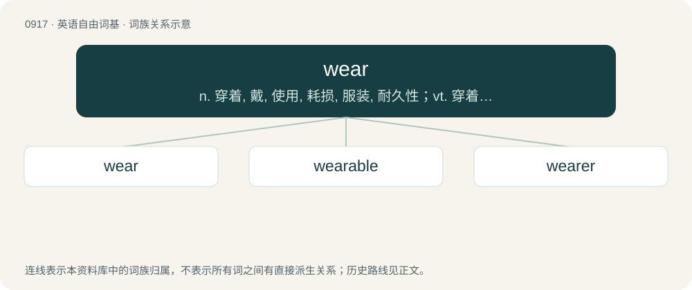

# 0991 · wear — n. 穿着, 戴, 使用, 耗损, 服装, 耐久性；vt. 穿着, 戴, 留(须、发等), 呈现, 磨损, 磨成, 耗损, 使疲乏, 消磨；vi. 磨损, 变旧, 耐久, 渐变, 渐渐消失

[总目录](../00_总目录_按常用程度.md)

**类型**：英语自由词基　｜　**来源语言**：见词源记录

## 核心含义与来源

- 核心含义：n. 穿着, 戴, 使用, 耗损, 服装, 耐久性；vt. 穿着, 戴, 留(须、发等), 呈现, 磨损, 磨成, 耗损, 使疲乏, 消磨；vi. 磨损, 变旧, 耐久, 渐变, 渐渐消失
- 英文含义：To carry or have equipped on or about one's body, as an item of clothing, equipment, decoration, perfume, etc.
- 词形：wear

**多个词源／构词路径**：同一拼写可能有不同来源；以下按词性和含义分别列出。

**来源记录 1**（动词；To carry or have equipped on or about one's body, as an item of clothing, equipment, decoration, perfume, etc.）

Inherited from Middle English weren, werien, from Old English werian (“to clothe, cover over; put on, wear, use; stock (land)”), from Proto-West Germanic \*waʀjan, from Proto-Germanic \*wazjaną (“to clothe”), from Proto-Indo-European \*wes- (“to dress, put on (clothes)”). Cognate to Sanskrit वस्ते (váste), Ancient Greek ἕννυμι (hénnumi, “put on”), Latin vestis (“garment”) (English vest), Albanian vesh (“dress up, wear”), Tocharian B wäs-, Old Armenian զգենում (zgenum), Welsh gwisgo, Hittite 𒉿𒀸- (waš-). Originally a weak verb (i.e. with a past tense in -ed), it became irregular during the Middle English period by analogy with verbs like beren (whence bear) and teren (whence tear).

**来源记录 2**（动词；To guard; watch; keep watch, especially from entry or invasion.）

From Middle English weren, werien, from Old English werian (“to guard, keep, defend; ward off, hinder, prevent, forbid; restrain; occupy, inhabit; dam up; discharge obligations on (land)”), from Proto-West Germanic \*warjan, from Proto-Germanic \*warjaną (“to defend, protect, ward off”), from Proto-Indo-European \*wer- (“to close, cover, protect, save, defend”). Cognate with Scots wer, weir (“to defend, protect”), Dutch weren (“to aver, ward off”), German wehren (“to fight”), Swedish värja (“to defend, ward off”), Icelandic verja (“to defend”).

## 词族图

## 单词速览（常用到不常用）

| 单词 | 音标 | 释义 |
|---|---|---|
| [wear](#w-1) | 英 /wɛə/；美 /wɛ(ə)ɹ/ | n. 穿着, 戴, 使用, 耗损, 服装, 耐久性；vt. 穿着, 戴, 留(须、发等), 呈现, 磨损, 磨成, 耗损, 使疲乏, 消磨；vi. 磨损, 变旧, 耐久, 渐变, 渐渐消失 |
| [wearable](#w-2) | 英 /wɛə̯ɹəbl̩/；美 /wɛə̯ɹəbl̩/ | a. 可穿用的；n. 衣服 |
| [wearer](#w-3) | 英 /ˈwɛəɹə/；美 /ˈweɹɚ/ | n. 穿用者 |

## 逐词详解

### 1. wear

**词性**：动词　｜　**音标**：英 /wɛə/；美 /wɛ(ə)ɹ/

**中文释义**：n. 穿着, 戴, 使用, 耗损, 服装, 耐久性；vt. 穿着, 戴, 留(须、发等), 呈现, 磨损, 磨成, 耗损, 使疲乏, 消磨；vi. 磨损, 变旧, 耐久, 渐变, 渐渐消失

**英文义项**：To carry or have equipped on or about one's body, as an item of clothing, equipment, decoration, perfume, etc. / To have or carry on one's person habitually, consistently; or, to maintain in a particular fashion or manner.

**词源与演化**：

Inherited from Middle English weren, werien, from Old English werian (“to clothe, cover over; put on, wear, use; stock (land)”), from Proto-West Germanic \*waʀjan, from Proto-Germanic \*wazjaną (“to clothe”), from Proto-Indo-European \*wes- (“to dress, put on (clothes)”). Cognate to Sanskrit वस्ते (váste), Ancient Greek ἕννυμι (hénnumi, “put on”), Latin vestis (“garment”) (English vest), Albanian vesh (“dress up, wear”), Tocharian B wäs-, Old Armenian զգենում (zgenum), Welsh gwisgo, Hittite 𒉿𒀸- (waš-). Originally a weak verb (i.e. with a past tense in -ed), it became irregular during the Middle English period by analogy with verbs like beren (whence bear) and teren (whence tear).

**例句**：

> This color wears so well. I must have washed this sweater a thousand times.

该用例对应义项：To last or remain durable under hard use or over time; to retain usefulness, value, or desirable qualities under any continued strain or long period of time; sometimes said of a person, regarding the quality of being easy or difficult to tolerate.

### 2. wearable

**词性**：形容词　｜　**音标**：英 /wɛə̯ɹəbl̩/；美 /wɛə̯ɹəbl̩/

**中文释义**：a. 可穿用的；n. 衣服

**英文义项**：Able to be worn. / Suitable for wear by ordinary people, or in ordinary circumstances, as opposed to being unusual, uncomfortable, or otherwise difficult to wear.

**构词拆分**：wear + -able

**词源与演化**：

From wear + -able.

**用法示例／搭配（非完整句）**：

> a wearable device

该用例对应义项：Able to be worn.

### 3. wearer

**词性**：名词　｜　**音标**：英 /ˈwɛəɹə/；美 /ˈweɹɚ/

**中文释义**：n. 穿用者

**英文义项**：One who wears.

**构词拆分**：wear + -er

**词源与演化**：

From Middle English werer, werere, equivalent to wear + -er.

**例句**：

> On Saint Patrick's day I put on my green shirt and join the wearers of the green.

该用例对应义项：One who wears.
