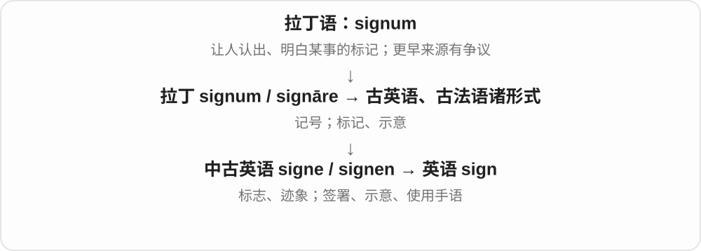
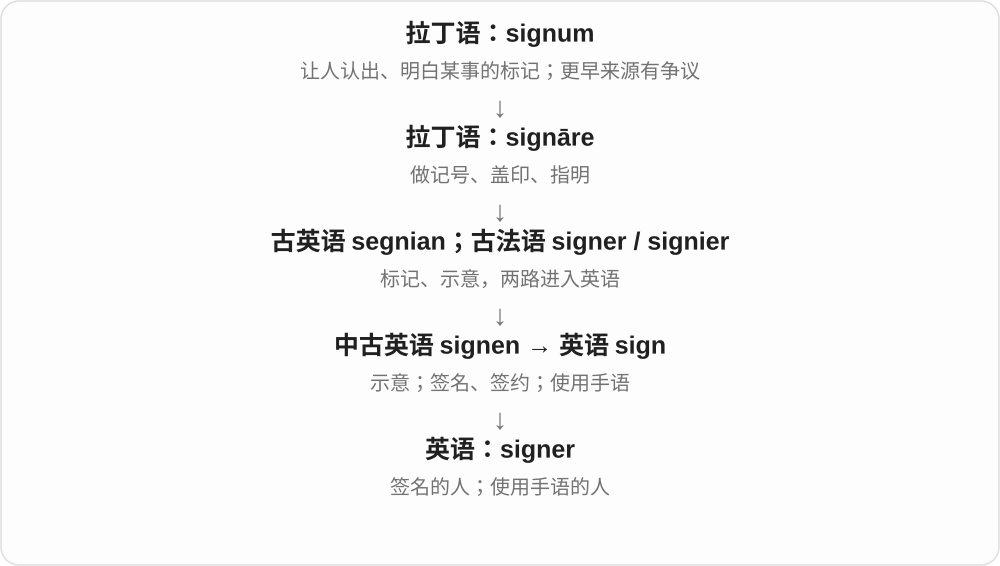
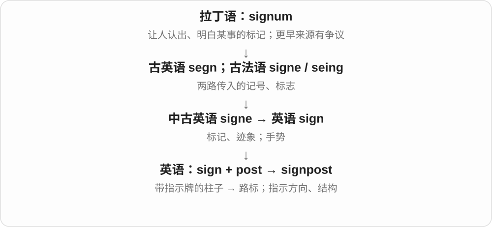
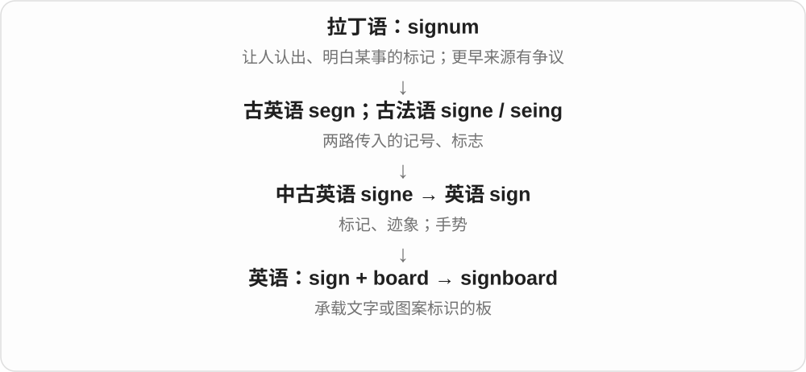

# 0992 · sign — 标记、签字与签约人物

[逐词精讲目录](../00_逐词精讲目录.md) · [总目录](../00_总目录_按常用程度.md)

## 核心词根与来源

经法语接拉丁标记词。-ee 不一定能靠被动受事一条规则解释所有英语词，在 signee 中看签约角色。

**SIGN：以记号确认；SIGNEE 与 COSIGN 各看角色**

基本 sign、signer 已精讲，新增 signee 被签约人物、cosign 共同签字，相关路标词共享归看。

- **基本词与签字、签约角色**：sign · signer · signee · cosign
- **已有标识与路标**：signage · signpost · signboard

## 词形与演化规律

sign → signer、signee、signage；co- + sign → cosign；sign + post、board。

## 单词速览（按词族由简到繁）

同一基础词的相关扩展放在一起，先读基础形式，再读扩展；各组之间优先读常用的。具体词源关系见各词讲解。

| 单词 | 音标 | 核心意思 |
|---|---|---|
| [sign](#w-1) | /saɪn/ | 标志；迹象；招牌；手势；签名、签约 |
| [signage](#w-2) | /ˈsaɪnɪdʒ/ | 标识牌；标识系统〔总称〕 |
| [signer](#w-3) | 英 /ˈsaɪnə/；美 /ˈsaɪnər/ | 签名者；使用手语的人 |
| [signpost](#w-4) | 英 /ˈsaɪnpəʊst/；美 /ˈsaɪnpoʊst/ | 路标；指示牌；标出方向；提示文章结构 |
| [signee](#w-5) | /saɪˈniː/ | 签约者；被签下的人 |
| [signboard](#w-6) | 英 /ˈsaɪnbɔːd/；美 /ˈsaɪnbɔːrd/ | 招牌；告示牌；标示牌 |
| [cosign](#w-7) | 英 /ˌkəʊˈsaɪn/；美 /ˌkoʊˈsaɪn/ | 共同签署；联署；贷款语境作共同签字担保 |

## 逐词讲解

### 1. sign — 标志；迹象；招牌；手势；签名、签约

**音标**：/saɪn/

**先抓住这个画面**

sign 是让你从眼前的东西读出另一层意思：路牌指方向，乌云露出雨的迹象，签名留下“是我”的标记。

**怎么拆**

名词承接古英语 segn 和古法语 signe，两路都追到拉丁 signum；动词也有古英语与法语来源，不是所有用法都由现代名词临时转来。

**怎么变成今天的意思**

sign of 表示……的迹象；sign a form 是签表；sign with a club 是签约加入俱乐部。sign language 是有自身语法的手语，不只是随便打手势。

**常见搭配与例句**

a warning sign；a sign of change；sign a document；sign up for。

> The wet pavement was a sign of recent rain.

湿路面表明不久前下过雨。

> Please sign your name at the bottom of the form.

请在表格底部签名。

> She signed to her friend across the room.

她隔着房间用手语和朋友交流。

**别混淆**

signal 通常强调传递信息的信号；sign 范围更大，未必有人故意发出。sign 的 g 不发音。

### 2. signage — 标识牌；标识系统〔总称〕

**音标**：/ˈsaɪnɪdʒ/

**先抓住这个画面**

signage 把一个地方所有指示牌、名称牌等看作一套系统，像车站里从入口一直带你走到站台的那些标识。

**怎么拆**

sign + -age，英语中把相关标志看作整体的构词。

**怎么变成今天的意思**

通常不可数：new signage、clear signage。一个具体的牌子一般说 a sign，不说 a signage。

**常见搭配与例句**

clear signage；directional signage；digital signage。

> The museum installed new signage near the entrance.

博物馆在入口附近安装了新标识。

> Clear signage makes the station easier to navigate.

清楚的标识让人在车站里更容易找路。

**别混淆**

signalling 是发出、传递信号的过程；signage 是标识的整体，可以是静态牌子或电子屏。

### 3. signer — 签名者；使用手语的人

**音标**：英 /ˈsaɪnə/；美 /ˈsaɪnər/

**先抓住这个画面**

signer 是做 sign 这个动作的人：拿笔签名的人，或用手语交流的人。

**怎么拆**

sign + -er，表示执行该动作的人。

**怎么变成今天的意思**

the signer of a letter 指信件署名者；a fluent signer 指手语流利的人。这个词本身不保证其职业是手语翻译。

**常见搭配与例句**

the signer of a document；a fluent signer；a native signer。

> The signer added the date beside her name.

签名者在姓名旁写上了日期。

> The video features two fluent signers in conversation.

视频展示了两位手语流利的人在交谈。

**别混淆**

signatory 更常说正式协议的签署人或签署方；signer 更一般。不要和 singer“歌手”混淆。

### 4. signpost — 路标；指示牌；标出方向；提示文章结构

**音标**：英 /ˈsaɪnpəʊst/；美 /ˈsaɪnpoʊst/

**先抓住这个画面**

signpost 像岔路口那根带箭头的杆：告诉你往哪走。文章里的提示句也能像路标一样帮读者跟上。

**怎么拆**

sign + post，post 在这里是柱、杆；名词又转为动词“立标指路”，并引申到组织信息。

**怎么变成今天的意思**

follow the signposts 是顺着路标走；signpost an argument 是把论证的方向和层次说明白。

**常见搭配与例句**

a signpost to；follow the signposts；signpost the main points。

> A signpost pointed us towards the lake.

路标指引我们往湖边走。

> The introduction signposts the main stages of the argument.

引言交代了论证的主要步骤。

**别混淆**

signboard 只强调板上有标识；signpost 更突出指引到某处或某个论述方向。

### 5. signee — 签约者；被签下的人

**音标**：/saɪˈniː/

**先抓住这个画面**

在体育、艺人经纪报道中，常说刚被球队、公司签下的那个人。

**怎么拆**

sign + -ee，现代形成签约关系人物名。-ee 在此常偏被签约的一方，不把所有签字者都一律称 signee。

**怎么变成今天的意思**

**拉丁 signum 标记 → 法语 signe、signer → sign**  
标志、作记号；签名

↓

**现代 sign 派生**  
签字主体与共同签署

↓

**sign + -ee → signee**  
签约关系中的人物 → 被签下的人

a new signee 新签约者，a recent signee 最近签下的人；实际角色由合同、报道对象决定。

**常见搭配与例句**

a new signee；a recent signee；the club’s latest signee。

> The club introduced its latest signee.

俱乐部介绍了最新签下的球员。

> The label’s new signee released her first single.

唱片公司新签的歌手发布了第一支单曲。

**别混淆**

signer 中性签字者，signee 常见被球队等签下的人；signatory 正式签署方是另一常用称谓。

### 6. signboard — 招牌；告示牌；标示牌

**音标**：英 /ˈsaɪnbɔːd/；美 /ˈsaɪnbɔːrd/

**先抓住这个画面**

signboard 把抽象的标记放到一块实际的板上，让经过的人能看懂店名或指示。

**怎么拆**

sign + board，英语复合词；board 在这里是板，不是董事会。

**怎么变成今天的意思**

可放在店前，也可在路口、工地或公共场所；不一定是商业广告。

**常见搭配与例句**

a shop signboard；a wooden signboard；read the signboard。

> A wooden signboard marked the entrance to the farm.

一块木牌标出了农场入口。

> The shop repainted its signboard before reopening.

商店重新开业前把招牌重漆了一遍。

**别混淆**

billboard 常是大型广告牌；signboard 更一般，尺寸和目的不限于广告。

### 7. cosign — 共同签署；联署；贷款语境作共同签字担保

**音标**：英 /ˌkəʊˈsaɪn/；美 /ˌkoʊˈsaɪn/

**先抓住这个画面**

不是只自己签，而是与别人一同在文件上签字；贷款语境还可能承担相应偿付责任。

**怎么拆**

co- 共同 + sign 签署，也常写 co-sign。发音以 /saɪn/ 结尾，不是数学 cosine 余弦。

**怎么变成今天的意思**

**拉丁 signum 标记 → 法语 signe、signer → sign**  
标志、作记号；签名

↓

**现代 sign 派生**  
签字主体与共同签署

↓

**co- + sign → cosign**  
一起签字 → 联署、共同签署

cosign a letter 联署信件，cosign a loan 在贷款上共同签字；具体责任依文件和制度，不从一个前缀推断。

**常见搭配与例句**

cosign a letter；cosign an agreement；cosign a loan。

> Three residents agreed to cosign the letter.

三名居民同意联署这封信。

> Her parent was asked to cosign the agreement.

她的家长被要求在协议上共同签字。

**别混淆**

cosign 与 witness 见证签字角色不同；签字见证者不自动成为共同借款、担保责任人。

## 这一组要分清什么

signee 常指被签下的球员、艺人；cosign 不等于 witness；cosine 余弦是另词。

## 串起来练习

The new signee signed the agreement at the club.

新签约球员在俱乐部签了协议。
