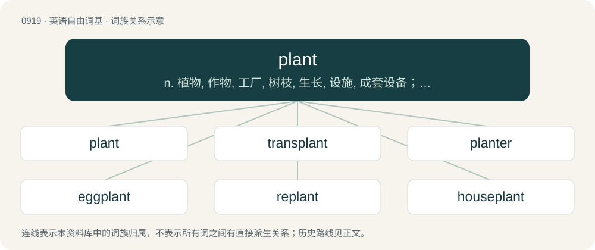

# 0994 · plant — n. 植物, 作物, 工厂, 树枝, 生长, 设施, 成套设备；vt. 种植, 栽培, 播种, 培养, 安置, 殖民于, 使位于；vi. 种植

[总目录](../00_总目录_按常用程度.md)

**类型**：英语自由词基　｜　**来源语言**：见词源记录

## 核心含义与来源

- 核心含义：n. 植物, 作物, 工厂, 树枝, 生长, 设施, 成套设备；vt. 种植, 栽培, 播种, 培养, 安置, 殖民于, 使位于；vi. 种植
- 英文含义：An organism that is not an animal, especially an organism capable of photosynthesis, and typically a small or herbaceous organism of this kind, rather than a tree.
- 词形：plant

**来源记录 1**（名词；An organism that is not an animal, especially an organism capable of photosynthesis, and typically a small or herbaceous organism of this kind, rather than a tree.）

From Middle English plante, from Old English plante (“young tree or shrub, herb newly planted”), from Proto-West Germanic \*plantu, from Latin planta (“sprout, shoot, cutting”). Broader sense of "any vegetable life, vegetation generally" is from Old French plante. Doublet of clan (borrowed through Celtic languages) and planta (directly from Latin). The verb is from Middle English planten, from Old English plantian (“to plant”), from Latin plantāre, later influenced by Old French planter. Compare also Dutch planten (“to plant”), German pflanzen (“to plant”), Swedish plantera (“to plant”), Icelandic planta (“to plant”). The factory and machinery senses comes from the Latin sense of "any vegetable production that serves to propagate the species," which refers to something that produces.

## 词族图

## 单词速览（常用到不常用）

| 单词 | 音标 | 释义 |
|---|---|---|
| [plant](#w-1) | 英 /plɑːnt/；美 /plænt/ | n. 植物, 作物, 工厂, 树枝, 生长, 设施, 成套设备；vt. 种植, 栽培, 播种, 培养, 安置, 殖民于, 使位于；vi. 种植 |
| [transplant](#w-2) | 英 /tɹɑːnzˈplɑːnt/；美 /tɹænzˈplænt/ | vt. 使移居, 移植, 使迁移；vi. 移居, 耐移植；n. 移居者, 移植 |
| [planter](#w-3) | /ˈplæntə(ɹ)/ | n. 种植者, 耕作者, 种植机, 花盆 |
| [eggplant](#w-4) | /ˈɛɡ.plænt/ | n. 茄子 |
| [replant](#w-5) | /ɹiːˈplænt/ | vt. 改种, 在...再植, 使移居 |
| [houseplant](#w-6) | 美 /ˈhaʊsˌplænt/ | 室内植物 |

## 逐词详解

### 1. plant

**词性**：名词　｜　**音标**：英 /plɑːnt/；美 /plænt/

**中文释义**：n. 植物, 作物, 工厂, 树枝, 生长, 设施, 成套设备；vt. 种植, 栽培, 播种, 培养, 安置, 殖民于, 使位于；vi. 种植

**英文义项**：An organism that is not an animal, especially an organism capable of photosynthesis, and typically a small or herbaceous organism of this kind, rather than a tree. / An organism of the kingdom Plantae, and now specifically, a living organism of the Embryophyta (land plants) or of the Chlorophyta (green algae), a eukaryote that includes double-membraned chloroplasts in its cells containing chlorophyll a and b, or any organism closely related to such an organism.

**词源与演化**：

From Middle English plante, from Old English plante (“young tree or shrub, herb newly planted”), from Proto-West Germanic \*plantu, from Latin planta (“sprout, shoot, cutting”). Broader sense of "any vegetable life, vegetation generally" is from Old French plante. Doublet of clan (borrowed through Celtic languages) and planta (directly from Latin). The verb is from Middle English planten, from Old English plantian (“to plant”), from Latin plantāre, later influenced by Old French planter. Compare also Dutch planten (“to plant”), German pflanzen (“to plant”), Swedish plantera (“to plant”), Icelandic planta (“to plant”). The factory and machinery senses comes from the Latin sense of "any vegetable production that serves to propagate the species," which refers to something that produces.

**例句**：

> The garden had a couple of trees, and a cluster of colourful plants around the border.

该用例对应义项：An organism that is not an animal, especially an organism capable of photosynthesis, and typically a small or herbaceous organism of this kind, rather than a tree.

### 2. transplant

**词性**：动词　｜　**音标**：英 /tɹɑːnzˈplɑːnt/；美 /tɹænzˈplænt/

**中文释义**：vt. 使移居, 移植, 使迁移；vi. 移居, 耐移植；n. 移居者, 移植

**英文义项**：To uproot (a growing plant), and plant it in another place. / To remove (something) and establish its residence in another place; to resettle or relocate.

**构词拆分**：trans- + plant

**词源与演化**：

From Middle English transplaunten, from Old French transplanter, from Late Latin transplantare, equivalent to trans- + plant.

**例句**：

> Transplant the young rice plants.

该用例对应义项：lift and reset in another soil or situation

### 3. planter

**词性**：名词　｜　**音标**：/ˈplæntə(ɹ)/

**中文释义**：n. 种植者, 耕作者, 种植机, 花盆

**英文义项**：One who plants something. / Any member of a similar landed class of (often wealthy) farm owners elsewhere, such as plantation owners whose lands are worked by farm workers, wage slaves, or slaves.

**构词拆分**：plant + -er

**词源与演化**：

From plant + -er.

**例句**：

> Sami was sitting on a planter, waiting for Layla to come pick him up.

### 4. eggplant

**词性**：名词　｜　**音标**：/ˈɛɡ.plænt/

**中文释义**：n. 茄子

**英文义项**：The plant Solanum melongena or its edible fruit; an aubergine. / A dark purple color, like that of the skin of this fruit.

**构词拆分**：egg + plant

**词源与演化**：

From egg + plant, originally applied only to the white-colored, egg-shaped variety. Compare Dutch and Afrikaans eierplant (“eggplant”), German Eierpflanze (“eggplant”), Swedish äggplanta (“eggplant”). Compare also Afrikaans eiervrug (“eggplant”, literally “egg-fruit”), Icelandic eggaldin (“eggplant”, literally “egg-fruit”).

**例句**：

> Eggplant is the main ingredient of some vegetarian dishes with tomato sauce.

### 5. replant

**词性**：动词　｜　**音标**：/ɹiːˈplænt/

**中文释义**：vt. 改种, 在...再植, 使移居

**英文义项**：To plant again, especially to plant in a different place, using different plants, or in a different design.

**构词拆分**：re- + plant

**词源与演化**：

From re- + plant.

**例句**：

> Ziri needs a new pot to replant his heather.

### 6. houseplant

**词性**：名词　｜　**音标**：美 /ˈhaʊsˌplænt/

**中文释义**：室内植物

**英文义项**：A plant that is grown indoors in places such as a house or office for decorative purposes. / A variety of plant that is especially suited to such cultivation, or that is frequently grown in such settings.

**构词拆分**：house + plant

**词源与演化**：

From house + plant.

**例句**：

> "I always thought a begonia was a houseplant!" exclaimed Sue, staring at the towering tropical specimen.

该用例对应义项：A variety of plant that is especially suited to such cultivation, or that is frequently grown in such settings.
