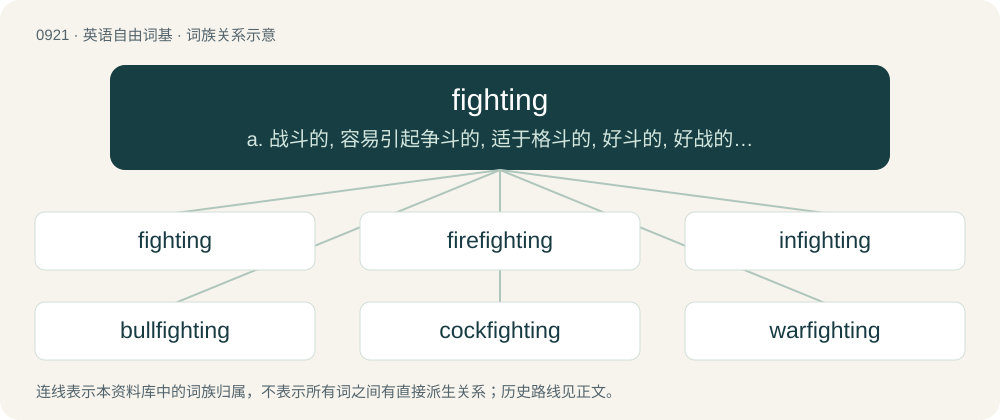

# 0995 · fighting — a. 战斗的, 容易引起争斗的, 适于格斗的, 好斗的, 好战的, 斗争的, 搏斗的；n. 战斗, 斗争, 搏斗

[总目录](../00_总目录_按常用程度.md)

**类型**：英语自由词基　｜　**来源语言**：见词源记录

## 核心含义与来源

- 核心含义：a. 战斗的, 容易引起争斗的, 适于格斗的, 好斗的, 好战的, 斗争的, 搏斗的；n. 战斗, 斗争, 搏斗
- 英文含义：Engaged in war or other conflict.
- 词形：fighting

**多个词源／构词路径**：同一拼写可能有不同来源；以下按词性和含义分别列出。

**来源记录 1**（形容词；Engaged in war or other conflict.）

From Middle English feghtyng, fyȝtynge, fightand, feghtand, feghtande, feightand, feȝtand, viȝtinde, feihtende, from Old English feohtende, from Proto-Germanic \*fehtandz, present participle of Proto-Germanic \*fehtaną (“to comb, struggle, contend with”), equivalent to fight + -ing.

**来源记录 2**（名词；The act or process of contending; violence or conflict.）

From Middle English fightyng, fightynge, fiȝtinge, feȝtyng, from Old English fihtung (“fighting”), equivalent to fight + -ing.

## 词族图

## 单词速览（常用到不常用）

| 单词 | 音标 | 释义 |
|---|---|---|
| [fighting](#w-1) | 英 /ˈfaɪ.tɪŋ/；美 /ˈfaɪ.tɪŋ/ | a. 战斗的, 容易引起争斗的, 适于格斗的, 好斗的, 好战的, 斗争的, 搏斗的；n. 战斗, 斗争, 搏斗 |
| [firefighting](#w-2) | /ˈfaɪ.əɹˌfaɪ.tɪŋ/ | 消防 |
| [infighting](#w-3) | /ˈinfaitiŋ/ | n. 近战, 混战, 暗斗 |
| [bullfighting](#w-4) | /ˈbʊlˌfaɪ.tɪŋ/ | n. 斗牛表演 |
| [cockfighting](#w-5) | /ˈkɒkfaitiŋ/ | n. 斗鸡 |
| [warfighting](#w-6) |  | 【英文】The fighting of a war. |

## 逐词详解

### 1. fighting

**词性**：形容词　｜　**音标**：英 /ˈfaɪ.tɪŋ/；美 /ˈfaɪ.tɪŋ/

**中文释义**：a. 战斗的, 容易引起争斗的, 适于格斗的, 好斗的, 好战的, 斗争的, 搏斗的；n. 战斗, 斗争, 搏斗

**英文义项**：Engaged in war or other conflict. / Apt to provoke a fight.

**构词拆分**：fight + -ing

**词源与演化**：

From Middle English feghtyng, fyȝtynge, fightand, feghtand, feghtande, feightand, feȝtand, viȝtinde, feihtende, from Old English feohtende, from Proto-Germanic \*fehtandz, present participle of Proto-Germanic \*fehtaną (“to comb, struggle, contend with”), equivalent to fight + -ing.

**例句**：

> Review the fighting forces.

该用例对应义项：engaged in or ready for military or naval operations

### 2. firefighting

**词性**：名词　｜　**音标**：/ˈfaɪ.əɹˌfaɪ.tɪŋ/

**中文释义**：消防

**英文义项**：The extinguishing of a fire. / The profession of being a firefighter.

**构词拆分**：fire + fighting

**词源与演化**：

From fire + fighting.

**例句**：

> Firefighting in Australia is becoming increasingly sophisticated.

### 3. infighting

**词性**：名词　｜　**音标**：/ˈinfaitiŋ/

**中文释义**：n. 近战, 混战, 暗斗

**英文义项**：Fighting or quarreling among the members of a single group or side. / Fighting with one's opponent closer than arm's length.

**构词拆分**：in- + fighting

**词源与演化**：

From in- + fighting. Compare Middle English infighten (“to attack”), Old English infiht (“infighting”).

**例句**：

> Stop this infighting! I took you in when no one else would.

### 4. bullfighting

**词性**：名词　｜　**音标**：/ˈbʊlˌfaɪ.tɪŋ/

**中文释义**：n. 斗牛表演

**英文义项**：A traditional spectacle, popular in Spain and many former Spanish colonies, in which a matador manipulates and ultimately kills a bull at close range.

**构词拆分**：bull + fighting

**词源与演化**：

From bull + fighting.

**例句**：

> Bullfighting is so cruel and barbaric.

### 5. cockfighting

**词性**：名词　｜　**音标**：/ˈkɒkfaitiŋ/

**中文释义**：n. 斗鸡

**英文义项**：A gambling blood sport (illegal in most countries) in which two roosters have spikes placed on their feet and are made to fight each other, usually to the death.

**构词拆分**：cock + fighting

**词源与演化**：

From Middle English cokfytyng, kokkysfythynge; equivalent to cock + fighting.

**例句**：

> Now illegal in many countries, cockfighting continues in rural areas.

### 6. warfighting

**词性**：名词

**英文义项**：The fighting of a war.

**构词拆分**：war + fighting

**词源与演化**：

From war + fighting.
