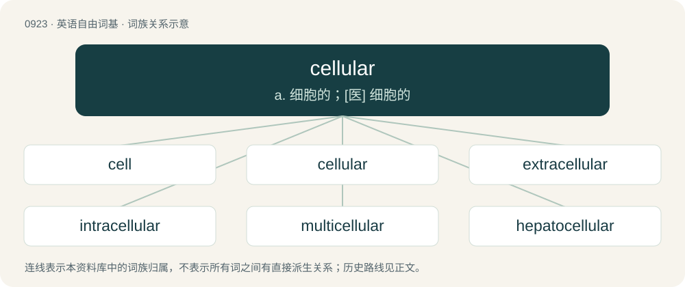

# 0997 · cellular — a. 细胞的；\[医\] 细胞的

[总目录](../00_总目录_按常用程度.md)

**类型**：英语自由词基　｜　**来源语言**：见词源记录

## 核心含义与来源

- 核心含义：a. 细胞的；\[医\] 细胞的
- 英文含义：Of, relating to, consisting of, or resembling a cell or cells.
- 词形：cellular

**来源记录 1**（形容词；Of, relating to, consisting of, or resembling a cell or cells.）

From New Latin cellulāris, from cellula (“cell”) + -āris.

## 词族图

## 单词速览（常用到不常用）

| 单词 | 音标 | 释义 |
|---|---|---|
| [cell](#w-1) | /sɛl/ | 【英文】A cellular phone. |
| [cellular](#w-2) | 英 /ˈsɛl.ju.lə/；美 /ˈsɛl.ju.lɚ/ | a. 细胞的；\[医\] 细胞的 |
| [extracellular](#w-3) | /,ekstrəˈseljulə/ | a. 细胞外的；\[医\] 细胞外的 |
| [intracellular](#w-4) | /,intrəˈseljulə/ | a. 胞内的, 细胞内的；\[医\] 细胞内的 |
| [multicellular](#w-5) | /.mʌltiˈseljulə/ | a. 多细胞的；\[医\] 多细胞的; 多空隙的 |
| [hepatocellular](#w-6) | /,hepətəuˈseljulə/ | a. 肝细胞的；\[医\] 肝细胞的 |
| [subcellular](#w-7) | /ˈsʌbˈseljulə/ | a. \[生\]亚细胞的 |
| [unicellular](#w-8) | /ˌjuːnɪˈsɛljʊlə(ɹ)/ | a. 单细胞的；\[医\] 单细胞的 |
| [intercellular](#w-9) | /.intəˈseljulə/ | a. 在细胞间的；\[医\] 细胞间的 |

## 逐词详解

### 1. cell

**词性**：名词　｜　**音标**：/sɛl/

**英文义项**：A cellular phone.

**构词拆分**：cellular + phone

**词源与演化**：

Ellipsis of cell phone, itself a clipping of cellular phone, from cellular + phone.

### 2. cellular

**词性**：形容词　｜　**音标**：英 /ˈsɛl.ju.lə/；美 /ˈsɛl.ju.lɚ/

**中文释义**：a. 细胞的；\[医\] 细胞的

**英文义项**：Of, relating to, consisting of, or resembling a cell or cells. / Light to mid-weight, having a regular cell-like construction with small perforations, generally woven; (of a garment) made of such a fabric.

**词源与演化**：

From New Latin cellulāris, from cellula (“cell”) + -āris.

**例句**：

> The reason the network can work is that it is cellular: devices within a certain area are connected to a tower that is not far away.

该用例对应义项：Using cells (local groups of devices sharing a transceiver).

### 3. extracellular

**词性**：形容词　｜　**音标**：/,ekstrəˈseljulə/

**中文释义**：a. 细胞外的；\[医\] 细胞外的

**英文义项**：Occurring or found outside of a cell.

**构词拆分**：extra- + cellular

**词源与演化**：

From extra- + cellular.

### 4. intracellular

**词性**：形容词　｜　**音标**：/,intrəˈseljulə/

**中文释义**：a. 胞内的, 细胞内的；\[医\] 细胞内的

**英文义项**：Inside or within a cell.

**构词拆分**：intra- + cellular

**词源与演化**：

From intra- + cellular.

**用法示例／搭配（非完整句）**：

> an intracellular process

该用例对应义项：Inside or within a cell.

### 5. multicellular

**词性**：形容词　｜　**音标**：/.mʌltiˈseljulə/

**中文释义**：a. 多细胞的；\[医\] 多细胞的; 多空隙的

**英文义项**：That has many cells, often differentiated in function.

**构词拆分**：multi- + cellular

**词源与演化**：

From multi- + cellular.

**例句**：

> The cells of multicellular organisms form tissues.

### 6. hepatocellular

**词性**：形容词　｜　**音标**：/,hepətəuˈseljulə/

**中文释义**：a. 肝细胞的；\[医\] 肝细胞的

**英文义项**：Of or pertaining to the cells of the liver

**构词拆分**：hepato- + cellular

**词源与演化**：

From hepato- + cellular.

### 7. subcellular

**词性**：形容词　｜　**音标**：/ˈsʌbˈseljulə/

**中文释义**：a. \[生\]亚细胞的

**英文义项**：Smaller than a normal cell. / Relating to objects or processes that involve parts of a cell.

**构词拆分**：sub- + cellular

**词源与演化**：

From sub- + cellular.

**例句**：

> 2014 Nobel Prize chemistry prizewinner, Eric Betzig has developed a new microscope that captures 3-D images of subcellular activity in real time.

### 8. unicellular

**词性**：形容词　｜　**音标**：/ˌjuːnɪˈsɛljʊlə(ɹ)/

**中文释义**：a. 单细胞的；\[医\] 单细胞的

**英文义项**：Describing any microorganism that has a single cell.

**构词拆分**：uni- + cellular

**词源与演化**：

From uni- + cellular.

**例句**：

> The amoeba is a unicellular organism.

### 9. intercellular

**词性**：形容词　｜　**音标**：/.intəˈseljulə/

**中文释义**：a. 在细胞间的；\[医\] 细胞间的

**英文义项**：Located between, or connecting, cells

**构词拆分**：inter- + cellular

**词源与演化**：

From inter- + cellular.
