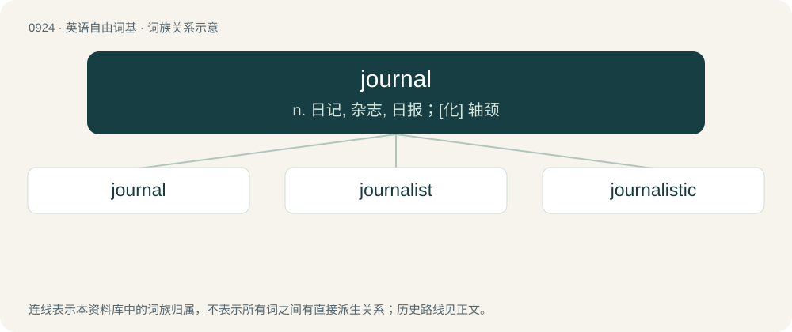

# 0998 · journal — n. 日记, 杂志, 日报；\[化\] 轴颈

[总目录](../00_总目录_按常用程度.md)

**类型**：英语自由词基　｜　**来源语言**：见词源记录

## 核心含义与来源

- 核心含义：n. 日记, 杂志, 日报；\[化\] 轴颈
- 英文含义：A diary or daily record of a person, organization, vessel etc.; daybook.
- 词形：journal

**多个词源／构词路径**：同一拼写可能有不同来源；以下按词性和含义分别列出。

**来源记录 1**（名词；A diary or daily record of a person, organization, vessel etc.; daybook.）

From Middle English journal, from Anglo-Norman jurnal (“daily”), from Old French jornel (“day”) (whence modern French journal), from Latin diurnālis, from diurnus (“of the day”). Doublet of diurnal and the journal from French.

**来源记录 2**（名词；The amount of land that can be worked in a day.）

From French journal. Doublet of diurnal and the journal from Middle English.

**来源记录 3**（名词；the part of a rotating shaft or axle that rests on the bearing）

Unknown, apparently of Scots origin. Perhaps from chirnel, from English kernel (“lump in the flesh”), owing to resemblance in shape.

## 词族图

## 单词速览（常用到不常用）

| 单词 | 音标 | 释义 |
|---|---|---|
| [journal](#w-1) | 英 /ˈd͡ʒɜːnəl/；美 /ˈd͡ʒɝnəl/ | n. 日记, 杂志, 日报；\[化\] 轴颈 |
| [journalist](#w-2) | 英 /ˈd͡ʒɜːnəlɪst/；美 /ˈd͡ʒɝnəlɪst/ | n. 新闻记者, 从事新闻杂志业的人 |
| [journalistic](#w-3) | /ˌd͡ʒɜː(ɹ)nəˈlɪstɪk/ | a. 新闻业的, 新闻工作者的, 报刊特有的, 新闻工作的 |

## 逐词详解

### 1. journal

**词性**：名词　｜　**音标**：英 /ˈd͡ʒɜːnəl/；美 /ˈd͡ʒɝnəl/

**中文释义**：n. 日记, 杂志, 日报；\[化\] 轴颈

**英文义项**：A diary or daily record of a person, organization, vessel etc.; daybook. / A newspaper or magazine dealing with a particular subject.

**词源与演化**：

From Middle English journal, from Anglo-Norman jurnal (“daily”), from Old French jornel (“day”) (whence modern French journal), from Latin diurnālis, from diurnus (“of the day”). Doublet of diurnal and the journal from French.

**例句**：

> The university's biology department subscribes to half a dozen academic journals.

该用例对应义项：A newspaper or magazine dealing with a particular subject.

### 2. journalist

**词性**：名词　｜　**音标**：英 /ˈd͡ʒɜːnəlɪst/；美 /ˈd͡ʒɝnəlɪst/

**中文释义**：n. 新闻记者, 从事新闻杂志业的人

**英文义项**：The keeper of a personal journal, who writes in it regularly. / One whose occupation is journalism, originally only writing in the printed press.

**构词拆分**：journal + -ist

**词源与演化**：

From journal + -ist.

**例句**：

> This journalist, whose article you were so interested in, is my neighbor.

### 3. journalistic

**词性**：形容词　｜　**音标**：/ˌd͡ʒɜː(ɹ)nəˈlɪstɪk/

**中文释义**：a. 新闻业的, 新闻工作者的, 报刊特有的, 新闻工作的

**英文义项**：Related to journalism or journalists.

**构词拆分**：journal + -istic (“adjective”)；journalist + -ic (“adjective”)

**词源与演化**：

From journal + -istic (“adjective”). Also parsed directly as journalist + -ic (“adjective”), also used in sense of related journalism (having to do with journalism).

**例句**：

> Substituting "\[expletive\]" for swear words in an article's text is a journalistic practice of sensibility.

该用例对应义项：Related to journalism or journalists.
