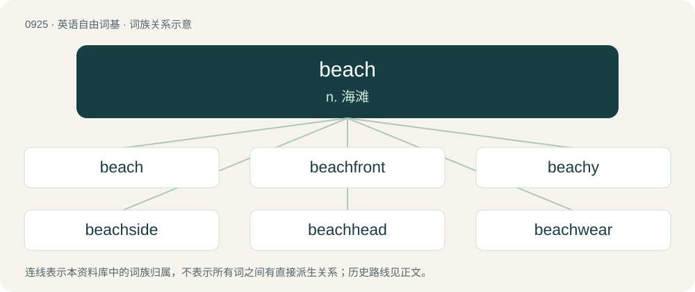

# 1000 · beach — n. 海滩

[总目录](../00_总目录_按常用程度.md)

**类型**：英语自由词基　｜　**来源语言**：见词源记录

## 核心含义与来源

- 核心含义：n. 海滩
- 英文含义：The shore of a body of water, especially when sandy or pebbly.
- 词形：beach

**来源记录 1**（名词；The shore of a body of water, especially when sandy or pebbly.）

From Middle English bache, bæcche (“bank, sandbank”), from Old English beċe (“beck, brook, stream”), from Proto-West Germanic \*baki, from Proto-Germanic \*bakiz (“brook”), from Proto-Indo-European \*bʰeg- (“flowing water”). Cognates Cognate with Cimbrian pach (“brook, creek, stream”), Dutch beek (“brook, stream”), German Bach (“brook, stream”), German Low German Beek (“brook, stream”), Luxembourgish Baach (“brook, stream”), Mòcheno pòch (“brook, creek, stream”), Vilamovian bāh, baoch (“brook, stream”), Danish bæk (“brook”), Icelandic bekkur (“creek, spring, stream”), Norwegian Bokmål and Norwegian Nynorsk bekk (“brook, creek, stream”), Swedish bäck (“brook, creek, stream”); also Lithuanian banga (“billow, wave”). More at batch, beck.

## 词族图

## 单词速览（常用到不常用）

| 单词 | 音标 | 释义 |
|---|---|---|
| [beach](#w-1) | /biːt͡ʃ/ | n. 海滩 |
| [beachfront](#w-2) | 美 /ˈbit͡ʃˌfɹʌnt/ | n. 海滨地区；a. 靠海滨的 |
| [beachy](#w-3) | /ˈbiːt͡ʃi/ | a. 多沙砾的 |
| [beachside](#w-4) | 美 /ˈbit͡ʃˌsaɪd/ | n. 海滨地区；a. 靠海滨的 |
| [beachhead](#w-5) | /ˈbiːt͡ʃhɛd/ | n. 滩头堡 |
| [beachwear](#w-6) | /ˈbiːtʃweə(r)/ | n. 海滩装(包括游泳衣裤,短裤,浴衣等) |

## 逐词详解

### 1. beach

**词性**：名词　｜　**音标**：/biːt͡ʃ/

**中文释义**：n. 海滩

**英文义项**：The shore of a body of water, especially when sandy or pebbly. / A horizontal strip of land, usually sandy, adjoining water.

**词源与演化**：

From Middle English bache, bæcche (“bank, sandbank”), from Old English beċe (“beck, brook, stream”), from Proto-West Germanic \*baki, from Proto-Germanic \*bakiz (“brook”), from Proto-Indo-European \*bʰeg- (“flowing water”). Cognates Cognate with Cimbrian pach (“brook, creek, stream”), Dutch beek (“brook, stream”), German Bach (“brook, stream”), German Low German Beek (“brook, stream”), Luxembourgish Baach (“brook, stream”), Mòcheno pòch (“brook, creek, stream”), Vilamovian bāh, baoch (“brook, stream”), Danish bæk (“brook”), Icelandic bekkur (“creek, spring, stream”), Norwegian Bokmål and Norwegian Nynorsk bekk (“brook, creek, stream”), Swedish bäck (“brook, creek, stream”); also Lithuanian banga (“billow, wave”). More at batch, beck.

**例句**：

> In summer, they used to play on the beach all day long.

### 2. beachfront

**词性**：形容词　｜　**音标**：美 /ˈbit͡ʃˌfɹʌnt/

**中文释义**：n. 海滨地区；a. 靠海滨的

**英文义项**：Of property (real estate): located on a beach.

**构词拆分**：beach + front

**词源与演化**：

From beach + front.

**例句**：

> Tom took Mary to a beachfront restaurant for dinner.

### 3. beachy

**词性**：形容词　｜　**音标**：/ˈbiːt͡ʃi/

**中文释义**：a. 多沙砾的

**英文义项**：Pertaining to the material making up the edge of a seashore, as with pebbles, gravel, and sand. / Pertaining to a beach or something beach-like.

**构词拆分**：beach + -y

**词源与演化**：

From beach + -y.

### 4. beachside

**词性**：形容词　｜　**音标**：美 /ˈbit͡ʃˌsaɪd/

**中文释义**：n. 海滨地区；a. 靠海滨的

**英文义项**：Bordering a beach

**构词拆分**：beach + side

**词源与演化**：

From beach + side.

**用法示例／搭配（非完整句）**：

> beachside property

该用例对应义项：Bordering a beach

### 5. beachhead

**词性**：名词　｜　**音标**：/ˈbiːt͡ʃhɛd/

**中文释义**：n. 滩头堡

**英文义项**：An area of hostile territory (especially on a beach) that, when captured, serves for the continuous landing (or movement into position) of further troops and material / A coastal landing place.

**构词拆分**：beach + head

**词源与演化**：

From beach + head.

**例句**：

> The town became a beachhead in the campaign to ban smoking outdoors.

该用例对应义项：an initial accomplishment that opens the way for further developments

### 6. beachwear

**词性**：名词　｜　**音标**：/ˈbiːtʃweə(r)/

**中文释义**：n. 海滩装(包括游泳衣裤,短裤,浴衣等)

**英文义项**：Clothing suitable for wearing on the beach, though not necessarily for swimming in.

**构词拆分**：beach + -wear

**词源与演化**：

From beach + -wear.
