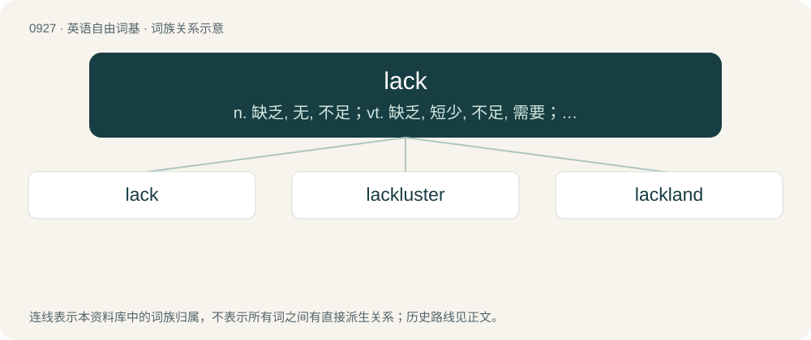

# 1002 · lack — n. 缺乏, 无, 不足；vt. 缺乏, 短少, 不足, 需要；vi. 缺乏

[总目录](../00_总目录_按常用程度.md)

**类型**：英语自由词基　｜　**来源语言**：见词源记录

## 核心含义与来源

- 核心含义：n. 缺乏, 无, 不足；vt. 缺乏, 短少, 不足, 需要；vi. 缺乏
- 英文含义：A deficiency or need (of something desirable or necessary); an absence, want, dearth.
- 词形：lack

**多个词源／构词路径**：同一拼写可能有不同来源；以下按词性和含义分别列出。

**来源记录 1**（名词；A deficiency or need (of something desirable or necessary); an absence, want, dearth.）

From Middle English lack, lakke, lak, from Old English \*læc (“deficiency, lack, want”), from Proto-West Germanic \*lak, from Proto-Germanic \*laką, \*lakaz (“slackness”), from Proto-Germanic \*lakaz (“limp, slack, loose, low”), related to \*lak(k)ōną (“to blame, reproach”), from Proto-Indo-European \*lok-néh₂-. Cognate with Saterland Frisian Lak (“lack”), Middle Low German lack, lak (“lack”), Dutch lak (“lack, deficiency, calumny”), Icelandic lakur (“lacking”). Related also to Middle Dutch laken (“to blame, lack”). Eclipsed non-native Middle English carence (“absence, lack”), from Old French carence.

**来源记录 2**（动词；To be without, not to have, to need, to require.）

From Middle English lacken, lakken, laken, from Old English læccian, \*lacian (“to blame, criticise, lack”), from Proto-West Germanic \*lak(k)ōn (“to blame, be lacking”), from Proto-Germanic \*lak(k)ōną (“to reproach, blame, be lacking”), from Proto-Indo-European \*lok-néh₂-. Cognate with Old Frisian lakia, lekia (“to contest, blame”), Middle Low German lacken, laken (“to reproach, blame, criticise”), Middle Dutch laken (“to disapprove, blame, lack”), Dutch laken (“to blame, reproach”).

## 词族图

## 单词速览（常用到不常用）

| 单词 | 音标 | 释义 |
|---|---|---|
| [lack](#w-1) | 英 /læk/ | n. 缺乏, 无, 不足；vt. 缺乏, 短少, 不足, 需要；vi. 缺乏 |
| [lackluster](#w-2) | 英 /ˈlæklʌstə/；美 /ˈlæklʌstɚ/ | a. 没有光泽的, 无生气的, 平凡的；n. 无光泽, 无生气, 暗淡 |
| [lackland](#w-3) | /ˈlæklænd/ | \[人名\] 拉克兰 |

## 逐词详解

### 1. lack

**词性**：名词　｜　**音标**：英 /læk/

**中文释义**：n. 缺乏, 无, 不足；vt. 缺乏, 短少, 不足, 需要；vi. 缺乏

**英文义项**：A deficiency or need (of something desirable or necessary); an absence, want, dearth.

**词源与演化**：

From Middle English lack, lakke, lak, from Old English \*læc (“deficiency, lack, want”), from Proto-West Germanic \*lak, from Proto-Germanic \*laką, \*lakaz (“slackness”), from Proto-Germanic \*lakaz (“limp, slack, loose, low”), related to \*lak(k)ōną (“to blame, reproach”), from Proto-Indo-European \*lok-néh₂-. Cognate with Saterland Frisian Lak (“lack”), Middle Low German lack, lak (“lack”), Dutch lak (“lack, deficiency, calumny”), Icelandic lakur (“lacking”). Related also to Middle Dutch laken (“to blame, lack”). Eclipsed non-native Middle English carence (“absence, lack”), from Old French carence.

**例句**：

> It is a question of money, or lack of same.

该用例对应义项：A deficiency or need (of something desirable or necessary); an absence, want, dearth.

### 2. lackluster

**词性**：形容词　｜　**音标**：英 /ˈlæklʌstə/；美 /ˈlæklʌstɚ/

**中文释义**：a. 没有光泽的, 无生气的, 平凡的；n. 无光泽, 无生气, 暗淡

**英文义项**：Lacking brilliance or intelligence. / Having no shine or luster; dull.

**构词拆分**：lack + luster

**词源与演化**：

From lack + luster.

**例句**：

> The actor gave a lackluster performance in his latest film.

该用例对应义项：Not exceptional; not worthy of special merit, attention, or interest; having no vitality.

### 3. lackland

**词性**：名词　｜　**音标**：/ˈlæklænd/

**中文释义**：\[人名\] 拉克兰

**英文义项**：A person who does not own land.

**构词拆分**：lack + land

**词源与演化**：

From lack + land.
