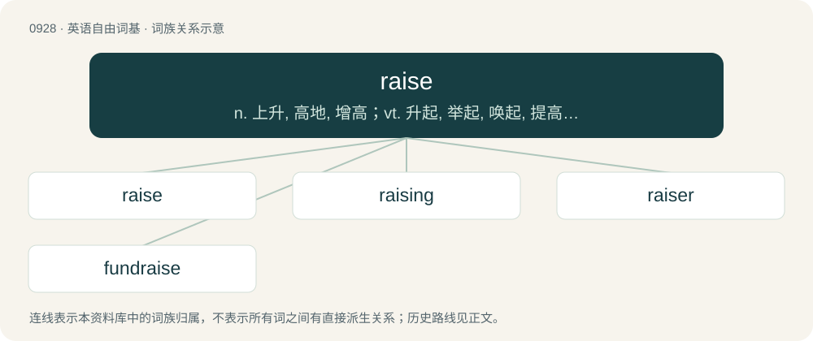

# 1003 · raise — n. 上升, 高地, 增高；vt. 升起, 举起, 唤起, 提高, 使出现, 使复活, 提出, 筹集, 饲养

[总目录](../00_总目录_按常用程度.md)

**类型**：英语自由词基　｜　**来源语言**：见词源记录

## 核心含义与来源

- 核心含义：n. 上升, 高地, 增高；vt. 升起, 举起, 唤起, 提高, 使出现, 使复活, 提出, 筹集, 饲养
- 英文含义：To cause to rise; to lift or elevate.
- 词形：raise

**多个词源／构词路径**：同一拼写可能有不同来源；以下按词性和含义分别列出。

**来源记录 1**（动词；To cause to rise; to lift or elevate.）

From Middle English reysen, raisen, reisen, from Old Norse reisa (“to raise”), from Proto-Germanic \*raisijaną, \*raizijaną (“to raise”), causative form of Proto-Germanic \*rīsaną (“to rise”), from Proto-Indo-European \*h₁rey- (“to rise, arise”). According to Kroonen (2013), from Proto-Indo-European \*h₃er- (“to stir, rise”). Cognate with Old English rāsian (“to explore, examine, research”), Old English rīsan (“to seize, carry off”), Old English rǣran (“to raise”). Doublet of rear.

**来源记录 2**（名词；A cairn or pile of stones.）

Borrowed from Old Norse hreysi; the spelling came about under the influence of the folk etymology that derived it from the verb.

## 词族图

## 单词速览（常用到不常用）

| 单词 | 音标 | 释义 |
|---|---|---|
| [raise](#w-1) | /ɹeɪz/ | n. 上升, 高地, 增高；vt. 升起, 举起, 唤起, 提高, 使出现, 使复活, 提出, 筹集, 饲养 |
| [raising](#w-2) | /ˈɹeɪzɪŋ/ | \[机\] 起油 |
| [raiser](#w-3) | /ˈɹeɪzə(ɹ)/ | n. 提高者, 饲养者, 招募者 |
| [fundraise](#w-4) | 美 /ˈfʌndˌɹeɪz/ | n. 募捐 |

## 逐词详解

### 1. raise

**词性**：动词　｜　**音标**：/ɹeɪz/

**中文释义**：n. 上升, 高地, 增高；vt. 升起, 举起, 唤起, 提高, 使出现, 使复活, 提出, 筹集, 饲养

**英文义项**：To cause to rise; to lift or elevate. / To form by the accumulation of materials or constituent parts; to build up; to erect.

**词源与演化**：

From Middle English reysen, raisen, reisen, from Old Norse reisa (“to raise”), from Proto-Germanic \*raisijaną, \*raizijaną (“to raise”), causative form of Proto-Germanic \*rīsaną (“to rise”), from Proto-Indo-European \*h₁rey- (“to rise, arise”). According to Kroonen (2013), from Proto-Indo-European \*h₃er- (“to stir, rise”). Cognate with Old English rāsian (“to explore, examine, research”), Old English rīsan (“to seize, carry off”), Old English rǣran (“to raise”). Doublet of rear.

**例句**：

> There should be some consideration (i.e., payment or exchange) to raise a use.

该用例对应义项：To create; to constitute (a use, or a beneficial interest in property).

### 2. raising

**词性**：名词　｜　**音标**：/ˈɹeɪzɪŋ/

**中文释义**：\[机\] 起油

**英文义项**：Elevation. / Nurturing; cultivation; providing sustenance and protection for a living thing from conception to maturity.

**构词拆分**：raise + -ing

**词源与演化**：

Inherited from Middle English reysynge; equivalent to raise + -ing.

**用法示例／搭配（非完整句）**：

> cattle raising

该用例对应义项：Nurturing; cultivation; providing sustenance and protection for a living thing from conception to maturity.

### 3. raiser

**词性**：名词　｜　**音标**：/ˈɹeɪzə(ɹ)/

**中文释义**：n. 提高者, 饲养者, 招募者

**英文义项**：A person or thing that raises. / A kind of armchair with a standing-up system.

**构词拆分**：raise + -er

**词源与演化**：

From raise + -er.

**例句**：

> She is a raiser of gerbils.

该用例对应义项：A person or thing that raises.

### 4. fundraise

**词性**：动词　｜　**音标**：美 /ˈfʌndˌɹeɪz/

**中文释义**：n. 募捐

**英文义项**：To raise funds (for a specified cause or purpose).

**构词拆分**：fund + raise

**词源与演化**：

From fund + raise, probably a back-formation from fundraising.

**用法示例／搭配（非完整句）**：

> Daniel's uncle volunteered to help fundraise for his nephew's class trip to Chile

该用例对应义项：To raise funds (for a specified cause or purpose).
