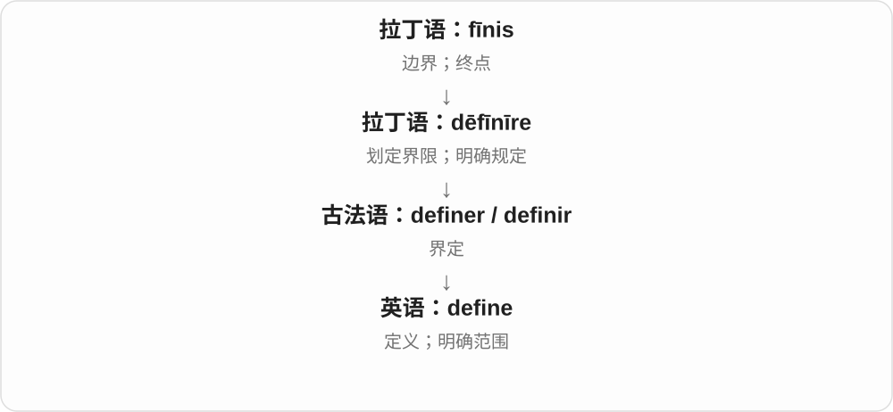

# 1006 · definite — 界定、确定与未定；明确肯定的副词

[逐词精讲目录](../00_逐词精讲目录.md) · [总目录](../00_总目录_按常用程度.md)

## 核心词根与来源

拉丁界定动词分词形成 definite，否定形容词也有自己的拉丁借入支线。明确界线的画面同时帮助学时间和语法术语。

**DEFINITE：边界答案定下；INDEFINITE：还没明确**

define 已精讲，接 definite → definitely，再对照 indefinite；冷门缩略 deffo 先略。

- **界定与确定**：define · definite · definitely
- **未界定、未确定**：indefinite

## 词形与演化规律

define 相关拉丁分词 → definite → definitely；拉丁否定 indēfīnītus → indefinite。

## 单词速览（按词族由简到繁）

同一基础词的相关扩展放在一起，先读基础形式，再读扩展；各组之间优先读常用的。具体词源关系见各词讲解。

| 单词 | 音标 | 核心意思 |
|---|---|---|
| [definite](#w-2) | /ˈdefɪnɪt/ | 明确的；确定的；有清楚界限的 |
| [definitely](#w-1) | /ˈdefɪnɪtli/ | 肯定地；明确地；当然 |
| [indefinite](#w-3) | /ɪnˈdefɪnɪt/ | 不确定的；未限定的；期限未定的 |
| [define](#w-5) | /dɪˈfaɪn/ | 定义；明确；界定 |

## 逐词讲解

### 1. definite — 明确的；确定的；有清楚界限的

**音标**：/ˈdefɪnɪt/

**先抓住这个画面**

原来模模糊糊，现在边界或答案定下来了：哪个时间、哪个计划，能说清。

**怎么拆**

借拉丁 dēfīnītus，dēfīnīre 的分词，与 define 同族。根意像把边界画清，不把 -ite 套成所有矿物名后缀。

**怎么变成今天的意思**

**拉丁 dēfīnīre → dēfīnītus**  
划定界线 → 已界定、确定

↓

**英语 definite**  
明确、确定 → 副词 definitely；否定 indefinite

a definite answer 明确答复，a definite date 确定日期，a definite improvement 明显改善；the definite article 语法定冠词。

**常见搭配与例句**

a definite answer；a definite date；a definite improvement。

> We need a definite date for the move.

我们需要确定搬迁日期。

> There has been a definite improvement in the writing.

写作有了明显进步。

**别混淆**

definite 确定、明确，definitive 常最终权威、定论性的；拼写相近但语气和搭配不同。

### 2. definitely — 肯定地；明确地；当然

**音标**：/ˈdefɪnɪtli/

**先抓住这个画面**

不是也许，而是说话者明确表态“确定，就是这样”。

**怎么拆**

definite + -ly，保持 definite 的拼写。日常加强肯定语气，也可单独回答 Definitely!。

**怎么变成今天的意思**

**拉丁 dēfīnīre → dēfīnītus**  
划定界线 → 已界定、确定

↓

**英语 definite**  
明确、确定 → 副词 definitely；否定 indefinite

↓

**definite + -ly → definitely**  
明确、毫无疑问地

definitely agree 完全肯定同意，definitely not 肯定不，I will definitely come 我一定来。

**常见搭配与例句**

definitely agree；definitely not；Definitely!。

> I will definitely call you tomorrow.

我明天一定打给你。

> That is definitely not the file I sent.

那肯定不是我发的文件。

**别混淆**

definitely 肯定与 defiantly 反抗地不是同词；避免拼成 definately。说话肯定不自动使内容成为事实。

### 3. indefinite — 不确定的；未限定的；期限未定的

**音标**：/ɪnˈdefɪnɪt/

**先抓住这个画面**

边界、时间或具体对象还没划清，有时就是不知道要持续到什么时候。

**怎么拆**

接晚期拉丁 indēfīnītus，现代可分析 in- 不 + definite。它否定确定界限，不等于每次都是无限、永远。

**怎么变成今天的意思**

**拉丁 dēfīnīre → dēfīnītus**  
划定界线 → 已界定、确定

↓

**晚期拉丁 in- + dēfīnītus → indefinite**  
没有被明确界定、确定的

an indefinite period 一段期限未定的时间，indefinite leave 期限未定的离开，an indefinite article 语法不定冠词。

**常见搭配与例句**

an indefinite period；for an indefinite time；the indefinite article。

> The event was postponed for an indefinite period.

活动延期，期限未定。

> They have only an indefinite idea of the cost.

他们对费用只有个模糊概念。

**别混淆**

indefinite 未规定终点，不保证 infinite 无限；计划尚未定可稍后确定。语法 indefinite article 是 a/an 的类别称呼。

### 4. define — 定义；明确；界定

**音标**：/dɪˈfaɪn/

**先抓住这个画面**

define 就是把模糊的边界画清楚。“成功”究竟算什么？这个岗位负责到哪里？把范围说清楚，就是在 define。

**怎么拆**

历史上是 dē- + fīnīre“划出界限”。这里不要把 de- 一律翻成“取消”；整个拉丁词已经表示明确界定。

**怎么变成今天的意思**

一开始的边界可以是空间上的，后来也可以是概念、职责和身份的边界。define a role 是明确职责，define a term 是说明一个词的意思。

**常见搭配与例句**

define a term（给术语下定义）；clearly define roles（明确职责）；be defined by…（由……塑造或界定）。

> We need to define each person’s role before we begin.

开始前，我们需要明确每个人的职责。

> Your job does not have to define your whole identity.

你的工作不必定义你整个人的身份。

**别混淆**

describe 描述一个东西是什么样；define 需要抓住决定“它是什么”的边界或特征。

## 这一组要分清什么

definitely 非 defiantly；indefinite 非必然 infinite；definite 与 definitive 有别。

## 串起来练习

We definitely need a definite answer rather than an indefinite delay.

我们确实需要明确答复，而不是期限未定的拖延。
