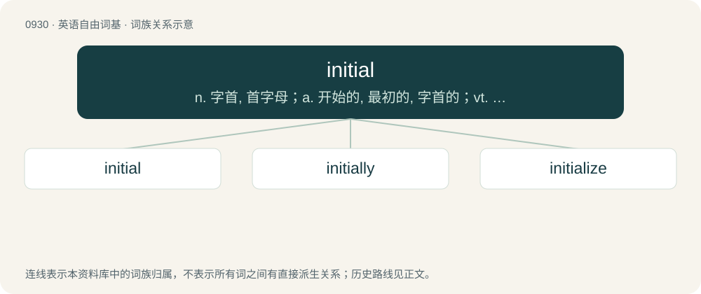

# 1007 · initial — n. 字首, 首字母；a. 开始的, 最初的, 字首的；vt. 用姓名的首字母签名

[总目录](../00_总目录_按常用程度.md)

**类型**：英语自由词基　｜　**来源语言**：见词源记录

## 核心含义与来源

- 核心含义：n. 字首, 首字母；a. 开始的, 最初的, 字首的；vt. 用姓名的首字母签名
- 英文含义：Chronologically first, early; of or pertaining to the beginning, cause or origin.
- 词形：initial

**来源记录 1**（形容词；Chronologically first, early; of or pertaining to the beginning, cause or origin.）

From Middle French initial or directly from its Latin etymon initiālis (“of the beginning, incipient, initial”), from initium (“a going in, entrance”), from inīre (“to go into, enter”), from in (“in”) + ire (“to go”).

## 词族图

## 单词速览（常用到不常用）

| 单词 | 音标 | 释义 |
|---|---|---|
| [initial](#w-1) | /ɪˈnɪʃ.əl/ | n. 字首, 首字母；a. 开始的, 最初的, 字首的；vt. 用姓名的首字母签名 |
| [initially](#w-2) | /ɪˈnɪʃəli/ | adv. 最初, 开头 |
| [initialize](#w-3) | /ɪˈnɪʃəlaɪz/ | vt. 预置；\[计\] 初始化 |

## 逐词详解

### 1. initial

**词性**：形容词　｜　**音标**：/ɪˈnɪʃ.əl/

**中文释义**：n. 字首, 首字母；a. 开始的, 最初的, 字首的；vt. 用姓名的首字母签名

**英文义项**：Chronologically first, early; of or pertaining to the beginning, cause or origin. / Spatially first, placed at the beginning, in the first position; especially said of the first letter of a word.

**词源与演化**：

From Middle French initial or directly from its Latin etymon initiālis (“of the beginning, incipient, initial”), from initium (“a going in, entrance”), from inīre (“to go into, enter”), from in (“in”) + ire (“to go”).

**例句**：

> Our initial admiration for their efficiency gave way to disgust about their methods.

该用例对应义项：Chronologically first, early; of or pertaining to the beginning, cause or origin.

### 2. initially

**词性**：副词　｜　**音标**：/ɪˈnɪʃəli/

**中文释义**：adv. 最初, 开头

**英文义项**：At the beginning. / Relating to initials.

**构词拆分**：initial + -ly

**词源与演化**：

From initial + -ly.

**例句**：

> Initially, I found city life incredibly difficult, but now I'm used to it.

该用例对应义项：At the beginning.

### 3. initialize

**词性**：动词　｜　**音标**：/ɪˈnɪʃəlaɪz/

**中文释义**：vt. 预置；\[计\] 初始化

**英文义项**：To assign initial values to something. / To assign an initial value to a variable.

**构词拆分**：initial + -ize

**词源与演化**：

From initial + -ize.

**例句**：

> Before you can use them, you first need to initialize the variables.
