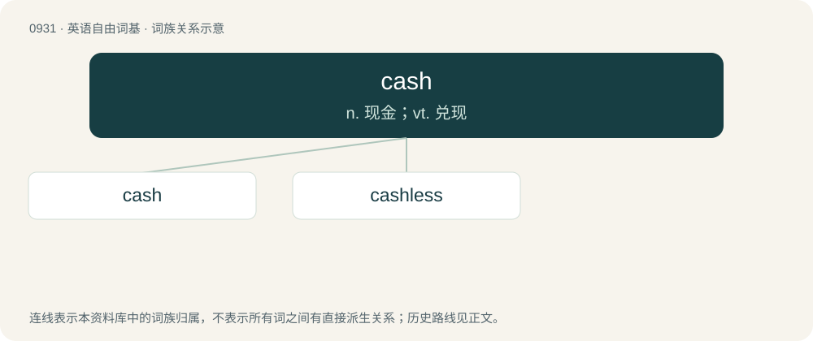

# 1008 · cash — n. 现金；vt. 兑现

[总目录](../00_总目录_按常用程度.md)

**类型**：英语自由词基　｜　**来源语言**：见词源记录

## 核心含义与来源

- 核心含义：n. 现金；vt. 兑现
- 英文含义：Money in the form of notes or bills and coins, as opposed to checks, credit or electronic transactions.
- 词形：cash

**多个词源／构词路径**：同一拼写可能有不同来源；以下按词性和含义分别列出。

**来源记录 1**（名词；Money in the form of notes or bills and coins, as opposed to checks, credit or electronic transactions.）

From late Middle French caisse (“money-box”), itself borrowed from Occitan caissa, from Latin capsa (“box”), ultimately from capiō (“take, seize”), from Proto-Indo-European \*kap- (“grasp”). Doublet of case, chase, and chasse. Compare Spanish caja (“box”).

**来源记录 2**（动词；To disband. To do away with, to kill.）

See cashier.

## 词族图

## 单词速览（常用到不常用）

| 单词 | 音标 | 释义 |
|---|---|---|
| [cash](#w-1) | 英 /ˈkæʃ/ | n. 现金；vt. 兑现 |
| [cashless](#w-2) | /ˈkæʃlis/ | a. 无现款的,无现金的,无钱的 |

## 逐词详解

### 1. cash

**词性**：名词　｜　**音标**：英 /ˈkæʃ/

**中文释义**：n. 现金；vt. 兑现

**英文义项**：Money in the form of notes or bills and coins, as opposed to checks, credit or electronic transactions. / Liquid assets, money that can be traded quickly, as distinct from assets that are invested and cannot be easily exchanged.

**词源与演化**：

From late Middle French caisse (“money-box”), itself borrowed from Occitan caissa, from Latin capsa (“box”), ultimately from capiō (“take, seize”), from Proto-Indo-European \*kap- (“grasp”). Doublet of case, chase, and chasse. Compare Spanish caja (“box”).

**例句**：

> How are you off for cash? After you bounced those checks last time, they want to be paid in cash.

该用例对应义项：Money in the form of notes or bills and coins, as opposed to checks, credit or electronic transactions.

### 2. cashless

**词性**：形容词　｜　**音标**：/ˈkæʃlis/

**中文释义**：a. 无现款的,无现金的,无钱的

**英文义项**：Operating without the need for cash, such as by accepting nondigital, noncash forms of payment (e.g., chit, cheques, money orders) or (in the 21st century, usually) using digital payment methods (e-payment). / Having no money.

**构词拆分**：cash + -less

**词源与演化**：

From cash + -less.

**用法示例／搭配（非完整句）**：

> cashless payment system

该用例对应义项：Operating without the need for cash, such as by accepting nondigital, noncash forms of payment (e.g., chit, cheques, money orders) or (in the 21st century, usually) using digital payment methods (e-payment).
