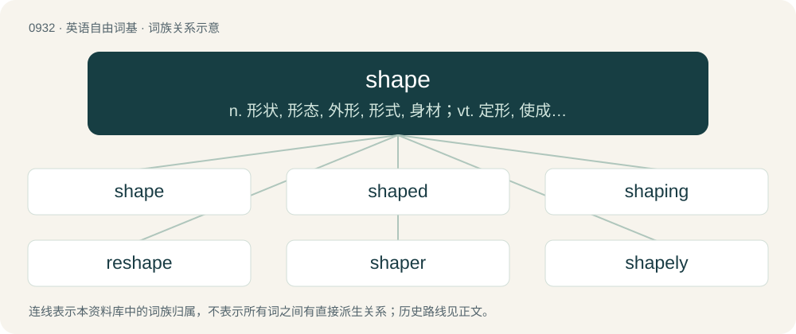

# 1009 · shape — n. 形状, 形态, 外形, 形式, 身材；vt. 定形, 使成形, 塑造, 计划, 使符合；vi. 成形, 形成, 成长

[总目录](../00_总目录_按常用程度.md)

**类型**：英语自由词基　｜　**来源语言**：见词源记录

## 核心含义与来源

- 核心含义：n. 形状, 形态, 外形, 形式, 身材；vt. 定形, 使成形, 塑造, 计划, 使符合；vi. 成形, 形成, 成长
- 英文含义：The status or condition of something
- 词形：shape

**来源记录 1**（名词；The status or condition of something）

From Middle English schap, schape, from Old English ġesceap (“shape, form, created being, creature, creation, dispensation, fate, condition, sex, gender, genitalia”), from Proto-West Germanic \*ga- + \*skap, from Proto-Germanic \*ga- + \*skapą (“shape, nature, condition”), possibly from Proto-Indo-European \*(s)kep- (“to split, cut”). The verb is from Middle English shapen, schapen, from Old English scieppan (“to shape, form, make, create, assign, arrange, destine, order, adjudge”), from Proto-West Germanic \*skappjan, from Proto-Germanic \*skapjaną (“to create”), from the noun. The noun is cognate with Middle Dutch schap (“form”), Middle High German geschaf (“creature”), Icelandic skap (“state, condition, temper, mood”). The verb is cognate with Dutch scheppen, German schaffen, Swedish skapa (“create, make”), Norwegian Bokmål skape (“create”). Doublet of -ship.

## 词族图

## 单词速览（常用到不常用）

| 单词 | 音标 | 释义 |
|---|---|---|
| [shape](#w-1) | /ˈʃeɪ̯p/ | n. 形状, 形态, 外形, 形式, 身材；vt. 定形, 使成形, 塑造, 计划, 使符合；vi. 成形, 形成, 成长 |
| [shaped](#w-2) | /ʃeɪpt/ | a. 成某种形状的, 制成一定形状的, 有某种形状的, 合适的, 计划好的, 有目标的；\[医\] 具形的, 形似的 |
| [shaping](#w-3) | /ˈʃeipiŋ/ | n. 成形, 塑造；a. 成形的, 塑造的；\[计\] 整形 |
| [reshape](#w-4) | 英 /ɹiːˈʃeɪ̯p/；美 /ɹiˈʃeɪ̯p/ | vt. 改造, 使成新的形状, 打开新局面；vt. 整形；vi. 整形 |
| [shaper](#w-5) | /ˈʃeɪpə(ɹ)/ | n. 成形机, 牛头刨床, 造型者, 塑造者；\[计\] 脉冲整形器 |
| [shapely](#w-6) | 美 /ˈʃeɪpli/ | a. 样子好的, 定形的, 形状美好的 |
| [shapeshifter](#w-7) | 英 /ˈʃeɪpʃɪftə/；美 /ˈʃeɪp.ʃɪf.tɚ/ | 【英文】A person or creature capable of changing their appearance or form at will. |
| [shapewear](#w-8) | /ʃeɪpˈwɜːr/ | 塑身内衣 |

## 逐词详解

### 1. shape

**词性**：名词　｜　**音标**：/ˈʃeɪ̯p/

**中文释义**：n. 形状, 形态, 外形, 形式, 身材；vt. 定形, 使成形, 塑造, 计划, 使符合；vi. 成形, 形成, 成长

**英文义项**：The status or condition of something / Condition of personal health, especially muscular health.

**词源与演化**：

From Middle English schap, schape, from Old English ġesceap (“shape, form, created being, creature, creation, dispensation, fate, condition, sex, gender, genitalia”), from Proto-West Germanic \*ga- + \*skap, from Proto-Germanic \*ga- + \*skapą (“shape, nature, condition”), possibly from Proto-Indo-European \*(s)kep- (“to split, cut”). The verb is from Middle English shapen, schapen, from Old English scieppan (“to shape, form, make, create, assign, arrange, destine, order, adjudge”), from Proto-West Germanic \*skappjan, from Proto-Germanic \*skapjaną (“to create”), from the noun. The noun is cognate with Middle Dutch schap (“form”), Middle High German geschaf (“creature”), Icelandic skap (“state, condition, temper, mood”). The verb is cognate with Dutch scheppen, German schaffen, Swedish skapa (“create, make”), Norwegian Bokmål skape (“create”). Doublet of -ship.

**例句**：

> The used bookshop wouldn’t offer much due to the poor shape of the book.

该用例对应义项：The status or condition of something

### 2. shaped

**词性**：形容词　｜　**音标**：/ʃeɪpt/

**中文释义**：a. 成某种形状的, 制成一定形状的, 有某种形状的, 合适的, 计划好的, 有目标的；\[医\] 具形的, 形似的

**英文义项**：Having been given a shape, especially a curved shape. / Having a particular shape (sharing the appearance of something in space, especially its outline – often a basic geometric two-dimensional figure).

**构词拆分**：shape + -ed

**词源与演化**：

From Middle English schaped, ischaped, equivalent to shape + -ed.

**例句**：

> The shaped sides of the wardrobe give it a more attractive appearance.

该用例对应义项：Having been given a shape, especially a curved shape.

### 3. shaping

**词性**：名词　｜　**音标**：/ˈʃeipiŋ/

**中文释义**：n. 成形, 塑造；a. 成形的, 塑造的；\[计\] 整形

**英文义项**：The action of the verb to shape. / A method of positive reinforcement of behaviour patterns in a series of steps in operant conditioning.

**构词拆分**：shape + -ing

**词源与演化**：

From Middle English schapynge, equivalent to shape + -ing.

**例句**：

> 2004 was shaping up to be the best year of Fadil's life.

### 4. reshape

**词性**：动词　｜　**音标**：英 /ɹiːˈʃeɪ̯p/；美 /ɹiˈʃeɪ̯p/

**中文释义**：vt. 改造, 使成新的形状, 打开新局面；vt. 整形；vi. 整形

**英文义项**：To make into a different shape. / To reorganize.

**构词拆分**：re- + shape

**词源与演化**：

From re- + shape.

**例句**：

> We do not want to discard the article but reshape it.

### 5. shaper

**词性**：名词　｜　**音标**：/ˈʃeɪpə(ɹ)/

**中文释义**：n. 成形机, 牛头刨床, 造型者, 塑造者；\[计\] 脉冲整形器

**英文义项**：Any agent that shapes (something), whether literally or figuratively. / A person who designs and builds surfboards.

**构词拆分**：shape + -er

**词源与演化**：

From Middle English schapere, alteration (perhaps due to Old Norse skaperi, skapari) of Old English sċyppend, sċieppend (“shaper; maker; creator”), equivalent to shape + -er. Cognate with Dutch schepper, German Schöpfer, Danish skaber, Swedish skapare, Icelandic skapari.

**用法示例／搭配（非完整句）**：

> one's birth is a shaper of one's fortunes

该用例对应义项：Any agent that shapes (something), whether literally or figuratively.

### 6. shapely

**词性**：形容词　｜　**音标**：美 /ˈʃeɪpli/

**中文释义**：a. 样子好的, 定形的, 形状美好的

**英文义项**：Having a pleasing shape, pleasant to look at.

**构词拆分**：shape + -ly

**词源与演化**：

From Middle English schaply, schappely (“well-shaped, beautiful, attractive”), perhaps from Old English \*ġesċeaplīċ (“according to design, proper, fit”) (suggested by Old English ġesċeaplīċe (“properly, fitting, well”)), equivalent to shape + -ly.

**例句**：

> A slim waist and shapely legs.

该用例对应义项：having a well-proportioned and pleasing shape

### 7. shapeshifter

**词性**：名词　｜　**音标**：英 /ˈʃeɪpʃɪftə/；美 /ˈʃeɪp.ʃɪf.tɚ/

**英文义项**：A person or creature capable of changing their appearance or form at will. / A person who is inconsistent and elusive.

**构词拆分**：shape + shifter

**词源与演化**：

From shape + shifter.

**例句**：

> One day, Mary revealed to Tom that she was an extraterrestrial shapeshifter who had come to Earth several hundred years ago to study humanity.

### 8. shapewear

**词性**：名词　｜　**音标**：/ʃeɪpˈwɜːr/

**中文释义**：塑身内衣

**英文义项**：Foundation garments, designed to hold a part of the body in a particular form.

**构词拆分**：shape + -wear

**词源与演化**：

From shape + -wear.
