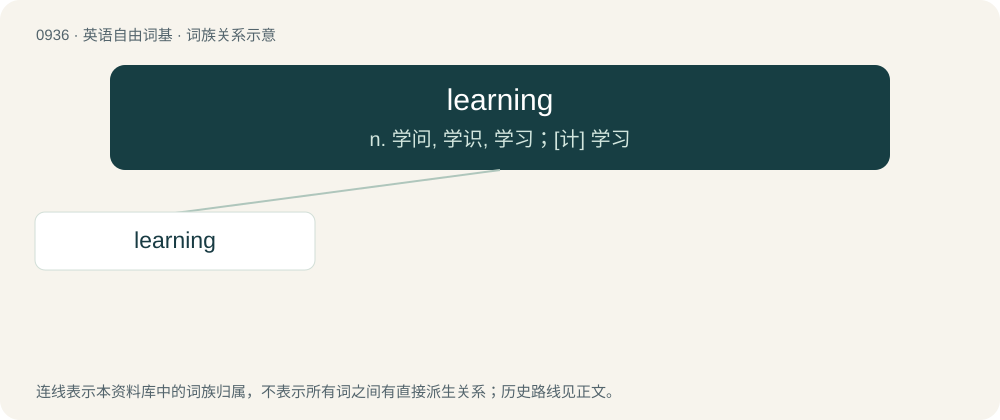

# 1011 · learning — n. 学问, 学识, 学习；\[计\] 学习

[总目录](../00_总目录_按常用程度.md)

**类型**：英语自由词基　｜　**来源语言**：见词源记录

## 核心含义与来源

- 核心含义：n. 学问, 学识, 学习；\[计\] 学习
- 英文含义：An act in which something is learned.
- 词形：learning

**来源记录 1**（名词；An act in which something is learned.）

From Middle English lernyng, lernynge, from Old English leornung (“learning, study”), from Proto-West Germanic \*liʀnungu (“learning”), equivalent to learn + -ing. Cognate with Old Saxon lernunga, German Lernung.

## 词族图

## 单词速览（常用到不常用）

| 单词 | 音标 | 释义 |
|---|---|---|
| [learning](#w-1) | 英 /ˈlɜːnɪŋ/；美 /ˈlɝnɪŋ/ | n. 学问, 学识, 学习；\[计\] 学习 |

## 逐词详解

### 1. learning

**词性**：名词　｜　**音标**：英 /ˈlɜːnɪŋ/；美 /ˈlɝnɪŋ/

**中文释义**：n. 学问, 学识, 学习；\[计\] 学习

**英文义项**：An act in which something is learned. / Accumulated knowledge.

**构词拆分**：learn + -ing

**词源与演化**：

From Middle English lernyng, lernynge, from Old English leornung (“learning, study”), from Proto-West Germanic \*liʀnungu (“learning”), equivalent to learn + -ing. Cognate with Old Saxon lernunga, German Lernung.

**例句**：

> The department head was also a scholar of great learning.

该用例对应义项：Accumulated knowledge.
