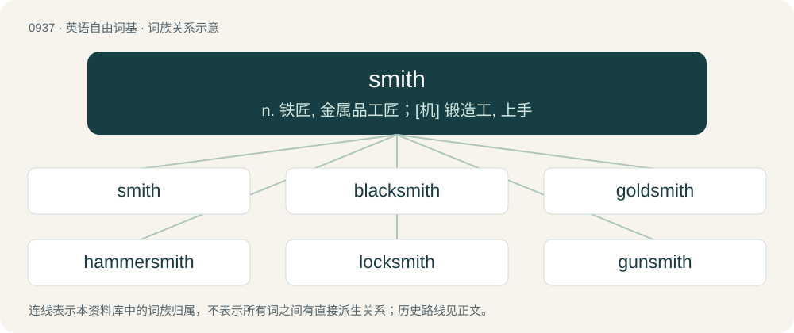

# 1013 · smith — n. 铁匠, 金属品工匠；\[机\] 锻造工, 上手

[总目录](../00_总目录_按常用程度.md)

**类型**：英语自由词基　｜　**来源语言**：见词源记录

## 核心含义与来源

- 核心含义：n. 铁匠, 金属品工匠；\[机\] 锻造工, 上手
- 英文含义：A craftsperson who works metal into desired forms using a hammer and other tools, sometimes heating the metal to make it more workable, especially a blacksmith.
- 词形：smith

**多个词源／构词路径**：同一拼写可能有不同来源；以下按词性和含义分别列出。

**来源记录 1**（名词；A craftsperson who works metal into desired forms using a hammer and other tools, sometimes heating the metal to make it more workable, especially a blacksmith.）

From Middle English smeth, smith, smiþ, smið, smyth, smythe, smyþ, smyþe, from Old English smiþ, from Proto-West Germanic \*smiþ, from Proto-Germanic \*smiþaz (“smith”), possibly from Proto-Indo-European \*smey- (“to smear, spread”). Cognates Cognate with Alemannic German Schmid, schméd, schmét, schmìd (“smith”), Bavarian schmidt, schmit, sghmiid (“smith”), Cimbrian smit, smitt (“smith”), Dutch smid (“smith”), German Schmied, Schmidt (“smith”), Low German Smidd, Smitt (“smith”), Luxembourgish Schmadd (“smith”), Mòcheno schmi' (“smith”), Vilamovian śmejt (“blacksmith”), Yiddish שמיד (shmid, “blacksmith, smith”), Danish, Norwegian Bokmål, Norwegian Nynorsk, and Swedish smed (“smith”), Elfdalian smið (“smith”), Faroese and Icelandic smiður (“smith”), Gothic \*𐍃𐌼𐌹𐌸𐌰 (\*smiþa, “smith”) (whence 𐌰𐌹𐌶𐌰𐍃𐌼𐌹𐌸𐌰 (aizasmiþa, “coppersmith”)); also Greek σμίλη (smíli, “chisel”).

**来源记录 2**（动词；To forge, to form, usually on an anvil; by heating and pounding.）

From Middle English smythen (“to work metal, forge, beat into, torment, refine (of God - to refine his chosen); to create, work as a blacksmith”), from Old English smiþian (“to forge, fabricate”), from Proto-West Germanic \*smiþōn, from Proto-Germanic \*smiþōną. Compare Dutch smeden, German schmieden.

## 词族图

## 单词速览（常用到不常用）

| 单词 | 音标 | 释义 |
|---|---|---|
| [smith](#w-1) | /smɪθ/ | n. 铁匠, 金属品工匠；\[机\] 锻造工, 上手 |
| [blacksmith](#w-2) | /ˈblæk.smɪθ/ | n. 铁匠；\[机\] 铁匠 |
| [goldsmith](#w-3) | 美 /ˈɡoʊldˌsmɪθ/ | n. 金匠 |
| [hammersmith](#w-4) | /ˈhæməsmiθ/ | n. 锻工 |
| [locksmith](#w-5) | 英 /ˈlɒksmɪθ/；美 /ˈlɑksmɪθ/ | n. 锁匠 |
| [gunsmith](#w-6) | 美 /ˈɡʌnˌsmɪθ/ | n. 枪炮工 |
| [wordsmith](#w-7) | 英 /ˈwɜːdsmɪθ/；美 /ˈwɝdˌsmɪθ/ | n. 擅长文字的人, 舞文弄墨者；作家 |
| [silversmith](#w-8) | /ˈsɪlvəsmɪθ/ | n. 银(器)匠 |
| [arrowsmith](#w-9) |  | 【英文】A smith who made the iron tips for arrows. |

## 逐词详解

### 1. smith

**词性**：名词　｜　**音标**：/smɪθ/

**中文释义**：n. 铁匠, 金属品工匠；\[机\] 锻造工, 上手

**英文义项**：A craftsperson who works metal into desired forms using a hammer and other tools, sometimes heating the metal to make it more workable, especially a blacksmith. / One who makes anything; wright.

**词源与演化**：

From Middle English smeth, smith, smiþ, smið, smyth, smythe, smyþ, smyþe, from Old English smiþ, from Proto-West Germanic \*smiþ, from Proto-Germanic \*smiþaz (“smith”), possibly from Proto-Indo-European \*smey- (“to smear, spread”). Cognates Cognate with Alemannic German Schmid, schméd, schmét, schmìd (“smith”), Bavarian schmidt, schmit, sghmiid (“smith”), Cimbrian smit, smitt (“smith”), Dutch smid (“smith”), German Schmied, Schmidt (“smith”), Low German Smidd, Smitt (“smith”), Luxembourgish Schmadd (“smith”), Mòcheno schmi' (“smith”), Vilamovian śmejt (“blacksmith”), Yiddish שמיד (shmid, “blacksmith, smith”), Danish, Norwegian Bokmål, Norwegian Nynorsk, and Swedish smed (“smith”), Elfdalian smið (“smith”), Faroese and Icelandic smiður (“smith”), Gothic \*𐍃𐌼𐌹𐌸𐌰 (\*smiþa, “smith”) (whence 𐌰𐌹𐌶𐌰𐍃𐌼𐌹𐌸𐌰 (aizasmiþa, “coppersmith”)); also Greek σμίλη (smíli, “chisel”).

**例句**：

> Smith argues that no international laws can be applied to this case.

### 2. blacksmith

**词性**：名词　｜　**音标**：/ˈblæk.smɪθ/

**中文释义**：n. 铁匠；\[机\] 铁匠

**英文义项**：A person who forges iron. / A person who shoes horses.

**构词拆分**：black (color of forged iron) + smith (related to smite)

**词源与演化**：

From black (color of forged iron) + smith (related to smite).

**例句**：

> In the past, there used to be a blacksmith in our village.

### 3. goldsmith

**词性**：名词　｜　**音标**：美 /ˈɡoʊldˌsmɪθ/

**中文释义**：n. 金匠

**英文义项**：A person who makes, repairs or sells things of gold, especially jewelry.

**构词拆分**：gold + smith

**词源与演化**：

From Middle English goldsmith, from Old English goldsmiþ (“goldsmith”), from Proto-Germanic \*gulþasmiþaz (“goldsmith”), equivalent to gold + smith. Cognate with Scots goldsmyth, gouldsmeth (“goldsmith”), Saterland Frisian Gouldsmid (“goldsmith”), West Frisian goudsmid (“goldsmith”), Dutch goudsmid (“goldsmith”), German Goldschmied (“goldsmith”), Danish guldsmed (“goldsmith”), Swedish guldsmed (“goldsmith”), Icelandic gullsmiður (“goldsmith”). Eclipsed non-native Middle English orbatour, orbatur (“goldsmith”) and orfever, orfevre (“goldsmith”), both borrowed from Old French.

**例句**：

> The Queen's goldsmith spent years working on the jewelled coffin.

### 4. hammersmith

**词性**：名词　｜　**音标**：/ˈhæməsmiθ/

**中文释义**：n. 锻工

**英文义项**：A maker of hammers.

**构词拆分**：hammer + smith

**词源与演化**：

From hammer + smith.

### 5. locksmith

**词性**：名词　｜　**音标**：英 /ˈlɒksmɪθ/；美 /ˈlɑksmɪθ/

**中文释义**：n. 锁匠

**英文义项**：One who practices locksmithing. / Someone who only bets when they are sure they will win.

**构词拆分**：lock + smith

**词源与演化**：

From Middle English loksmith; equivalent to lock + smith.

**例句**：

> How much would it cost to get a locksmith to unlock my car?

### 6. gunsmith

**词性**：名词　｜　**音标**：美 /ˈɡʌnˌsmɪθ/

**中文释义**：n. 枪炮工

**英文义项**：A manufacturer of guns. / A person skilled in the repair and servicing of firearms.

**构词拆分**：gun + smith

**词源与演化**：

From gun + smith.

### 7. wordsmith

**词性**：名词　｜　**音标**：英 /ˈwɜːdsmɪθ/；美 /ˈwɝdˌsmɪθ/

**中文释义**：n. 擅长文字的人, 舞文弄墨者；作家

**英文义项**：One who uses words skilfully.

**构词拆分**：word + smith (“craftsperson who works metal into desired forms; (by extension) one who makes anything”)

**词源与演化**：

The noun is derived from word + smith (“craftsperson who works metal into desired forms; (by extension) one who makes anything”). The verb is derived from the noun.

**例句**：

> She has always been known as a capable wordsmith, but in this latest novel she also shows surprising emotional depth.

该用例对应义项：One who uses words skilfully.

### 8. silversmith

**词性**：名词　｜　**音标**：/ˈsɪlvəsmɪθ/

**中文释义**：n. 银(器)匠

**英文义项**：A person who makes articles out of silver usually larger than jewellery.

**构词拆分**：silver + smith

**词源与演化**：

Inherited from Middle English silver smyth, from Old English seolforsmiþ (“silversmith”), from Proto-Germanic \*silubrasmiþaz (“silversmith”), equivalent to silver + smith. Cognate with Saterland Frisian Säälwersmid (“silversmith”), West Frisian sulversmid (“silversmith”), Dutch zilversmid (“silversmith”), German Low German Sülversmitt (“silversmith”), German Silberschmied (“silversmith”), Danish sølvsmed (“silversmith”), Norwegian Bokmål sølvsmed (“silversmith”), Norwegian Nynorsk sølvsmed (“silversmith”), sylvsmed (“silversmith”), Swedish silversmed (“silversmith”), Icelandic silfursmiður (“silversmith”). Eclipsed non-native Middle English argentarie (“silversmith”) from Latin (faber) argentārius (“dealer in silver, silversmith”).

### 9. arrowsmith

**词性**：名词

**英文义项**：A smith who made the iron tips for arrows.

**构词拆分**：arrow + smith

**词源与演化**：

From arrow + smith.
