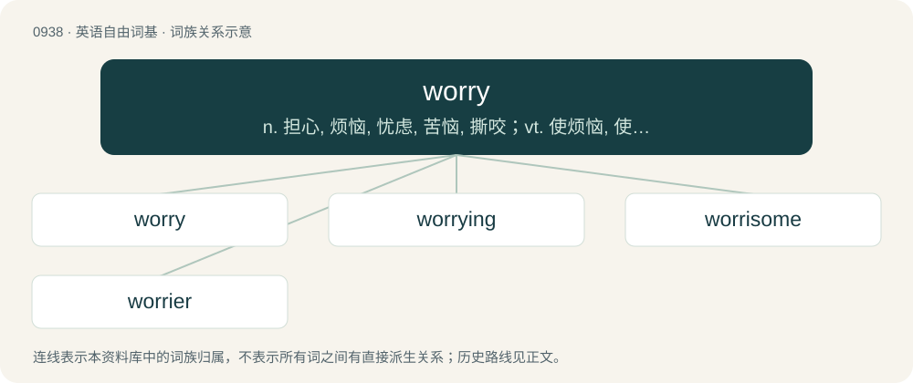

# 1014 · worry — n. 担心, 烦恼, 忧虑, 苦恼, 撕咬；vt. 使烦恼, 使焦虑, 使苦恼, 困扰, 折磨, 撕咬；vi. 烦恼, 担心, 撕咬

[总目录](../00_总目录_按常用程度.md)

**类型**：英语自由词基　｜　**来源语言**：见词源记录

## 核心含义与来源

- 核心含义：n. 担心, 烦恼, 忧虑, 苦恼, 撕咬；vt. 使烦恼, 使焦虑, 使苦恼, 困扰, 折磨, 撕咬；vi. 烦恼, 担心, 撕咬
- 英文含义：To be troubled; to give way to mental anxiety or doubt.
- 词形：worry

**来源记录 1**（动词；To be troubled; to give way to mental anxiety or doubt.）

From Middle English worien (“to choke, strangle”), from Old English wyrġan, from Proto-West Germanic \*wurgijan, from Proto-Germanic \*wurgijaną, from Proto-Indo-European \*werǵʰ- (“bind, squeeze”). Cognate with Dutch worgen, wurgen, German würgen. Compare Latin urgere (“to press, push”), Sanskrit वृहति (vṛhati, “to tear out, pluck”), Lithuanian ver̃žti (“to string; squeeze”), Russian (poetic) отверза́ть (otverzátʹ, “to open”, literally “to untie”). Related to wring.

## 词族图

## 单词速览（常用到不常用）

| 单词 | 音标 | 释义 |
|---|---|---|
| [worry](#w-1) | 英 /ˈwʌ.ɹi/；/ˈwɝ.i/ | n. 担心, 烦恼, 忧虑, 苦恼, 撕咬；vt. 使烦恼, 使焦虑, 使苦恼, 困扰, 折磨, 撕咬；vi. 烦恼, 担心, 撕咬 |
| [worrying](#w-2) | 英 /ˈwʌɹi.ɪŋ/；/ˈwʌɹi.ɪŋ/ | a. 使人烦恼的, 忧虑重重的 |
| [worrisome](#w-3) | 英 /ˈwʌɹisəm/；美 /ˈwʌɹisəm/ | a. 令人烦恼的, 麻烦的, 劳碌命的 |
| [worrier](#w-4) | /ˈwʌriə/ | n. 担心的人, 发愁的人 |

## 逐词详解

### 1. worry

**词性**：动词　｜　**音标**：英 /ˈwʌ.ɹi/；/ˈwɝ.i/

**中文释义**：n. 担心, 烦恼, 忧虑, 苦恼, 撕咬；vt. 使烦恼, 使焦虑, 使苦恼, 困扰, 折磨, 撕咬；vi. 烦恼, 担心, 撕咬

**英文义项**：To be troubled; to give way to mental anxiety or doubt. / Disturb the peace of mind of; afflict with mental agitation or distress; to exercise.

**词源与演化**：

From Middle English worien (“to choke, strangle”), from Old English wyrġan, from Proto-West Germanic \*wurgijan, from Proto-Germanic \*wurgijaną, from Proto-Indo-European \*werǵʰ- (“bind, squeeze”). Cognate with Dutch worgen, wurgen, German würgen. Compare Latin urgere (“to press, push”), Sanskrit वृहति (vṛhati, “to tear out, pluck”), Lithuanian ver̃žti (“to string; squeeze”), Russian (poetic) отверза́ть (otverzátʹ, “to open”, literally “to untie”). Related to wring.

**例句**：

> Your dog’s been worrying sheep again.

该用例对应义项：To seize or shake by the throat, especially of a dog or wolf.

### 2. worrying

**词性**：形容词　｜　**音标**：英 /ˈwʌɹi.ɪŋ/；/ˈwʌɹi.ɪŋ/

**中文释义**：a. 使人烦恼的, 忧虑重重的

**英文义项**：Inducing worry.

**构词拆分**：From worry + -ing.

**词源与演化**：

From worry + -ing.

**例句**：

> There is no sense in your worrying about your health so much.

### 3. worrisome

**词性**：形容词　｜　**音标**：英 /ˈwʌɹisəm/；美 /ˈwʌɹisəm/

**中文释义**：a. 令人烦恼的, 麻烦的, 劳碌命的

**英文义项**：Causing worry; perturbing or vexing. / Inclined to worry.

**构词拆分**：worry + -some

**词源与演化**：

From worry + -some.

**例句**：

> In a particularly worrisome predicament.

该用例对应义项：causing distress or worry or anxiety

### 4. worrier

**词性**：名词　｜　**音标**：/ˈwʌriə/

**中文释义**：n. 担心的人, 发愁的人

**英文义项**：A person who worries a great deal, especially unnecessarily. / A person who causes worry in others.

**构词拆分**：From worry + -er.

**词源与演化**：

From worry + -er.

**例句**：

> Tom is not a warrior. He is a worrier.
