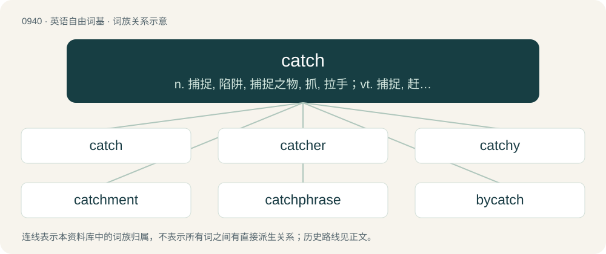

# 1015 · catch — n. 捕捉, 陷阱, 捕捉之物, 抓, 拉手；vt. 捕捉, 赶上, 感染, 听清楚；vi. 抓住, 燃着

[总目录](../00_总目录_按常用程度.md)

**类型**：英语自由词基　｜　**来源语言**：见词源记录

## 核心含义与来源

- 核心含义：n. 捕捉, 陷阱, 捕捉之物, 抓, 拉手；vt. 捕捉, 赶上, 感染, 听清楚；vi. 抓住, 燃着
- 英文含义：The act of seizing or capturing.
- 词形：catch

**来源记录 1**（名词；The act of seizing or capturing.）

From Middle English cacchen, from Anglo-Norman cachier, variant of Old French chacier, from Late Latin captiāre, from Latin captāre, frequentative of capere. Akin to Modern French chasser (from Old French chacier) and Spanish cazar, and thus a doublet of chase. Compare ketch. Via PIE cognate with have. Displaced Middle English fangen ("to catch"; &gt; Modern English fang (verb)), from Old English fōn (“to seize, take”); Middle English lacchen ("to catch" and heavily displaced Modern English latch), from Old English læċċan. The verb became irregular, possibly under the influence of the semantically similar latch (from Old English læċċan), whose past tense was lahte, lauhte, laught (Old English læhte), until becoming regularised in Modern English.

## 词族图

## 单词速览（常用到不常用）

| 单词 | 音标 | 释义 |
|---|---|---|
| [catch](#w-1) | 英 /kæt͡ʃ/；美 /kæt͡ʃ/ | n. 捕捉, 陷阱, 捕捉之物, 抓, 拉手；vt. 捕捉, 赶上, 感染, 听清楚；vi. 抓住, 燃着 |
| [catcher](#w-2) | 英 /ˈkæt͡ʃə/；美 /ˈkæt͡ʃəɹ/ | n. 捕手, 捕捉器；\[化\] 受器; 接受器 |
| [catchy](#w-3) | /ˈkæt͡ʃi/ | a. 易记住的, 欺骗性的, 不规则发生的 |
| [catchment](#w-4) | 英 /ˈkatʃmənt/；美 /ˈkɛt͡ʃmənt/ | n. 排水区, 集水, 流域 |
| [catchphrase](#w-5) | /ˈkætʃfreiz/ | n. 吸引人们注意的话/字句 |
| [bycatch](#w-6) |  | 误捕的鱼（捕捞其他种类的鱼时意外捕获） |

## 逐词详解

### 1. catch

**词性**：名词　｜　**音标**：英 /kæt͡ʃ/；美 /kæt͡ʃ/

**中文释义**：n. 捕捉, 陷阱, 捕捉之物, 抓, 拉手；vt. 捕捉, 赶上, 感染, 听清楚；vi. 抓住, 燃着

**英文义项**：The act of seizing or capturing. / The act of catching an object in motion, especially a ball.

**词源与演化**：

From Middle English cacchen, from Anglo-Norman cachier, variant of Old French chacier, from Late Latin captiāre, from Latin captāre, frequentative of capere. Akin to Modern French chasser (from Old French chacier) and Spanish cazar, and thus a doublet of chase. Compare ketch. Via PIE cognate with have. Displaced Middle English fangen ("to catch"; &gt; Modern English fang (verb)), from Old English fōn (“to seize, take”); Middle English lacchen ("to catch" and heavily displaced Modern English latch), from Old English læċċan. The verb became irregular, possibly under the influence of the semantically similar latch (from Old English læċċan), whose past tense was lahte, lauhte, laught (Old English læhte), until becoming regularised in Modern English.

**例句**：

> The catch of the perpetrator was the product of a year of police work.

该用例对应义项：The act of seizing or capturing.

### 2. catcher

**词性**：名词　｜　**音标**：英 /ˈkæt͡ʃə/；美 /ˈkæt͡ʃəɹ/

**中文释义**：n. 捕手, 捕捉器；\[化\] 受器; 接受器

**英文义项**：Someone or something that catches. / The player who squats behind home plate and receives the pitches from the pitcher.

**构词拆分**：catch + -er

**词源与演化**：

From catch + -er.

**例句**：

> A catcher needs a lot of protective equipment.

该用例对应义项：the position on a baseball team of the player who is stationed behind home plate and who catches the balls that the pitcher throws

### 3. catchy

**词性**：形容词　｜　**音标**：/ˈkæt͡ʃi/

**中文释义**：a. 易记住的, 欺骗性的, 不规则发生的

**英文义项**：Instantly appealing and memorable. / Tending to catch or ensnare; entangling.

**构词拆分**：catch + -y

**词源与演化**：

From catch + -y.

**例句**：

> Eric wrote a catchy tune to play on his acoustic guitar while Alyssa plays the drums.

该用例对应义项：Instantly appealing and memorable.

### 4. catchment

**词性**：名词　｜　**音标**：英 /ˈkatʃmənt/；美 /ˈkɛt͡ʃmənt/

**中文释义**：n. 排水区, 集水, 流域

**英文义项**：Any structure or land feature which catches and holds water; the collection of such water. / A catchment area, or the people it serves.

**构词拆分**：catch + -ment

**词源与演化**：

From catch + -ment.

**例句**：

> The hospital's catchment area is the hospital's city plus the 3 adjacent towns.

### 5. catchphrase

**词性**：名词　｜　**音标**：/ˈkætʃfreiz/

**中文释义**：n. 吸引人们注意的话/字句

**英文义项**：A repeated expression, often originating in popular culture. / A signature phrase of a particular person or group.

**构词拆分**：catch + phrase

**词源与演化**：

From catch + phrase, from the notion that the phrase will catch in the mind of the user.

**例句**：

> You don't even have a catchphrase.

### 6. bycatch

**词性**：名词

**中文释义**：误捕的鱼（捕捞其他种类的鱼时意外捕获）

**英文义项**：Any fish (or other creatures) that are not targeted as a catch but are unintentionally caught, and often discarded back into the sea. / Any person, animal, or thing, captured unintentionally on camera or film.

**构词拆分**：by- + catch

**词源与演化**：

From by- + catch.

**例句**：

> Trawling causes a devastating waste of life in the form of bycatch.
