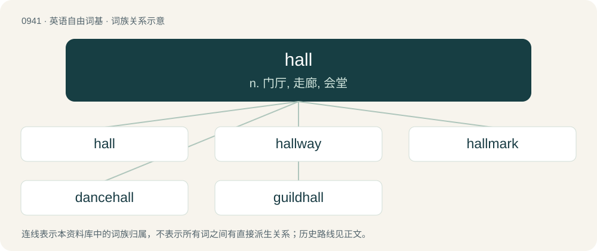

# 1016 · hall — n. 门厅, 走廊, 会堂

[总目录](../00_总目录_按常用程度.md)

**类型**：英语自由词基　｜　**来源语言**：见词源记录

## 核心含义与来源

- 核心含义：n. 门厅, 走廊, 会堂
- 英文含义：A corridor; a hallway.
- 词形：hall

**来源记录 1**（名词；A corridor; a hallway.）

Inherited from Middle English halle (“hall”), from Old English heall (“hall, dwelling, house, palace, temple, law-court”), from Proto-West Germanic \*hallu (“hall”), from Proto-Germanic \*hallō (“hall”), from Proto-Indo-European \*ḱel- (“to hide, conceal”). Cognate with Scots hall, haw (“hall”), Dutch hal (“hall”), German Halle (“hall”), Danish hal (“hall, sports centre”), Faroese høll (“hall, palace”), Icelandic höll (“palace”), Norwegian hall (“hall”), Swedish hall (“hall”), Latin cella (“room, cell”), Sanskrit शाला (śā́lā, “house, mansion, hall”). Doublet of cell and cella.

## 词族图

## 单词速览（常用到不常用）

| 单词 | 音标 | 释义 |
|---|---|---|
| [hall](#w-1) | 英 /hɔːl/；/hɔl/ | n. 门厅, 走廊, 会堂 |
| [hallway](#w-2) | 英 /ˈhɔːlweɪ/；美 /ˈhɔlˌweɪ/ | n. 门厅；玄关；走廊 |
| [hallmark](#w-3) | 英 /ˈhɔːlmɑːk/；美 /ˈhɔlmɑɹk/ | n. 纯度检验证明, 品质证明；vt. 加盖纯度检验证明 |
| [dancehall](#w-4) | /ˈdɑːnsˌhɔːl/ | 【英文】A public hall for dancing. |
| [guildhall](#w-5) | /ˈ^ild,hɔːl/ | \[法\] 同业工会会所 |

## 逐词详解

### 1. hall

**词性**：名词　｜　**音标**：英 /hɔːl/；/hɔl/

**中文释义**：n. 门厅, 走廊, 会堂

**英文义项**：A corridor; a hallway. / A large meeting room.

**词源与演化**：

Inherited from Middle English halle (“hall”), from Old English heall (“hall, dwelling, house, palace, temple, law-court”), from Proto-West Germanic \*hallu (“hall”), from Proto-Germanic \*hallō (“hall”), from Proto-Indo-European \*ḱel- (“to hide, conceal”). Cognate with Scots hall, haw (“hall”), Dutch hal (“hall”), German Halle (“hall”), Danish hal (“hall, sports centre”), Faroese høll (“hall, palace”), Icelandic höll (“palace”), Norwegian hall (“hall”), Swedish hall (“hall”), Latin cella (“room, cell”), Sanskrit शाला (śā́lā, “house, mansion, hall”). Doublet of cell and cella.

**例句**：

> The hotel had three halls for conferences, and two were in use by the convention.

该用例对应义项：A large meeting room.

### 2. hallway

**词性**：名词　｜　**音标**：英 /ˈhɔːlweɪ/；美 /ˈhɔlˌweɪ/

**中文释义**：n. 门厅；玄关；走廊

**英文义项**：A corridor in a building that connects rooms.

**构词拆分**：hall + way

**词源与演化**：

From hall + way.

**例句**：

> I have to pee, but your friends are completely crowding the hallway.

### 3. hallmark

**词性**：名词　｜　**音标**：英 /ˈhɔːlmɑːk/；美 /ˈhɔlmɑɹk/

**中文释义**：n. 纯度检验证明, 品质证明；vt. 加盖纯度检验证明

**英文义项**：A distinguishing characteristic. / An official marking made by a trusted party, usually an assay office, on items made of precious metals.

**构词拆分**：hall + mark

**词源与演化**：

1721. From hall + mark, from Goldsmiths' Hall in London, the site of the assay office, official stamp of purity in gold and silver articles. The general sense of “mark of quality” first recorded 1864. Use as a verb from 1773.

**例句**：

> A certain hallmark of wisdom is the cheerful benevolence it confers.

### 4. dancehall

**词性**：名词　｜　**音标**：/ˈdɑːnsˌhɔːl/

**英文义项**：A public hall for dancing. / A genre of Jamaican dance music derived from dub and reggae.

**构词拆分**：dance + hall

**词源与演化**：

From dance + hall.

### 5. guildhall

**词性**：名词　｜　**音标**：/ˈ^ild,hɔːl/

**中文释义**：\[法\] 同业工会会所

**英文义项**：A hall where a guild or corporation usually assembles.

**构词拆分**：guild + hall

**词源与演化**：

From guild + hall.

**例句**：

> At exactly quarter to ten, she got off the tram at the stop next to the guildhall.
