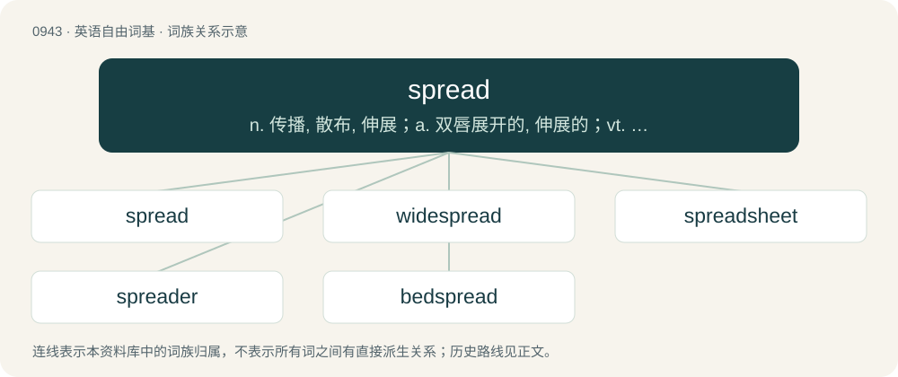

# 1017 · spread — n. 传播, 散布, 伸展；a. 双唇展开的, 伸展的；vt. 展开, 铺开, 传播, 推广, 伸出, 涂, 敷, 延伸

[总目录](../00_总目录_按常用程度.md)

**类型**：英语自由词基　｜　**来源语言**：见词源记录

## 核心含义与来源

- 核心含义：n. 传播, 散布, 伸展；a. 双唇展开的, 伸展的；vt. 展开, 铺开, 传播, 推广, 伸出, 涂, 敷, 延伸
- 英文含义：To stretch out, open out (a material etc.) so that it more fully covers a given area of space.
- 词形：spread

**多个词源／构词路径**：同一拼写可能有不同来源；以下按词性和含义分别列出。

**来源记录 1**（动词；To stretch out, open out (a material etc.) so that it more fully covers a given area of space.）

From Middle English spreden, from Old English sprǣdan (“to spread, expand”), from Proto-Germanic \*spraidijaną (“to spread”), from Proto-Indo-European \*(s)per- (“to strew, sow, sprinkle”). Cognate with Saterland Frisian spreede (“to spread”), West Frisian spriede (“to spread”), North Frisian spriedjen (“to spread”), Dutch spreiden (“to spread”), Low German spreden (“to spread”), German spreiten (“to spread, spread out”), Danish sprede (“to spread”), Norwegian spre, spreie (“to spread, disseminate”), Swedish sprida (“to spread”), Latin spernō, spargō, Ancient Greek σπείρω (speírō), Persian سپردن (sepordan, “to deposit”). Doublet of spurn.

**来源记录 2**（动词；To speedread; to recite one's arguments at an extremely fast pace.）

Blend of speed + read.

## 词族图

## 单词速览（常用到不常用）

| 单词 | 音标 | 释义 |
|---|---|---|
| [spread](#w-1) | /spɹɛd/ | n. 传播, 散布, 伸展；a. 双唇展开的, 伸展的；vt. 展开, 铺开, 传播, 推广, 伸出, 涂, 敷, 延伸 |
| [widespread](#w-2) | /ˌwaɪdˈspɹɛd/ | a. 充分伸展的, 广布的, 普及的, 流传广的 |
| [spreadsheet](#w-3) | 英 /ˈspɹɛd.ʃiːt/；美 /ˈspɹɛd.ʃit/ | n. 空白表格程序, 电子制表软件, 电子数据表；\[计\] 电子表格 |
| [spreader](#w-4) | 美 /ˈspɹɛdɚ/ | n. 散布者, 传播者, 涂黄油用的小刀, 撒布机, 分纱器, 分经筘；\[化\] 刮胶机; 分流梭; 分布器; 涂胶机; 涂布机; 涂铺器; 扩张器; 沥青喷洒车 |
| [bedspread](#w-5) | 美 /ˈbɛd.spɹɛd/ | n. 床单, 床罩 |

## 逐词详解

### 1. spread

**词性**：动词　｜　**音标**：/spɹɛd/

**中文释义**：n. 传播, 散布, 伸展；a. 双唇展开的, 伸展的；vt. 展开, 铺开, 传播, 推广, 伸出, 涂, 敷, 延伸

**英文义项**：To stretch out, open out (a material etc.) so that it more fully covers a given area of space. / To extend (individual rays, limbs etc.); to stretch out in varying or opposing directions. simple past and past participle of spread

**词源与演化**：

From Middle English spreden, from Old English sprǣdan (“to spread, expand”), from Proto-Germanic \*spraidijaną (“to spread”), from Proto-Indo-European \*(s)per- (“to strew, sow, sprinkle”). Cognate with Saterland Frisian spreede (“to spread”), West Frisian spriede (“to spread”), North Frisian spriedjen (“to spread”), Dutch spreiden (“to spread”), Low German spreden (“to spread”), German spreiten (“to spread, spread out”), Danish sprede (“to spread”), Norwegian spre, spreie (“to spread, disseminate”), Swedish sprida (“to spread”), Latin spernō, spargō, Ancient Greek σπείρω (speírō), Persian سپردن (sepordan, “to deposit”). Doublet of spurn.

**例句**：

> The missionaries quickly spread their new message across the country.

该用例对应义项：To disseminate; to cause to proliferate, to make (something) widely known or present.

### 2. widespread

**词性**：形容词　｜　**音标**：/ˌwaɪdˈspɹɛd/

**中文释义**：a. 充分伸展的, 广布的, 普及的, 流传广的

**英文义项**：Affecting, or found throughout, a large area (e.g. the entire land or body); broad in extent; widely diffused. / Spread far apart.

**构词拆分**：wide + spread

**词源与演化**：

From wide + spread.

**例句**：

> There was widespread support for the proposal.

该用例对应义项：Affecting, or found throughout, a large area (e.g. the entire land or body); broad in extent; widely diffused.

### 3. spreadsheet

**词性**：名词　｜　**音标**：英 /ˈspɹɛd.ʃiːt/；美 /ˈspɹɛd.ʃit/

**中文释义**：n. 空白表格程序, 电子制表软件, 电子数据表；\[计\] 电子表格

**英文义项**：A computer application for organization, analysis, and storage of data in tabular form. / A document created with such an application.

**构词拆分**：spread + sheet

**词源与演化**：

From spread + sheet.

**例句**：

> Once you get the hang of it, spreadsheet software is really useful.

### 4. spreader

**词性**：名词　｜　**音标**：美 /ˈspɹɛdɚ/

**中文释义**：n. 散布者, 传播者, 涂黄油用的小刀, 撒布机, 分纱器, 分经筘；\[化\] 刮胶机; 分流梭; 分布器; 涂胶机; 涂布机; 涂铺器; 扩张器; 沥青喷洒车

**英文义项**：An object or person who spreads. / A spacer or device for keeping two objects apart.

**构词拆分**：From spread + -er.

**词源与演化**：

From spread + -er.

**例句**：

> Ellen put grass seed on the lawn with a seed spreader.

该用例对应义项：A device used to spread bulk material.

### 5. bedspread

**词性**：名词　｜　**音标**：美 /ˈbɛd.spɹɛd/

**中文释义**：n. 床单, 床罩

**英文义项**：The topmost covering of a bed, often functioning as a blanket. / A coverlet.

**构词拆分**：bed + spread

**词源与演化**：

From bed + spread.

**例句**：

> On my bed is a coloured bedspread, which my grandma once made.
