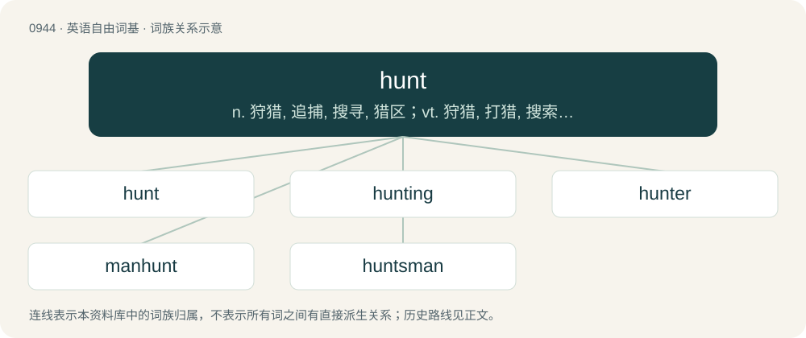

# 1018 · hunt — n. 狩猎, 追捕, 搜寻, 猎区；vt. 狩猎, 打猎, 搜索；vi. 打猎, 猎食, 搜寻

[总目录](../00_总目录_按常用程度.md)

**类型**：英语自由词基　｜　**来源语言**：见词源记录

## 核心含义与来源

- 核心含义：n. 狩猎, 追捕, 搜寻, 猎区；vt. 狩猎, 打猎, 搜索；vi. 打猎, 猎食, 搜寻
- 英文含义：To find or search for an animal in the wild with the intention of killing the animal for its meat or for sport.
- 词形：hunt

**来源记录 1**（动词；To find or search for an animal in the wild with the intention of killing the animal for its meat or for sport.）

From Middle English hunten, from Old English huntian (“to hunt”), from Proto-West Germanic \*huntōn (“to hunt, capture”), possibly from Proto-Indo-European \*ḱent- (“to catch, seize”). Related to Old High German hunda (“booty”), Gothic 𐌷𐌿𐌽𐌸𐍃 (hunþs, “body of captives”), Old English hūþ (“plunder, booty, prey”), Old English hentan (“to catch, seize”). More at hent, hint. In some areas read as a collective form of hound by folk etymology.

## 词族图

## 单词速览（常用到不常用）

| 单词 | 音标 | 释义 |
|---|---|---|
| [hunt](#w-1) | /hʌnt/ | n. 狩猎, 追捕, 搜寻, 猎区；vt. 狩猎, 打猎, 搜索；vi. 打猎, 猎食, 搜寻 |
| [hunting](#w-2) | /ˈhʌntɪŋ/ | n. 狩猎, 猎狐, 探求；\[计\] 寻找平衡; 寻找 |
| [hunter](#w-3) | 英 /ˈhʌntə/；美 /ˈhʌntɚ/ | n. 猎人, 猎犬, 追求者 |
| [manhunt](#w-4) | 美 /ˈmænˌhʌnt/ | n. 搜捕；\[法\] 搜索逃犯 |
| [huntsman](#w-5) | /ˈhʌntsmən/ | n. 猎人, 管猎犬者 |

## 逐词详解

### 1. hunt

**词性**：动词　｜　**音标**：/hʌnt/

**中文释义**：n. 狩猎, 追捕, 搜寻, 猎区；vt. 狩猎, 打猎, 搜索；vi. 打猎, 猎食, 搜寻

**英文义项**：To find or search for an animal in the wild with the intention of killing the animal for its meat or for sport. / To try to find something; search (for).

**词源与演化**：

From Middle English hunten, from Old English huntian (“to hunt”), from Proto-West Germanic \*huntōn (“to hunt, capture”), possibly from Proto-Indo-European \*ḱent- (“to catch, seize”). Related to Old High German hunda (“booty”), Gothic 𐌷𐌿𐌽𐌸𐍃 (hunþs, “body of captives”), Old English hūþ (“plunder, booty, prey”), Old English hentan (“to catch, seize”). More at hent, hint. In some areas read as a collective form of hound by folk etymology.

**例句**：

> State Wildlife Management areas often offer licensed hunters the opportunity to hunt on public lands.

该用例对应义项：To find or search for an animal in the wild with the intention of killing the animal for its meat or for sport.

### 2. hunting

**词性**：名词　｜　**音标**：/ˈhʌntɪŋ/

**中文释义**：n. 狩猎, 猎狐, 探求；\[计\] 寻找平衡; 寻找

**英文义项**：The act of finding and killing a wild animal, either for sport or with the intention of using its parts to make food, clothes, etc. / The act of looking for something, especially for a job or flat.

**构词拆分**：hunt + -ing

**词源与演化**：

From Middle English hunting, from Old English huntung, equivalent to hunt + -ing.

**用法示例／搭配（非完整句）**：

> a hunting rifle with a high-powered scope

该用例对应义项：The act of finding and killing a wild animal, either for sport or with the intention of using its parts to make food, clothes, etc.

### 3. hunter

**词性**：名词　｜　**音标**：英 /ˈhʌntə/；美 /ˈhʌntɚ/

**中文释义**：n. 猎人, 猎犬, 追求者

**英文义项**：One who hunts game for sport or for food; a huntsman or huntswoman. / A dog used in hunting; a hunting dog.

**构词拆分**：hunt + -er

**词源与演化**：

From Middle English huntere, hunter, equivalent to hunt + -er. Compare Old English hunta (“hunter”).

**例句**：

> The hunter becomes the hunted.

该用例对应义项：One who hunts or seeks after anything.

### 4. manhunt

**词性**：名词　｜　**音标**：美 /ˈmænˌhʌnt/

**中文释义**：n. 搜捕；\[法\] 搜索逃犯

**英文义项**：An organized search for a criminal or enemy. / A variant of hide and seek in which a player who is caught by the seeker themselves becomes a seeker, and the final player remaining is declared the winner.

**构词拆分**：man + hunt

**词源与演化**：

From man + hunt.

**例句**：

> After the murderer escaped, there was a full-scale manhunt to catch him.

该用例对应义项：An organized search for a criminal or enemy.

### 5. huntsman

**词性**：名词　｜　**音标**：/ˈhʌntsmən/

**中文释义**：n. 猎人, 管猎犬者

**英文义项**：A hunter. / A fox hunter.

**构词拆分**：hunt + -s- + -man

**词源与演化**：

From hunt + -s- + -man.

**例句**：

> He was the kind of huntsman who could never successfully catch even a single animal.
