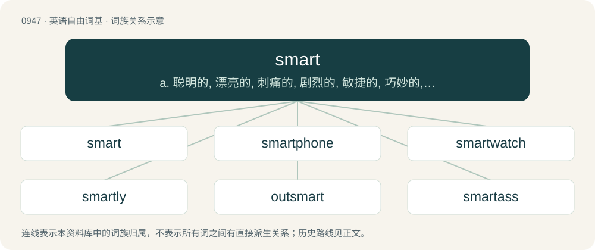

# 1020 · smart — a. 聪明的, 漂亮的, 刺痛的, 剧烈的, 敏捷的, 巧妙的, 伶俐的, 潇洒的；n. 刺痛, 痛苦；vi. 刺痛

[总目录](../00_总目录_按常用程度.md)

**类型**：英语自由词基　｜　**来源语言**：见词源记录

## 核心含义与来源

- 核心含义：a. 聪明的, 漂亮的, 刺痛的, 剧烈的, 敏捷的, 巧妙的, 伶俐的, 潇洒的；n. 刺痛, 痛苦；vi. 刺痛
- 英文含义：To hurt or sting.
- 词形：smart

**多个词源／构词路径**：同一拼写可能有不同来源；以下按词性和含义分别列出。

**来源记录 1**（动词；To hurt or sting.）

From Middle English smerten, from Old English \*smeortan (“to smart”), from Proto-West Germanic \*smertan, from Proto-Germanic \*smertaną (“to hurt, ache”), from Proto-Indo-European \*(s)merd- (“to bite, sting”). Cognate with Scots smert, Dutch smarten, German schmerzen, Danish smerte, Swedish smärta.

**来源记录 2**（形容词；Exhibiting social ability or cleverness.）

From Middle English smert, smart, from Old English smeart (“smarting, smart, painful”), from Proto-West Germanic \*smart, from Proto-Germanic \*smartaz (“hurting, aching”), from Proto-Indo-European \*(s)merd- (“to bite, sting”). Cognate with Scots smert (“painful, smart”), Old Frisian smert (“sharp, painful”).

**来源记录 3**（名词；A sharp, quick, lively pain; a sting.）

From Middle English smerte, from smerten (“to smart”); see above. Cognate with Scots smert, Dutch smart, Low German smart, German Schmerz, Danish smerte, Swedish smärta. More above.

## 词族图

## 单词速览（常用到不常用）

| 单词 | 音标 | 释义 |
|---|---|---|
| [smart](#w-1) | 英 /smɑːt/；美 /smɑɹt/ | a. 聪明的, 漂亮的, 刺痛的, 剧烈的, 敏捷的, 巧妙的, 伶俐的, 潇洒的；n. 刺痛, 痛苦；vi. 刺痛 |
| [smartphone](#w-2) | 英 /ˈsmɑːtfəʊn/；美 /ˈsmɑɹtfoʊn/ | n. 智能手机 |
| [smartwatch](#w-3) |  | 【英文】A wristwatch with electronic functionality beyond timekeeping. |
| [smartly](#w-4) | /ˈsmɑː(ɹ)tli/ | adv. 潇洒地, 火辣辣地, 刺痛地 |
| [outsmart](#w-5) | /aʊtˈsmɑː(ɹ)t/ | vt. 比...更聪明, 打败, 瞒过 |
| [smartass](#w-6) |  | 【英文】An insolent person, especially one who makes snide remarks. |
| [smarty](#w-7) | 英 /ˈsmɑːti/；美 /ˈsmɑɹti/ | n. 自作聪明的人 |
| [smarting](#w-8) | /ˈsmɑɹtɪŋ/ | n. 剧烈疼痛；刺痛 |
| [smartness](#w-9) | /ˈsmɑːtnis/ | n. 现代风格, 敏捷, 机灵 |
| [smarten](#w-10) | /ˈsmɑːt(ə)n/ | vt. 使潇洒, 使整洁；vi. 变潇洒, 变强烈 |

## 逐词详解

### 1. smart

**词性**：动词　｜　**音标**：英 /smɑːt/；美 /smɑɹt/

**中文释义**：a. 聪明的, 漂亮的, 刺痛的, 剧烈的, 敏捷的, 巧妙的, 伶俐的, 潇洒的；n. 刺痛, 痛苦；vi. 刺痛

**英文义项**：To hurt or sting. / To cause a smart or sting in.

**词源与演化**：

From Middle English smerten, from Old English \*smeortan (“to smart”), from Proto-West Germanic \*smertan, from Proto-Germanic \*smertaną (“to hurt, ache”), from Proto-Indo-European \*(s)merd- (“to bite, sting”). Cognate with Scots smert, Dutch smarten, German schmerzen, Danish smerte, Swedish smärta.

**例句**：

> After being hit with a pitch, the batter exclaimed "Ouch, my arm smarts!"

该用例对应义项：To hurt or sting.

### 2. smartphone

**词性**：名词　｜　**音标**：英 /ˈsmɑːtfəʊn/；美 /ˈsmɑɹtfoʊn/

**中文释义**：n. 智能手机

**英文义项**：A mobile phone with more advanced features and greater computing capacity than a feature phone.

**构词拆分**：smart + phone

**词源与演化**：

From smart + phone; first usage in the mid-1990s.

**例句**：

> Tom downloaded a new app launcher to organize his smartphone's home screen.

### 3. smartwatch

**词性**：名词

**英文义项**：A wristwatch with electronic functionality beyond timekeeping. / A mobile device worn on the wrist with a touchscreen display.

**构词拆分**：smart + watch

**词源与演化**：

From smart + watch. Compare smartphone.

### 4. smartly

**词性**：副词　｜　**音标**：/ˈsmɑː(ɹ)tli/

**中文释义**：adv. 潇洒地, 火辣辣地, 刺痛地

**英文义项**：With a fine or fashionable appearance. / Quickly.

**构词拆分**：smart + -ly

**词源与演化**：

From Middle English smertly; equivalent to smart + -ly.

**用法示例／搭配（非完整句）**：

> smartly dressed

该用例对应义项：With a fine or fashionable appearance.

### 5. outsmart

**词性**：动词　｜　**音标**：/aʊtˈsmɑː(ɹ)t/

**中文释义**：vt. 比...更聪明, 打败, 瞒过

**英文义项**：To beat in a competition of wits.

**构词拆分**：out- + smart

**词源与演化**：

From out- + smart.

**例句**：

> If you think you can outsmart me, then you've got it all wrong.

### 6. smartass

**词性**：名词

**英文义项**：An insolent person, especially one who makes snide remarks. / Synonym of know-it-all, an obnoxious clever person or a person making obnoxious efforts to seem clever by acting or behaving as if they know everything.

**构词拆分**：From smart + -ass.

**词源与演化**：

From smart + -ass.

**例句**：

> Lots of luck, smartass.

该用例对应义项：An insolent person, especially one who makes snide remarks.

### 7. smarty

**词性**：名词　｜　**音标**：英 /ˈsmɑːti/；美 /ˈsmɑɹti/

**中文释义**：n. 自作聪明的人

**英文义项**：An obnoxiously clever or quick-witted person.

**构词拆分**：From smart + -y.

**词源与演化**：

From smart + -y.

### 8. smarting

**词性**：形容词　｜　**音标**：/ˈsmɑɹtɪŋ/

**中文释义**：n. 剧烈疼痛；刺痛

**英文义项**：Painful, sore. / Experiencing emotional pain or embarrassment.

**构词拆分**：smart + -ing

**词源与演化**：

From Middle English smertyng, smertinge, from Old English smeortung, smertung (“smarting, itching”), equivalent to smart + -ing.

**例句**：

> My arm is still smarting from where the ball hit it.

该用例对应义项：Painful, sore.

### 9. smartness

**词性**：名词　｜　**音标**：/ˈsmɑːtnis/

**中文释义**：n. 现代风格, 敏捷, 机灵

**英文义项**：The state or quality of being smart, intelligence. / The state or quality of being smart in appearance.

**构词拆分**：smart + -ness

**词源与演化**：

From Middle English smartnesse, smertnesse, equivalent to smart + -ness. Cognate with Middle Dutch smartenisse (“pain, injury, insult, scorn, agony”).

**例句**：

> Her appearance presented a valiant attempt at smartness.

### 10. smarten

**词性**：动词　｜　**音标**：/ˈsmɑːt(ə)n/

**中文释义**：vt. 使潇洒, 使整洁；vi. 变潇洒, 变强烈

**英文义项**：To make smarter in appearance; to refurbish or spruce up. / To increase the speed of (one's travel on foot, etc.).

**构词拆分**：From smart + -en.

**词源与演化**：

From smart + -en.

**例句**：

> Smarten up and stop making dumb plans.
