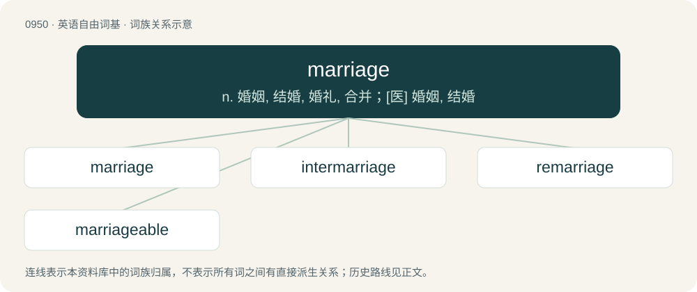

# 1023 · marriage — n. 婚姻, 结婚, 婚礼, 合并；\[医\] 婚姻, 结婚

[总目录](../00_总目录_按常用程度.md)

**类型**：英语自由词基　｜　**来源语言**：见词源记录

## 核心含义与来源

- 核心含义：n. 婚姻, 结婚, 婚礼, 合并；\[医\] 婚姻, 结婚
- 英文含义：The state of being married.
- 词形：marriage

**来源记录 1**（名词；The state of being married.）

From Middle English mariage, from Old French mariage, from marier (“to marry”), from Latin marītō (“marry”, verb, literally “give in marriage”), from marītus (“lover”, “nuptial”), from mas (“male, masculine, of the male sex”). Equivalent to marry + -age. Doublet of maritage. Displaced native Old English sinsċipe.

## 词族图

## 单词速览（常用到不常用）

| 单词 | 音标 | 释义 |
|---|---|---|
| [marriage](#w-1) | 英 /ˈmæɹɪd͡ʒ/；/ˈmæɹɪd͡ʒ/ | n. 婚姻, 结婚, 婚礼, 合并；\[医\] 婚姻, 结婚 |
| [intermarriage](#w-2) | /.intəˈmæridʒ/ | n. 异族结婚, 近亲结婚；\[医\] 血族婚姻, 异种结婚 |
| [remarriage](#w-3) | /.riːˈmæridʒ/ | n. 再婚；\[法\] 再婚, 再娶, 再嫁 |
| [marriageable](#w-4) | /ˈmæridʒəbl/ | a. 可结婚的, 适合结婚的 |

## 逐词详解

### 1. marriage

**词性**：名词　｜　**音标**：英 /ˈmæɹɪd͡ʒ/；/ˈmæɹɪd͡ʒ/

**中文释义**：n. 婚姻, 结婚, 婚礼, 合并；\[医\] 婚姻, 结婚

**英文义项**：The state of being married. / A union of two or more people that creates a family tie and carries legal, social, or religious rights and responsibilities.

**构词拆分**：marry + -age

**词源与演化**：

From Middle English mariage, from Old French mariage, from marier (“to marry”), from Latin marītō (“marry”, verb, literally “give in marriage”), from marītus (“lover”, “nuptial”), from mas (“male, masculine, of the male sex”). Equivalent to marry + -age. Doublet of maritage. Displaced native Old English sinsċipe.

**例句**：

> You are cordially invited to the marriage of James Smith and Jane Doe.

该用例对应义项：A wedding; a ceremony in which people wed.

### 2. intermarriage

**词性**：名词　｜　**音标**：/.intəˈmæridʒ/

**中文释义**：n. 异族结婚, 近亲结婚；\[医\] 血族婚姻, 异种结婚

**英文义项**：Marriage between people belonging to different groups, such as different racial, ethnic, or religious groups; mixed marriage.

**构词拆分**：inter- + marriage

**词源与演化**：

From inter- + marriage.

**例句**：

> During the 1960s, some Georgians opposed the intermarriage of blacks and whites.

该用例对应义项：Marriage between people belonging to different groups, such as different racial, ethnic, or religious groups; mixed marriage.

### 3. remarriage

**词性**：名词　｜　**音标**：/.riːˈmæridʒ/

**中文释义**：n. 再婚；\[法\] 再婚, 再娶, 再嫁

**英文义项**：a second or subsequent marriage.

**构词拆分**：re- + marriage

**词源与演化**：

From re- + marriage.

**例句**：

> John noticed my surprise at the news of his mother's remarriage.

### 4. marriageable

**词性**：形容词　｜　**音标**：/ˈmæridʒəbl/

**中文释义**：a. 可结婚的, 适合结婚的

**英文义项**：Suitable for marriage.

**构词拆分**：marriage + -able

**词源与演化**：

From marriage + -able.

**例句**：

> Skura is a young woman of marriageable age.
