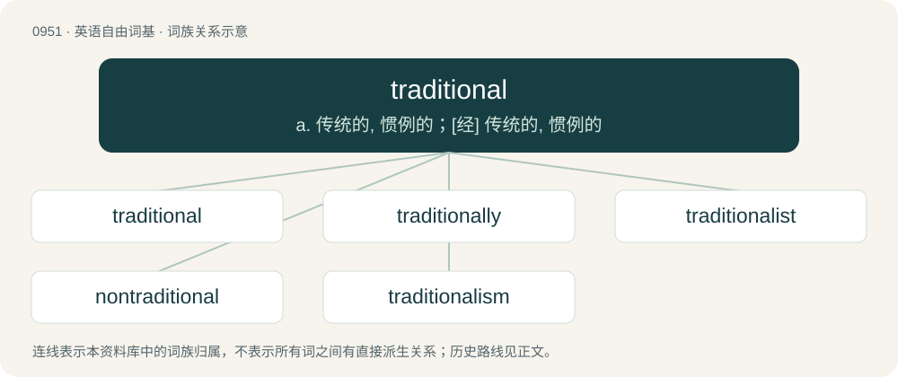

# 1024 · traditional — a. 传统的, 惯例的；\[经\] 传统的, 惯例的

[总目录](../00_总目录_按常用程度.md)

**类型**：英语自由词基　｜　**来源语言**：见词源记录

## 核心含义与来源

- 核心含义：a. 传统的, 惯例的；\[经\] 传统的, 惯例的
- 英文含义：Of, relating to, or derived from tradition.
- 词形：traditional

**来源记录 1**（形容词；Of, relating to, or derived from tradition.）

From tradition + -al. First attested in 1545.

## 词族图

## 单词速览（常用到不常用）

| 单词 | 音标 | 释义 |
|---|---|---|
| [traditional](#w-1) | /tɹəˈdɪʃ.ə.nəl/ | a. 传统的, 惯例的；\[经\] 传统的, 惯例的 |
| [traditionally](#w-2) | /tɹəˈdɪʃ.ə.nə.li/ | adv. 传统上；传说上；习惯上 |
| [traditionalist](#w-3) |  | n. 传统主义者, 因循守旧者 |
| [nontraditional](#w-4) | /.nɔntrəˈdiʃənəl/ | a. 不符合传统的, 非传统的 |
| [traditionalism](#w-5) | /trəˈdiʃənlizm/ | n. 传统主义 |

## 逐词详解

### 1. traditional

**词性**：形容词　｜　**音标**：/tɹəˈdɪʃ.ə.nəl/

**中文释义**：a. 传统的, 惯例的；\[经\] 传统的, 惯例的

**英文义项**：Of, relating to, or derived from tradition. / Communicated from ancestors to descendants orally.

**构词拆分**：tradition + -al

**词源与演化**：

From tradition + -al. First attested in 1545.

**例句**：

> The traditional form of the character has twice as many strokes as the simplified form.

该用例对应义项：Relating to traditional Chinese.

### 2. traditionally

**词性**：副词　｜　**音标**：/tɹəˈdɪʃ.ə.nə.li/

**中文释义**：adv. 传统上；传说上；习惯上

**英文义项**：In a traditional manner. / From the beginning.

**构词拆分**：traditional + -ly

**词源与演化**：

From traditional + -ly.

**例句**：

> Traditionally, we eat fried foods on Hanukah.

该用例对应义项：according to tradition; in a traditional manner

### 3. traditionalist

**词性**：名词

**中文释义**：n. 传统主义者, 因循守旧者

**英文义项**：A person who adheres to tradition, especially in cultural or religious practices. / A traditional climbing climber.

**构词拆分**：traditional + -ist

**词源与演化**：

From traditional + -ist.

**例句**：

> In a world full of constantly changing techniques, there's some honour in being a traditionalist.

### 4. nontraditional

**词性**：形容词　｜　**音标**：/.nɔntrəˈdiʃənəl/

**中文释义**：a. 不符合传统的, 非传统的

**英文义项**：Not traditional; not related to tradition, untraditional. / Innovative; new; daring.

**构词拆分**：non- + traditional

**词源与演化**：

From non- + traditional.

### 5. traditionalism

**词性**：名词　｜　**音标**：/trəˈdiʃənlizm/

**中文释义**：n. 传统主义

**英文义项**：The adherence to traditional views or practices, especially with regard to cultural or religious matters. / The continuation of theological rituals on the basis that the ritual has always completed, rather than the ritual being a manifestation of theology.

**构词拆分**：traditional + -ism

**词源与演化**：

From traditional + -ism.

**例句**：

> Traditionalism means that one prefers a silver salt shaker which does not pour any salt over one from plastic which actually pours salt.
