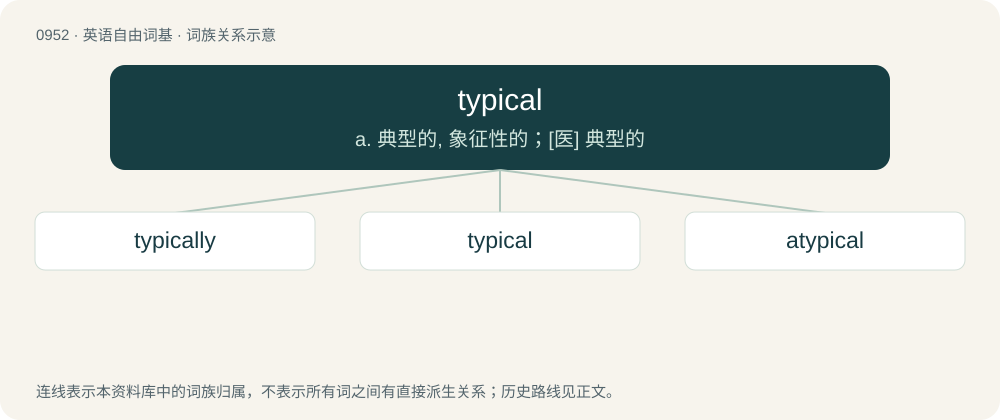

# 1025 · typical — a. 典型的, 象征性的；\[医\] 典型的

[总目录](../00_总目录_按常用程度.md)

**类型**：英语自由词基　｜　**来源语言**：见词源记录

## 核心含义与来源

- 核心含义：a. 典型的, 象征性的；\[医\] 典型的
- 英文含义：Capturing the overall sense of a thing.
- 词形：typical

**来源记录 1**（形容词；Capturing the overall sense of a thing.）

From Late Latin typicalis, from Latin typicus (“typical”), from Ancient Greek τυπικός (tupikós, “of or pertaining to a type, conformable, typical”), from τύπος (túpos, “mark, impression, type”), equivalent to typic + -al and type + -ical.

## 词族图

## 单词速览（常用到不常用）

| 单词 | 音标 | 释义 |
|---|---|---|
| [typically](#w-1) | 英 /ˈtɪp.ɪ.kli/ | adv. 代表性地；作为特色地 |
| [typical](#w-2) | /ˈtɪp.ɪ.kəl/ | a. 典型的, 象征性的；\[医\] 典型的 |
| [atypical](#w-3) | 英 /eɪˈtɪp.ɪ.kəl/ | a. 非典型的；\[医\] 非典型的, 不标准的 |

## 逐词详解

### 1. typically

**词性**：副词　｜　**音标**：英 /ˈtɪp.ɪ.kli/

**中文释义**：adv. 代表性地；作为特色地

**英文义项**：In a typical or common manner. / In an expected or customary manner.

**构词拆分**：typical + -ly

**词源与演化**：

From typical + -ly.

**例句**：

> Tom was typically hostile.

该用例对应义项：in a typical manner

### 2. typical

**词性**：名词　｜　**音标**：/ˈtɪp.ɪ.kəl/

**中文释义**：a. 典型的, 象征性的；\[医\] 典型的

**英文义项**：Anything that is typical, normal, or standard.

**构词拆分**：typic + -al；type + -ical

**词源与演化**：

From Late Latin typicalis, from Latin typicus (“typical”), from Ancient Greek τυπικός (tupikós, “of or pertaining to a type, conformable, typical”), from τύπος (túpos, “mark, impression, type”), equivalent to typic + -al and type + -ical.

**例句**：

> Antipsychotic drugs can be divided into typicals and atypicals.

该用例对应义项：Anything that is typical, normal, or standard.

### 3. atypical

**词性**：形容词　｜　**音标**：英 /eɪˈtɪp.ɪ.kəl/

**中文释义**：a. 非典型的；\[医\] 非典型的, 不标准的

**英文义项**：Not conforming to the normal type. / Unusual or irregular.

**构词拆分**：a- + typical

**词源与演化**：

From a- + typical.

**例句**：

> A group that is atypical of the target audience.

该用例对应义项：not representative of a group, class, or type
