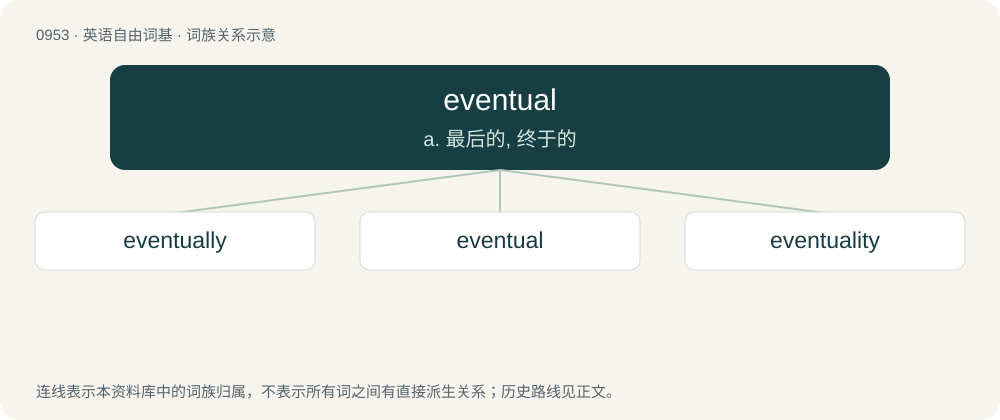

# 1027 · eventual — a. 最后的, 终于的

[总目录](../00_总目录_按常用程度.md)

**类型**：英语自由词基　｜　**来源语言**：见词源记录

## 核心含义与来源

- 核心含义：a. 最后的, 终于的
- 英文含义：Finally resulting or occurring (after a period of time); inevitable.
- 词形：eventual

**来源记录 1**（形容词；Finally resulting or occurring (after a period of time); inevitable.）

From event + -ual; compare French éventuel. The third sense is influenced by any of several European languages, including German eventuell, French éventuel, Italian eventuale, Spanish eventual, Swedish eventuell.

## 词族图

## 单词速览（常用到不常用）

| 单词 | 音标 | 释义 |
|---|---|---|
| [eventually](#w-1) | 英 /ɪˈvɛn.t͡ʃuː.ə.li/；美 /ɪˈvɛn.t͡ʃu.ə.li/ | adv. 最后, 终于 |
| [eventual](#w-2) | 英 /ɪˈvɛn.(t)ʃʊ.əl/；美 /ɪˈvɛn.t͡ʃu.əl/ | a. 最后的, 终于的 |
| [eventuality](#w-3) | /ɪˌvɛntjuˈælɪti/ | n. 可能发生的事, 可能性 |

## 逐词详解

### 1. eventually

**词性**：副词　｜　**音标**：英 /ɪˈvɛn.t͡ʃuː.ə.li/；美 /ɪˈvɛn.t͡ʃu.ə.li/

**中文释义**：adv. 最后, 终于

**英文义项**：In the end; at some later time, especially after a long time, a series of problems, struggles, delays or setbacks. / For some tail; for all terms beyond some term; with only finitely many exceptions.

**构词拆分**：eventual + -ly

**词源与演化**：

From eventual + -ly. The third sense is influenced by any of several European languages, including Czech eventuálně, French éventuellement, Swedish eventuellt.

**例句**：

> She didn't arrive. Eventually, we started without her.

该用例对应义项：In the end; at some later time, especially after a long time, a series of problems, struggles, delays or setbacks.

### 2. eventual

**词性**：形容词　｜　**音标**：英 /ɪˈvɛn.(t)ʃʊ.əl/；美 /ɪˈvɛn.t͡ʃu.əl/

**中文释义**：a. 最后的, 终于的

**英文义项**：Finally resulting or occurring (after a period of time); inevitable. / Pertaining to events; event-related, evential.

**构词拆分**：event + -ual

**词源与演化**：

From event + -ual; compare French éventuel. The third sense is influenced by any of several European languages, including German eventuell, French éventuel, Italian eventuale, Spanish eventual, Swedish eventuell.

**例句**：

> They both opposed an eventual imposition of anti-dumping measures as they considered that it could lead to a cessation of imports of the product concerned from the PRC79.

该用例对应义项：Possible, potential.

### 3. eventuality

**词性**：名词　｜　**音标**：/ɪˌvɛntjuˈælɪti/

**中文释义**：n. 可能发生的事, 可能性

**英文义项**：A possible event; something that may happen.

**构词拆分**：eventual + -ity

**词源与演化**：

Calque of French éventualité, eventual + -ity

**例句**：

> We need to be ready for any eventuality.
