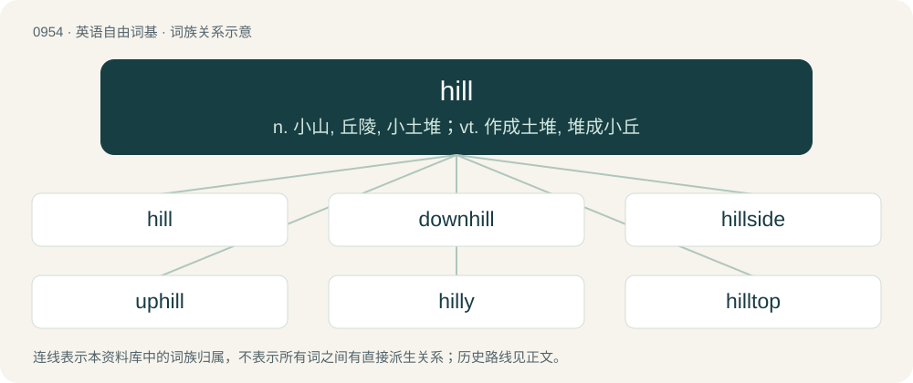

# 1028 · hill — n. 小山, 丘陵, 小土堆；vt. 作成土堆, 堆成小丘

[总目录](../00_总目录_按常用程度.md)

**类型**：英语自由词基　｜　**来源语言**：见词源记录

## 核心含义与来源

- 核心含义：n. 小山, 丘陵, 小土堆；vt. 作成土堆, 堆成小丘
- 英文含义：An elevated landmass smaller than a mountain.
- 词形：hill

**来源记录 1**（名词；An elevated landmass smaller than a mountain.）

From Middle English hil (“hill”), from Old English hyll (“hill”), from Proto-West Germanic \*hulli (“hill”), from Proto-Germanic \*hulliz (“hill”), from Proto-Indo-European \*kl̥Hnís (“top, hill, rock”) (compare also Proto-Germanic \*halluz (“stone, rock”)). Cognate with Middle Dutch hille, hulle (“hill”), Low German hull (“hill”), Faroese hólur (“hill”), Icelandic and Old Norse hóll (“hill”), Norn hul (“hillock”), Norwegian hol (“low hillock”), Swedish kulle (“hill”), Catalan coll (“hill”), Italian colle (“hill”), Latin collis (“hill”), Lithuanian kalnas (“hill, mountain”), Albanian kallumë (“big pile, tall heap”), Russian холм (xolm, “hill”), Old English holm (“rising land, island”). More at holm.

## 词族图

## 单词速览（常用到不常用）

| 单词 | 音标 | 释义 |
|---|---|---|
| [hill](#w-1) | /hɪl/ | n. 小山, 丘陵, 小土堆；vt. 作成土堆, 堆成小丘 |
| [downhill](#w-2) | /ˈdaʊnˌhɪl/ | a. 下坡的；adv. 下坡, 向下 |
| [hillside](#w-3) | 美 /ˈhɪlˌsaɪd/ | n. 山坡, 山腹 |
| [uphill](#w-4) | /ˈʌphɪl/ | a. 上坡的, 向上的；adv. 往上坡, 向上地 |
| [hilly](#w-5) | /ˈhɪli/ | a. 多丘陵的, 多山岗的, 险峻的 |
| [hilltop](#w-6) | 英 /ˈhɪltɒp/ | n. 小山顶 |
| [hillbilly](#w-7) | /ˈhɪlˌbɪli/ | n. 乡下人, 乡巴佬；山地内部的贫农, 山地人 |
| [hillman](#w-8) | 英 /ˈhɪlmən/ | n. 住在山区的人 |
| [hiller](#w-9) | 英 /ˈhɪlə(ɹ)/；美 /ˈhɪlɚ/ | n. \[农机\] 培土器 |
| [underhill](#w-10) |  | 【英文】(of a road, track or other path) passing along the foot of a hill. |
| [hillcrest](#w-11) | /ˈhilkrest/ | n. 山顶 |
| [foothill](#w-12) | /ˈfuthil/ | n. 山麓小丘 |
| [hillock](#w-13) | 英 /ˈhɪl.ək/ | n. 小丘, 小高处, 土堆；\[医\] 丘, 阜 |
| [sandhill](#w-14) | /ˈsændhil/ | crane\[鸟\]沙丘鹤 |
| [molehill](#w-15) | /ˈməʊlhɪl/ | n. 鼹鼠丘, 琐事 |
| [anthill](#w-16) | /ˈænt.hɪl/ | n. 蚁冢, 人群密集的地方 |

## 逐词详解

### 1. hill

**词性**：名词　｜　**音标**：/hɪl/

**中文释义**：n. 小山, 丘陵, 小土堆；vt. 作成土堆, 堆成小丘

**英文义项**：An elevated landmass smaller than a mountain. / A sloping part of a landscape, especially one with a road, trail, etc.

**词源与演化**：

From Middle English hil (“hill”), from Old English hyll (“hill”), from Proto-West Germanic \*hulli (“hill”), from Proto-Germanic \*hulliz (“hill”), from Proto-Indo-European \*kl̥Hnís (“top, hill, rock”) (compare also Proto-Germanic \*halluz (“stone, rock”)). Cognate with Middle Dutch hille, hulle (“hill”), Low German hull (“hill”), Faroese hólur (“hill”), Icelandic and Old Norse hóll (“hill”), Norn hul (“hillock”), Norwegian hol (“low hillock”), Swedish kulle (“hill”), Catalan coll (“hill”), Italian colle (“hill”), Latin collis (“hill”), Lithuanian kalnas (“hill, mountain”), Albanian kallumë (“big pile, tall heap”), Russian холм (xolm, “hill”), Old English holm (“rising land, island”). More at holm.

**例句**：

> You need to pick up speed to get up the hill that's coming up.

该用例对应义项：A sloping part of a landscape, especially one with a road, trail, etc.

### 2. downhill

**词性**：形容词　｜　**音标**：/ˈdaʊnˌhɪl/

**中文释义**：a. 下坡的；adv. 下坡, 向下

**英文义项**：Located towards or at the bottom of a slope or hill. / Going down a slope or a hill.

**构词拆分**：From down- + hill.

**词源与演化**：

From down- + hill.

**例句**：

> That's the hard part of the job done. From now on it's downhill all the way.

该用例对应义项：Easy.

### 3. hillside

**词性**：名词　｜　**音标**：美 /ˈhɪlˌsaɪd/

**中文释义**：n. 山坡, 山腹

**英文义项**：The side of a hill.

**构词拆分**：hill + side

**词源与演化**：

From hill + side.

**例句**：

> Tom and Mary sat on a hillside and watched the fireworks together.

### 4. uphill

**词性**：形容词　｜　**音标**：/ˈʌphɪl/

**中文释义**：a. 上坡的, 向上的；adv. 往上坡, 向上地

**英文义项**：Located up a slope or on a hill. / Going up a slope or a hill.

**构词拆分**：up + hill

**词源与演化**：

From up + hill.

**例句**：

> My efforts felt like a constant uphill battle that I couldn't win.

### 5. hilly

**词性**：形容词　｜　**音标**：/ˈhɪli/

**中文释义**：a. 多丘陵的, 多山岗的, 险峻的

**英文义项**：Abundant in hills; having many hills.

**构词拆分**：hill + -y

**词源与演化**：

From Middle English hilly, hylly, hully, equivalent to hill + -y.

**例句**：

> This is awfully hilly terrain; I hope we don't screw up the transmission.

### 6. hilltop

**词性**：名词　｜　**音标**：英 /ˈhɪltɒp/

**中文释义**：n. 小山顶

**英文义项**：The peak or crest of a hill.

**构词拆分**：hill + top

**词源与演化**：

From hill + top.

**例句**：

> The caves are situated on a hilltop and provide an excellent vantage point.

### 7. hillbilly

**词性**：名词　｜　**音标**：/ˈhɪlˌbɪli/

**中文释义**：n. 乡下人, 乡巴佬；山地内部的贫农, 山地人

**英文义项**：Someone who is from the hills; especially from a rural area, with a connotation of a lack of refinement or sophistication. / A white person from the rural southern part of the United States, especially the Southeastern states.

**构词拆分**：hill + billy (“fellow”)

**词源与演化**：

From hill + billy (“fellow”). Compare Scots chapman billie (“travelling salesman”).

**例句**：

> My grandfather was a hillbilly from Virginia.

### 8. hillman

**词性**：名词　｜　**音标**：英 /ˈhɪlmən/

**中文释义**：n. 住在山区的人

**英文义项**：A native or inhabitant of hilly or mountainous country; a tribesman who lives in the mountains. / A supernatural being, such as a dwarf, that lives beneath a hill.

**构词拆分**：hill + man

**词源与演化**：

From hill + man.

### 9. hiller

**词性**：名词　｜　**音标**：英 /ˈhɪlə(ɹ)/；美 /ˈhɪlɚ/

**中文释义**：n. \[农机\] 培土器

**英文义项**：A poor rural person.

**构词拆分**：hill + -er

**词源与演化**：

From hill + -er.

### 10. underhill

**词性**：形容词

**英文义项**：(of a road, track or other path) passing along the foot of a hill.

**构词拆分**：under- + hill

**词源与演化**：

From under- + hill.

**例句**：

> There's an underhill lane you can walk along there.

该用例对应义项：(of a road, track or other path) passing along the foot of a hill.

### 11. hillcrest

**词性**：名词　｜　**音标**：/ˈhilkrest/

**中文释义**：n. 山顶

**英文义项**：The crest of a hill

**构词拆分**：hill + crest

**词源与演化**：

From hill + crest.

### 12. foothill

**词性**：名词　｜　**音标**：/ˈfuthil/

**中文释义**：n. 山麓小丘

**英文义项**：A hill at the base of a mountain or mountain range.

**构词拆分**：From foot + hill.

**词源与演化**：

From foot + hill.

### 13. hillock

**词性**：名词　｜　**音标**：英 /ˈhɪl.ək/

**中文释义**：n. 小丘, 小高处, 土堆；\[医\] 丘, 阜

**英文义项**：A small hill.

**构词拆分**：hill + -ock

**词源与演化**：

From Middle English hillok, equivalent to hill + -ock.

**例句**：

> I went to the top of the hillock and looked about me.

### 14. sandhill

**词性**：名词　｜　**音标**：/ˈsændhil/

**中文释义**：crane\[鸟\]沙丘鹤

**英文义项**：A dune or sandpile. / A sandhill crane (Antigone canadensis).

**构词拆分**：sand + hill

**词源与演化**：

From sand + hill.

**例句**：

> Migrant birds such as the sandhill crane fly overhead, moving south.

### 15. molehill

**词性**：名词　｜　**音标**：/ˈməʊlhɪl/

**中文释义**：n. 鼹鼠丘, 琐事

**英文义项**：A small mound of earth created by a mole's burrowing underneath the surface of the ground.

**构词拆分**：mole + hill

**词源与演化**：

From mole + hill. The verb sense comes from the idiom make a mountain out of a molehill.

**例句**：

> She is probably just making a mountain out of a molehill again.

### 16. anthill

**词性**：名词　｜　**音标**：/ˈænt.hɪl/

**中文释义**：n. 蚁冢, 人群密集的地方

**英文义项**：A cone-shaped structure built from sediment and other available materials by ants or white ants (termites), and beneath which the colony nests.

**构词拆分**：ant + hill

**词源与演化**：

From Middle English ametehul, amptehille, from Old English ǣmethyll, equivalent to ant + hill.

**例句**：

> The anthill is full of food collected by the ants.
