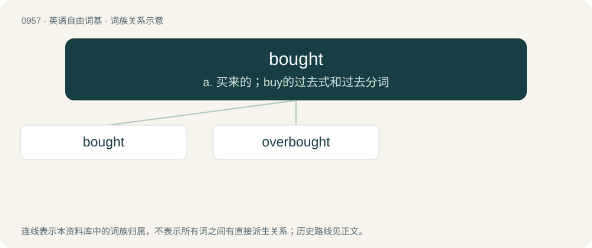

# 1030 · bought — a. 买来的；buy的过去式和过去分词

[总目录](../00_总目录_按常用程度.md)

**类型**：英语自由词基　｜　**来源语言**：见词源记录

## 核心含义与来源

- 核心含义：a. 买来的；buy的过去式和过去分词
- 英文含义：Compromised by money from special interests; corrupt.
- 词形：bought

**来源记录 1**（形容词；Compromised by money from special interests; corrupt.）

See buy.

## 词族图

## 单词速览（常用到不常用）

| 单词 | 音标 | 释义 |
|---|---|---|
| [bought](#w-1) | 英 /ˈbɔːt/；美 /ˈbɔt/ | a. 买来的；buy的过去式和过去分词 |
| [overbought](#w-2) | /,əuvəˈbɔːt/ | overbuy的过去式和过去分词；\[经\] 过多地买进, 买空 |

## 逐词详解

### 1. bought

**词性**：形容词　｜　**音标**：英 /ˈbɔːt/；美 /ˈbɔt/

**中文释义**：a. 买来的；buy的过去式和过去分词

**英文义项**：Compromised by money from special interests; corrupt.

**词源与演化**：

See buy.

**例句**：

> Don't bother filing a complaint, the regulators are bought.

该用例对应义项：Compromised by money from special interests; corrupt.

### 2. overbought

**词性**：形容词　｜　**音标**：/,əuvəˈbɔːt/

**中文释义**：overbuy的过去式和过去分词；\[经\] 过多地买进, 买空

**英文义项**：Of a stock or commodity market condition: where there has been significant trading bidding up prices to higher levels, levels which seem overextended or excessive on a short-term basis.

**构词拆分**：over- + bought

**词源与演化**：

From over- + bought.
