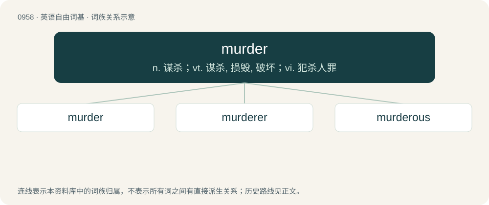

# 1031 · murder — n. 谋杀；vt. 谋杀, 损毁, 破坏；vi. 犯杀人罪

[总目录](../00_总目录_按常用程度.md)

**类型**：英语自由词基　｜　**来源语言**：见词源记录

## 核心含义与来源

- 核心含义：n. 谋杀；vt. 谋杀, 损毁, 破坏；vi. 犯杀人罪
- 英文含义：An act of killing a person unlawfully, especially with predetermination.
- 词形：murder

**来源记录 1**（名词；An act of killing a person unlawfully, especially with predetermination.）

From Middle English murder, murdre, mourdre, alteration of earlier murthre (“murder”) (see murther), from Old English morþor (“secret slaying, unlawful killing”) and Old English myrþra (“murder, homicide”), both from Proto-West Germanic \*morþr, from Proto-Germanic \*murþrą (“death, killing, murder”), from Proto-Indo-European \*mr̥tro- (“killing”), from Proto-Indo-European \*mer-, \*mor-, \*mr̥- (“to die”). Akin to Gothic 𐌼𐌰𐌿𐍂𐌸𐍂 (maurþr, “murder”), Old High German mord (“murder”), Old Norse morð (“murder”), Old English myrþrian (“to murder”) and morþ. The -d- in the Middle English form may have been influenced in part by Anglo-Norman murdre, from Old French murdre, from Medieval Latin murdrum (whence the English doublet of murdrum), from Frankish \*morþr, \*murþr (“murder”), from the same Germanic root, though this may also have been wholly the result of internal development (compare burden, from burthen and spider, from spiþra). (crows): Attested at least since 1475.

## 词族图

## 单词速览（常用到不常用）

| 单词 | 音标 | 释义 |
|---|---|---|
| [murder](#w-1) | 英 /ˈmɜːdə(ɹ)/；美 /ˈmɝ.dɚ/ | n. 谋杀；vt. 谋杀, 损毁, 破坏；vi. 犯杀人罪 |
| [murderer](#w-2) | 英 /ˈmɜːdəɹə/；美 /ˈmɝdɚɚ/ | n. 凶手, 杀人者, 谋害者；\[法\] 谋杀犯, 凶手 |
| [murderous](#w-3) | 英 /ˈmɜːdəɹəs/；美 /ˈmɝdəɹəs/ | a. 凶狠的, 杀人的, 致命的；\[法\] 谋杀的, 杀人的, 残酷的 |

## 逐词详解

### 1. murder

**词性**：名词　｜　**音标**：英 /ˈmɜːdə(ɹ)/；美 /ˈmɝ.dɚ/

**中文释义**：n. 谋杀；vt. 谋杀, 损毁, 破坏；vi. 犯杀人罪

**英文义项**：An act of killing a person unlawfully, especially with predetermination. / The crime of killing a person unlawfully, especially with predetermination.

**词源与演化**：

From Middle English murder, murdre, mourdre, alteration of earlier murthre (“murder”) (see murther), from Old English morþor (“secret slaying, unlawful killing”) and Old English myrþra (“murder, homicide”), both from Proto-West Germanic \*morþr, from Proto-Germanic \*murþrą (“death, killing, murder”), from Proto-Indo-European \*mr̥tro- (“killing”), from Proto-Indo-European \*mer-, \*mor-, \*mr̥- (“to die”). Akin to Gothic 𐌼𐌰𐌿𐍂𐌸𐍂 (maurþr, “murder”), Old High German mord (“murder”), Old Norse morð (“murder”), Old English myrþrian (“to murder”) and morþ. The -d- in the Middle English form may have been influenced in part by Anglo-Norman murdre, from Old French murdre, from Medieval Latin murdrum (whence the English doublet of murdrum), from Frankish \*morþr, \*murþr (“murder”), from the same Germanic root, though this may also have been wholly the result of internal development (compare burden, from burthen and spider, from spiþra). (crows): Attested at least since 1475.

**例句**：

> Throwing that punch was a murder whether you meant for it to happen or not.

该用例对应义项：An act of killing a person unlawfully, especially with predetermination.

### 2. murderer

**词性**：名词　｜　**音标**：英 /ˈmɜːdəɹə/；美 /ˈmɝdɚɚ/

**中文释义**：n. 凶手, 杀人者, 谋害者；\[法\] 谋杀犯, 凶手

**英文义项**：A person who commits murder.

**构词拆分**：murder + -er

**词源与演化**：

From Middle English murderere; equivalent to murder + -er.

**例句**：

> Even now, we still doubt that he is the real murderer.

### 3. murderous

**词性**：形容词　｜　**音标**：英 /ˈmɜːdəɹəs/；美 /ˈmɝdəɹəs/

**中文释义**：a. 凶狠的, 杀人的, 致命的；\[法\] 谋杀的, 杀人的, 残酷的

**英文义项**：Of, characterized by, or pertaining to murder or murderers. / Of a person: intending or likely to commit murder; bloodthirsty, homicidal.

**构词拆分**：murder + -ous (suffix forming adjectives from nouns denoting possession or presence of a quality)

**词源与演化**：

From murder + -ous (suffix forming adjectives from nouns denoting possession or presence of a quality).

**例句**：

> She gave me a murderous look.

该用例对应义项：Of a person: intending or likely to commit murder; bloodthirsty, homicidal.
