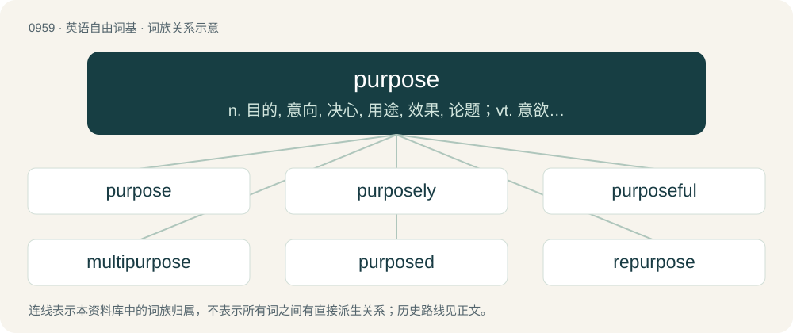

# 1032 · purpose — n. 目的, 意向, 决心, 用途, 效果, 论题；vt. 意欲, 企图, 计划

[总目录](../00_总目录_按常用程度.md)

**类型**：英语自由词基　｜　**来源语言**：见词源记录

## 核心含义与来源

- 核心含义：n. 目的, 意向, 决心, 用途, 效果, 论题；vt. 意欲, 企图, 计划
- 英文含义：The end for which something is done, is made or exists.
- 词形：purpose

**多个词源／构词路径**：同一拼写可能有不同来源；以下按词性和含义分别列出。

**来源记录 1**（名词；The end for which something is done, is made or exists.）

From Middle English purpos, from Old French purposer (“to propose”) (with conjugation altered based on poser), from Latin prō- (“forth”) + pōnere (“place, put”), hence Latin prōpōnō, prōpōnere. By surface analysis, pur- + pose (“halt, pause, put, place”).

**来源记录 2**（动词；To have or set as one's purpose or aim; resolve to accomplish; intend; plan.）

From Middle English purposen, from Old French purposer (“to propose”).

## 词族图

## 单词速览（常用到不常用）

| 单词 | 音标 | 释义 |
|---|---|---|
| [purpose](#w-1) | 英 /ˈpɜː.pəs/；美 /ˈpɝ.pəs/ | n. 目的, 意向, 决心, 用途, 效果, 论题；vt. 意欲, 企图, 计划 |
| [purposely](#w-2) | 英 /ˈpɜːpəsli/；美 /ˈpɝpəsli/ | adv. 故意地 |
| [purposeful](#w-3) | 英 /ˈpɜː.pəs.fəl/；美 /ˈpɝ.pəs.fəl/ | a. 有目的的；\[法\] 有意图的, 有目的的, 故意的 |
| [multipurpose](#w-4) | 美 /mʌltipɝpəs/ | \[计\] 多用途的, 通用的, 多功能的 |
| [purposed](#w-5) | 英 /ˈpəːpəst/ | a. 打算的；计划的 |
| [repurpose](#w-6) | 英 /ɹiːˈpɜː.pəs/；美 /ɹiˈpɝ.pəs/ | vt. 赋予新的用途 |
| [purposeless](#w-7) | /ˈpəːpəslis/ | a. 无目的的, 无意义的 |

## 逐词详解

### 1. purpose

**词性**：名词　｜　**音标**：英 /ˈpɜː.pəs/；美 /ˈpɝ.pəs/

**中文释义**：n. 目的, 意向, 决心, 用途, 效果, 论题；vt. 意欲, 企图, 计划

**英文义项**：The end for which something is done, is made or exists. / Function, role.

**词源与演化**：

From Middle English purpos, from Old French purposer (“to propose”) (with conjugation altered based on poser), from Latin prō- (“forth”) + pōnere (“place, put”), hence Latin prōpōnō, prōpōnere. By surface analysis, pur- + pose (“halt, pause, put, place”).

**例句**：

> The exceptionally small gate-leg table served the purpose of a tea table admirably.

该用例对应义项：Function, role.

### 2. purposely

**词性**：副词　｜　**音标**：英 /ˈpɜːpəsli/；美 /ˈpɝpəsli/

**中文释义**：adv. 故意地

**英文义项**：On purpose; intentionally.

**构词拆分**：purpose + -ly

**词源与演化**：

From Middle English purposly; equivalent to purpose + -ly.

**例句**：

> I purposely left the door unlocked.

该用例对应义项：On purpose; intentionally.

### 3. purposeful

**词性**：形容词　｜　**音标**：英 /ˈpɜː.pəs.fəl/；美 /ˈpɝ.pəs.fəl/

**中文释义**：a. 有目的的；\[法\] 有意图的, 有目的的, 故意的

**英文义项**：Having purpose: having intention or meaning; intentional. / Having a purpose in mind; resolute; determined, full of determination.

**构词拆分**：purpose + -ful

**词源与演化**：

From purpose + -ful.

**例句**：

> Led a happy purposeful life.

该用例对应义项：having meaning through having an aim

### 4. multipurpose

**词性**：形容词　｜　**音标**：美 /mʌltipɝpəs/

**中文释义**：\[计\] 多用途的, 通用的, 多功能的

**英文义项**：Designed or intended to fit more than one type of function or application; having multiple uses.

**构词拆分**：multi- + purpose

**词源与演化**：

From multi- + purpose.

**例句**：

> Oats are a multipurpose and valuable nourishment.

### 5. purposed

**词性**：形容词　｜　**音标**：英 /ˈpəːpəst/

**中文释义**：a. 打算的；计划的

**英文义项**：Intentional, deliberate. / Having a purpose or aim; determined.

**构词拆分**：purpose + -ed

**词源与演化**：

From purpose + -ed.

**例句**：

> He purposed never to speak of it again.

### 6. repurpose

**词性**：动词　｜　**音标**：英 /ɹiːˈpɜː.pəs/；美 /ɹiˈpɝ.pəs/

**中文释义**：vt. 赋予新的用途

**英文义项**：To reuse for a different purpose, on a long-term basis, with or without alteration.

**构词拆分**：re- + purpose

**词源与演化**：

From re- + purpose.

### 7. purposeless

**词性**：形容词　｜　**音标**：/ˈpəːpəslis/

**中文释义**：a. 无目的的, 无意义的

**英文义项**：Without purpose.

**构词拆分**：purpose + -less

**词源与演化**：

From purpose + -less.

**例句**：

> A life essentially purposeless.

该用例对应义项：serving no useful purpose; having no excuse for being
