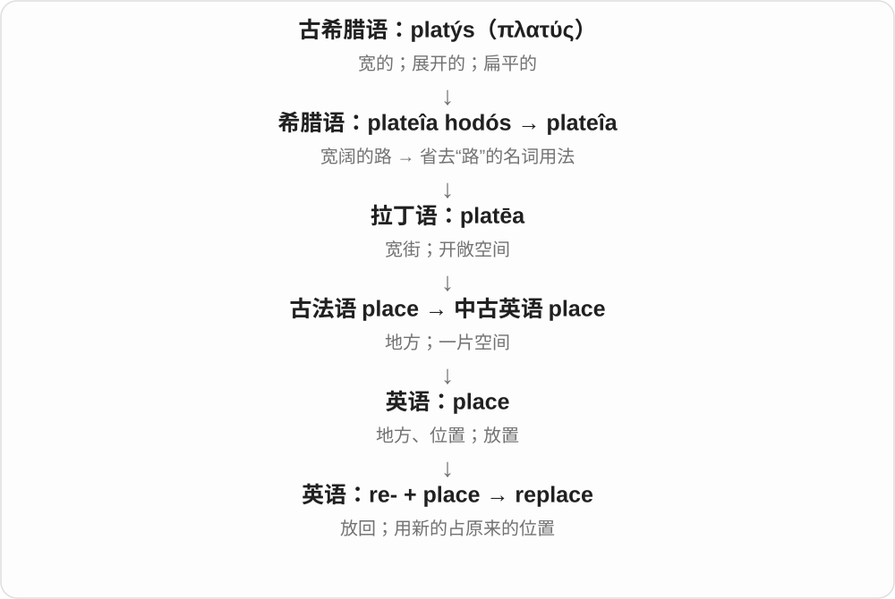
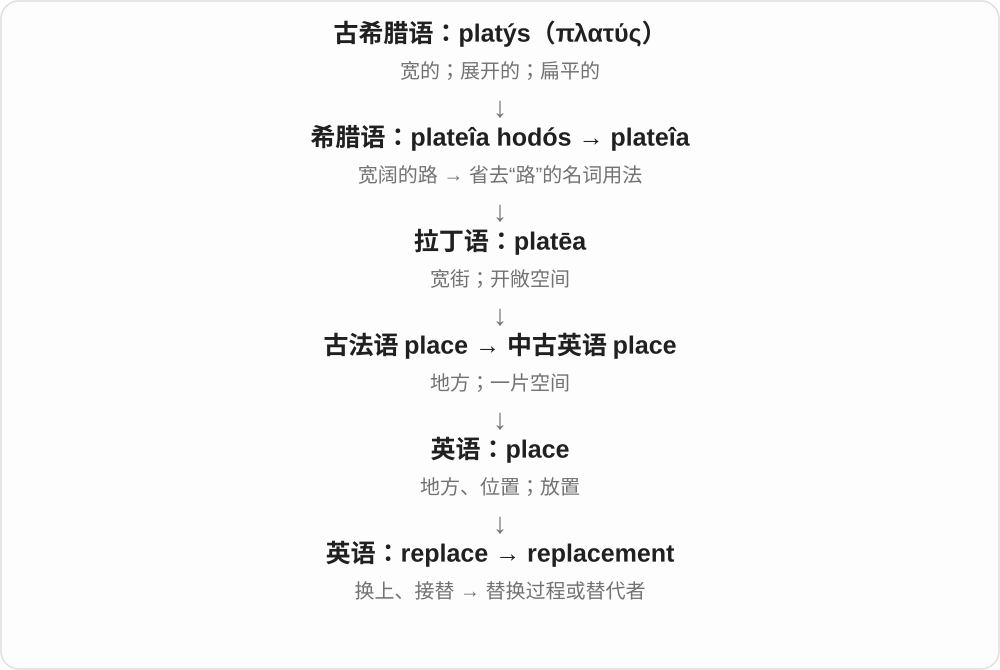

# 1033 · replace — 换掉、接替；替代物与可替换性质

[逐词精讲目录](../00_逐词精讲目录.md) · [总目录](../00_总目录_按常用程度.md)

## 核心词根与来源

替换动作、替代物和是否能换分清。可替换不保证可修理，产品用途只用作词义例子。

**REPLACE：原来的位置由另一个来接上**

replace → replacement → replaceable，复用已有前两词精讲。

- **动作、替代物和性质**：replace · replacement · replaceable
- **replace → replaced：放回、换上与接替**：replace · replaced
- **replace → replacing：换入一个，接替原来的**：replace · replacing · replacement

## 词形与演化规律

replace + -ment/-able；replacement 和 replaceable 不同词性。

re- 与 place 组合，现代替换义既可接被换下者，也可说明换上者。

re 与 place 的重新放置背景，现代去 e 加 ing。

## 单词速览（按词族由简到繁）

同一基础词的相关扩展放在一起，先读基础形式，再读扩展；各组之间优先读常用的。具体词源关系见各词讲解。

| 单词 | 音标 | 核心意思 |
|---|---|---|
| [replace](#w-1) | 英 /rɪˈpleɪs/；美 /rɪˈpleɪs/ | 替换；接替；放回原处 |
| [replaced](#w-4) | /rɪˈpleɪst/ | 替换、接替；放回〔replace 的过去式、过去分词〕 |
| [replacement](#w-2) | 英 /rɪˈpleɪsmənt/；美 /rɪˈpleɪsmənt/ | 替换；替代品；接替者 |
| [replacing](#w-5) | /rɪˈpleɪsɪŋ/ | 替换、更换；接替〔现在分词、动名词〕 |
| [replaceable](#w-3) | /rɪˈpleɪsəbəl/ | 可替换的、可更换的 |

## 逐词讲解

### 1. replace — 替换；接替；放回原处

**音标**：英 /rɪˈpleɪs/；美 /rɪˈpleɪs/

**先抓住这个画面**

原来的位置空出来，由另一个东西接上；有时也是真把原物放回去。

**怎么拆**

re- 再、回 + place 放置；由重新放置发展出替换、接替义。

**怎么变成今天的意思**

replace A with B 是拿 B 替换 A；replace the lid 可以是把盖子盖回去，不必是换新盖子。

**常见搭配与例句**

replace the battery；replace A with B；replace the lid。

> We replaced the old sofa with a smaller one.

我们把旧沙发换成了一张更小的。

> Please replace the lid after use.

用后请把盖子盖回去。

**别混淆**

replace A with B 的 A 是被换掉的；不要把两个对象的角色弄反。

### 2. replaced — 替换、接替；放回〔replace 的过去式、过去分词〕

**音标**：/rɪˈpleɪst/

**先抓住这个画面**

把旧东西拿下、把另一个放到它的位置，是 replaced 的替换义；把原来的东西重新放回去，也保留重新放置的画面。

**怎么拆**

replace 已有 e，加 -d，清音 /s/ 后读 /t/。re- 再、回与 place 放置组合，英语从重新放置发展出用另一物接替原来位置的用法。

**怎么变成今天的意思**

**re- + place → replace**  
重新、放回 → 替换位置

↓

**replace 去 e + -ed → replaced**  
换掉了、被接替；重新放回

replaced the battery 更换电池；replaced by 被……替代；replaced it with a new one 用新的换掉它。

**常见搭配与例句**

replaced the broken chair；replaced the lid。

> She replaced the broken chair with a new one.

她用一把新椅子换掉了坏椅子。

> He replaced the lid and put the jar away.

他把盖子盖回去，将罐子收了起来。

**别混淆**

She replaced A with B 是用 B 换下 A；A was replaced by B 同样是 B 接替 A。replaced the lid 在开关容器语境里常是把盖子盖回去。

### 3. replacement — 替换；替代品；接替者

**音标**：英 /rɪˈpleɪsmənt/；美 /rɪˈpleɪsmənt/

**先抓住这个画面**

旧的不能继续用了，接上来的那一个，或这个换上的过程，就是 replacement。

**怎么拆**

replace + -ment。

**怎么变成今天的意思**

a replacement for the broken part 是坏零件的替代品；replacement costs 是更换成本。它不保证新东西与原物完全相同。

**常见搭配与例句**

a replacement part；a replacement for someone；need replacement。

> The company sent a replacement for the damaged lamp.

公司寄来一盏灯，替换损坏的那盏。

> The manager is looking for a replacement for the departing employee.

经理正在找人接替即将离职的员工。

**别混淆**

replacement 可指动作也可指新东西；substitute 更容易强调代用品或临时代替者，但用法有重叠。

### 4. replacing — 替换、更换；接替〔现在分词、动名词〕

**音标**：/rɪˈpleɪsɪŋ/

**先抓住这个画面**

原来的位置还需要有人、东西来占，但放进去的换成了另一位、另一件，就是 replacing。

**怎么拆**

replace 去 e 加 -ing。re- 再、回与 place 放置结合，重新放置的背景发展为替换、接替。

**怎么变成今天的意思**

**re- + place → replace**  
重新放到位置上 → 用一个接替另一个

↓

**replace 去 e 加 -ing → replacing**  
正在替换、接替

replacing the old chairs 更换旧椅子；replacing someone on a team 接替队中某人；replacing A with B 用 B 换掉 A。

**常见搭配与例句**

replacing a broken part 更换坏零件；a tool replacing manual work 接替手工劳动的工具。

> We are replacing the old chairs with lighter ones.

我们正把旧椅子换成更轻的椅子。

> Replacing the damaged part took only a few minutes.

更换损坏的零件只花了几分钟。

**别混淆**

replacing A with B，A 是被换掉的，B 是换入的；A is replaced by B 则把 A 放成被动主语。

### 5. replaceable — 可替换的、可更换的

**音标**：/rɪˈpleɪsəbəl/

**先抓住这个画面**

坏了可以换一个新的，或这个角色可以由别人接手。重点在有替代办法。

**怎么拆**

replace + -able，保留 e，形成可被替换的形容词。这里接替换义，不把所有 replace 的历史和现代义都压成重新摆放。

**怎么变成今天的意思**

**replace 的替换、更换等现代用法**  
换一个来接替；另有放回等用法背景

↓

**replace + -able → replaceable**  
可以换掉、可以找到替代的

a replaceable battery 可更换电池，replaceable parts 可换零件，easily replaceable 容易替代的。

**常见搭配与例句**

a replaceable battery；replaceable parts；easily replaceable。

> The device has a replaceable battery.

这台设备的电池可以更换。

> The damaged part is easily replaceable.

损坏的零件很容易更换。

**别混淆**

replaceable 可替换，repairable 可修理；可换不保证能修，能修也不保证有替代件。

## 这一组要分清什么

replace 替换、replacement 替代物或更换、replaceable 可换；repairable 可修不是同义。

## 串起来练习

The replacement battery is replaceable too.

换上的新电池也可以再更换。
