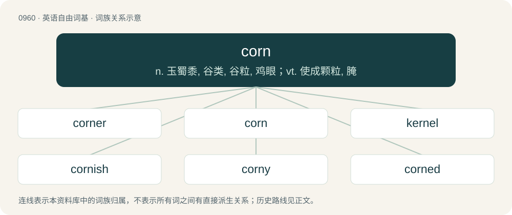

# 1034 · corn — n. 玉蜀黍, 谷类, 谷粒, 鸡眼；vt. 使成颗粒, 腌

[总目录](../00_总目录_按常用程度.md)

**类型**：英语自由词基　｜　**来源语言**：见词源记录

## 核心含义与来源

- 核心含义：n. 玉蜀黍, 谷类, 谷粒, 鸡眼；vt. 使成颗粒, 腌
- 英文含义：Any cereal plant (or its grain) that is the main crop or staple of a country or region.
- 词形：corn

**多个词源／构词路径**：同一拼写可能有不同来源；以下按词性和含义分别列出。

**来源记录 1**（名词；Any cereal plant (or its grain) that is the main crop or staple of a country or region.）

Inherited from Middle English corn, from Old English corn, from Proto-West Germanic \*korn, from Proto-Germanic \*kurną, from Proto-Indo-European \*ǵr̥h₂nóm (“grain; worn-down”), from \*ǵerh₂- (“grow old, mature”). Cognate with Dutch koren, German Low German Koorn, German Korn, Danish, Norwegian Bokmål, Norwegian Nynorsk, and Swedish korn; see also Albanian grurë, Russian зерно́ (zernó), Czech zrno, Latin grānum and Lithuanian žirnis. Doublet of grain, gram, granum, and grao. The sense maize (Zea mays) is an ellipsis of Indian corn that developed in 18th century North America.

**来源记录 2**（名词；Something (e.g., acting, humour, music, or writing) which is deemed old-fashioned or intended to induce emotion.）

From corny.

**来源记录 3**（名词；pornography; porn）

Rhyming euphemism for porn, and with influence from the emoji substitute 🌽.

## 词族图

## 单词速览（常用到不常用）

| 单词 | 音标 | 释义 |
|---|---|---|
| [corner](#w-1) | 英 /ˈkɔːnə(ɹ)/；美 /ˈkɔɹnɚ/ | 【英文】One who corns, or preserves food in salt. |
| [corn](#w-2) | 英 /ˈkɔːn/；美 /ˈkɔɹn/ | n. 玉蜀黍, 谷类, 谷粒, 鸡眼；vt. 使成颗粒, 腌 |
| [kernel](#w-3) | 英 /ˈkɜː.nəl/；美 /ˈkɝ.nəl/ | n. 核心, 中心, 精髓, 内核；\[计\] 内核 |
| [cornish](#w-4) | /ˈkɔːniʃ/ | a. 康沃尔人的；康沃尔郡的 |
| [corny](#w-5) | 英 /ˈkɔːni/；美 /ˈkɔɹni/ | a. 谷类的, 乡巴佬似的, 粗野的；\[建\] 角制的, 角(质)的 |
| [corned](#w-6) | /kɒːnd/ | a. 结籽的, 盐腌的 |
| [cornfield](#w-7) | 英 /ˈkɔːnfiːld/；美 /ˈkɔɹnˌfild/ | n. 玉米田 |
| [cornstarch](#w-8) | /ˈkɒːnstɑːtʃ/ | n. 玉米淀粉；\[医\] 玉蜀黍淀粉 |
| [cornmeal](#w-9) | 英 /ˈkɔːnˌmiːl/；美 /ˈkɔɹnˌmil/ | n. 玉蜀黍粉, 玉米片, 麦片 |
| [peppercorn](#w-10) | 英 /ˈpɛpəkɔːn/；美 /ˈpɛpɚkɔɹn/ | n. 空有其名的租金, 微不足道的答礼, 空有其名的答礼 |
| [cornhole](#w-11) | 美 /ˈkɔɹnˌhoʊl/ | 【英文】A small room connected to a threshing floor. |
| [cornflower](#w-12) | 美 /ˈkɔɹnˌflaʊ.ɚ/ | n. 矢车菊 |

## 逐词详解

### 1. corner

**词性**：名词　｜　**音标**：英 /ˈkɔːnə(ɹ)/；美 /ˈkɔɹnɚ/

**英文义项**：One who corns, or preserves food in salt.

**构词拆分**：corn + -er

**词源与演化**：

From corn + -er. Piecewise doublet of grainer.

### 2. corn

**词性**：名词　｜　**音标**：英 /ˈkɔːn/；美 /ˈkɔɹn/

**中文释义**：n. 玉蜀黍, 谷类, 谷粒, 鸡眼；vt. 使成颗粒, 腌

**英文义项**：Any cereal plant (or its grain) that is the main crop or staple of a country or region. / Maize, a grain crop of the species Zea mays.

**词源与演化**：

Inherited from Middle English corn, from Old English corn, from Proto-West Germanic \*korn, from Proto-Germanic \*kurną, from Proto-Indo-European \*ǵr̥h₂nóm (“grain; worn-down”), from \*ǵerh₂- (“grow old, mature”). Cognate with Dutch koren, German Low German Koorn, German Korn, Danish, Norwegian Bokmål, Norwegian Nynorsk, and Swedish korn; see also Albanian grurë, Russian зерно́ (zernó), Czech zrno, Latin grānum and Lithuanian žirnis. Doublet of grain, gram, granum, and grao. The sense maize (Zea mays) is an ellipsis of Indian corn that developed in 18th century North America.

**例句**：

> He paid her the nominal fee of two corns of barley.

该用例对应义项：A single seed of a food crop, especially a cereal grass crop.

### 3. kernel

**词性**：名词　｜　**音标**：英 /ˈkɜː.nəl/；美 /ˈkɝ.nəl/

**中文释义**：n. 核心, 中心, 精髓, 内核；\[计\] 内核

**英文义项**：The core, center, or essence of an object or system. / The central (usually edible) part of a nut, especially once the hard shell has been removed.

**构词拆分**：corn + -le

**词源与演化**：

From Middle English kernel, kirnel, kürnel, from Old English cyrnel, from Proto-West Germanic \*kurnil, diminutive of Proto-Germanic \*kurną (“seed, grain, corn”), equivalent to corn + -le. Cognate with Yiddish קערנדל (kerndl), Middle Dutch kernel, cornel, Middle High German kornel. Related also to Old Norse kjarni (“kernel”).

**例句**：

> The Dirichlet kernel convolved with a function yields its Fourier series approximation.

该用例对应义项：A function used to define an integral transform.

### 4. cornish

**词性**：形容词　｜　**音标**：/ˈkɔːniʃ/

**中文释义**：a. 康沃尔人的；康沃尔郡的

**英文义项**：cornlike; resembling corn

**构词拆分**：corn + -ish

**词源与演化**：

From corn + -ish.

**例句**：

> Welsh, Cornish and Breton are all closely related.

### 5. corny

**词性**：形容词　｜　**音标**：英 /ˈkɔːni/；美 /ˈkɔɹni/

**中文释义**：a. 谷类的, 乡巴佬似的, 粗野的；\[建\] 角制的, 角(质)的

**英文义项**：Boring and unoriginal. / Hackneyed or excessively sentimental.

**构词拆分**：corn (“a type of cereal or grain”) + -y

**词源与演化**：

From Middle English corny, equivalent to corn (“a type of cereal or grain”) + -y. Piecewise doublet of grainy. In the "hackneyed" sense, from "corn catalogue jokes", reputedly low-quality jokes that were formerly printed in mail-order seed catalogues.

**例句**：

> The movie was okay, but the love scene was really corny.

该用例对应义项：Hackneyed or excessively sentimental.

### 6. corned

**词性**：形容词　｜　**音标**：/kɒːnd/

**中文释义**：a. 结籽的, 盐腌的

**英文义项**：Consisting of grains; granulated. / Preserved in salt.

**构词拆分**：corn + -ed

**词源与演化**：

From corn + -ed. Piecewise doublet of grained.

**例句**：

> Ziri wants a corned beef sandwich.

### 7. cornfield

**词性**：名词　｜　**音标**：英 /ˈkɔːnfiːld/；美 /ˈkɔɹnˌfild/

**中文释义**：n. 玉米田

**英文义项**：A field of corn: maize, wheat, or other cereal crop. / A field of corn (maize).

**构词拆分**：corn + field

**词源与演化**：

From corn + field.

**例句**：

> For the astronomers it was like finding a skyscraper in the middle of a cornfield.

### 8. cornstarch

**词性**：名词　｜　**音标**：/ˈkɒːnstɑːtʃ/

**中文释义**：n. 玉米淀粉；\[医\] 玉蜀黍淀粉

**英文义项**：A very fine starch powder derived from corn (maize) used in cooking as a thickener, to keep things from sticking, or as an anti-caking agent.

**构词拆分**：corn + starch

**词源与演化**：

From corn + starch.

**例句**：

> Whisk sugar and cornstarch in a bowl. Set aside.

### 9. cornmeal

**词性**：名词　｜　**音标**：英 /ˈkɔːnˌmiːl/；美 /ˈkɔɹnˌmil/

**中文释义**：n. 玉蜀黍粉, 玉米片, 麦片

**英文义项**：Dried corn (maize) milled (ground) to a meal, especially a coarse one.

**构词拆分**：corn + meal

**词源与演化**：

From corn + meal.

**例句**：

> She made a kind of polenta from cornmeal and chicken broth, with some cheese sprinkled on top.

该用例对应义项：Dried corn (maize) milled (ground) to a meal, especially a coarse one.

### 10. peppercorn

**词性**：名词　｜　**音标**：英 /ˈpɛpəkɔːn/；美 /ˈpɛpɚkɔɹn/

**中文释义**：n. 空有其名的租金, 微不足道的答礼, 空有其名的答礼

**英文义项**：The seeds of the pepper plant Piper nigrum, commonly used as a spice, usually ground or crushed. / A small, insignificant quantity; a whit or jot.

**构词拆分**：pepper + corn

**词源与演化**：

Inherited from Middle English peper corn, peper-corn, pepercorn, from Old English piporcorn (“peppercorn”), corresponding to pepper + corn. Compare Dutch peperkorrel (“peppercorn”), German Pfefferkorn (“peppercorn”), Danish peberkorn (“peppercorn”), Swedish pepparkorn (“peppercorn”), Icelandic piparkorn (“peppercorn”).

**用法示例／搭配（非完整句）**：

> peppercorn rent

该用例对应义项：A nominal consideration used to satisfy the requirements for the creation of a legal contract.

### 11. cornhole

**词性**：名词　｜　**音标**：美 /ˈkɔɹnˌhoʊl/

**英文义项**：A small room connected to a threshing floor. / A game similar to beanbag toss, popular in Ohio, in which a bag filled with corn feed is thrown into a hole.

**构词拆分**：corn + hole

**词源与演化**：

From corn + hole. (anus): From the old-fashioned practice of using dried corncobs instead of toilet paper in outdoor privies.

### 12. cornflower

**词性**：名词　｜　**音标**：美 /ˈkɔɹnˌflaʊ.ɚ/

**中文释义**：n. 矢车菊

**英文义项**：A small annual plant in the family Asteraceae, Centaurea cyanus, usually with bushy blue flowers which grows natively in European cornfields (i.e. wheatfields). / A plant of the species Cichorium intybus.

**构词拆分**：corn + flower

**词源与演化**：

From corn + flower. Piecewise doublet of cornflour.

**例句**：

> Far out at sea the water is as blue as the bluest cornflower and as clear as the clearest crystal.
