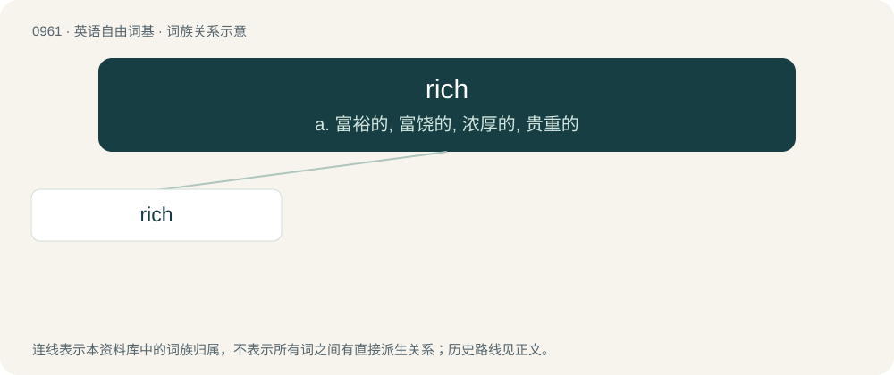

# 1035 · rich — a. 富裕的, 富饶的, 浓厚的, 贵重的

[总目录](../00_总目录_按常用程度.md)

**类型**：英语自由词基　｜　**来源语言**：见词源记录

## 核心含义与来源

- 核心含义：a. 富裕的, 富饶的, 浓厚的, 贵重的
- 英文含义：Wealthy: having a lot of money and possessions.
- 词形：rich

**来源记录 1**（形容词；Wealthy: having a lot of money and possessions.）

From Middle English riche (“strong, powerful, rich”), from Old English rīċe (“powerful, mighty, great, high-ranking, rich, wealthy, strong, potent”), from Proto-West Germanic \*rīkī (“powerful, rich”), from Proto-Germanic \*rīkijaz (“kingly, powerful, rich”), from Proto-Germanic \*rīks (“king, ruler”), an early borrowing from Proto-Celtic \*rīxs, from Proto-Indo-European \*h₃rḗǵs. Reinforced by Old French riche, from the same West Germanic source. Cognate with Dutch rijk, German reich, Danish rig, Norwegian Bokmål, Norwegian Nynorsk, and Swedish rik, Faroese and Icelandic ríkur, Portuguese and Spanish rico, French riche, Italian ricco.

## 词族图

## 单词速览（常用到不常用）

| 单词 | 音标 | 释义 |
|---|---|---|
| [rich](#w-1) | /ˈɹɪt͡ʃ/ | a. 富裕的, 富饶的, 浓厚的, 贵重的 |

## 逐词详解

### 1. rich

**词性**：形容词　｜　**音标**：/ˈɹɪt͡ʃ/

**中文释义**：a. 富裕的, 富饶的, 浓厚的, 贵重的

**英文义项**：Wealthy: having a lot of money and possessions. / Having an intense fatty or sugary flavour.

**词源与演化**：

From Middle English riche (“strong, powerful, rich”), from Old English rīċe (“powerful, mighty, great, high-ranking, rich, wealthy, strong, potent”), from Proto-West Germanic \*rīkī (“powerful, rich”), from Proto-Germanic \*rīkijaz (“kingly, powerful, rich”), from Proto-Germanic \*rīks (“king, ruler”), an early borrowing from Proto-Celtic \*rīxs, from Proto-Indo-European \*h₃rḗǵs. Reinforced by Old French riche, from the same West Germanic source. Cognate with Dutch rijk, German reich, Danish rig, Norwegian Bokmål, Norwegian Nynorsk, and Swedish rik, Faroese and Icelandic ríkur, Portuguese and Spanish rico, French riche, Italian ricco.

**例句**：

> The ETF is trading rich to NAV right now; we can arb this by selling the ETF and buying the underlying constituents.

该用例对应义项：Trading at a price level which is high relative to historical trends, a similar asset, or (for derivatives) a theoretical value.
