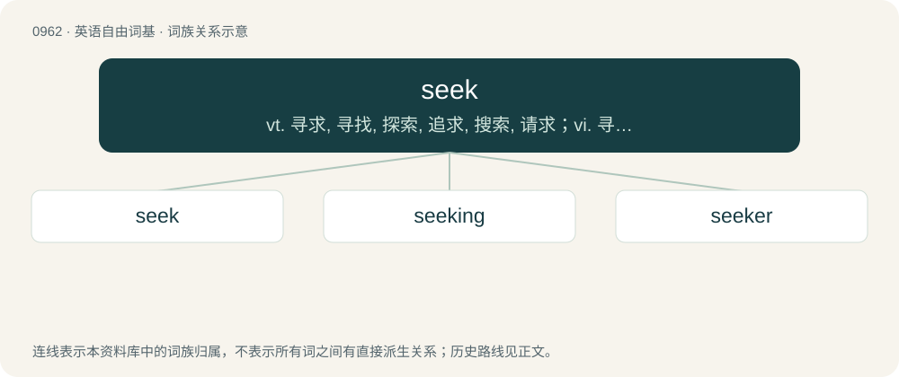

# 1036 · seek — vt. 寻求, 寻找, 探索, 追求, 搜索, 请求；vi. 寻找, 搜索；\[计\] 查找

[总目录](../00_总目录_按常用程度.md)

**类型**：英语自由词基　｜　**来源语言**：见词源记录

## 核心含义与来源

- 核心含义：vt. 寻求, 寻找, 探索, 追求, 搜索, 请求；vi. 寻找, 搜索；\[计\] 查找
- 英文含义：To try to find; to look for; to search for.
- 词形：seek

**来源记录 1**（动词；To try to find; to look for; to search for.）

From Middle English seke, seken, from Old English sēċan, sēċean, sœ̄ċan, from Proto-West Germanic \*sōkijan, from Proto-Germanic \*sōkijaną (“to seek”), from Proto-Indo-European \*séh₂gyeti (“to seek out”), from \*seh₂g- (“to follow, trace”). Cognates Cognate with Yola zeek (“to seek”), North Frisian schük, sjuk, säke (“to search, seek”), Saterland Frisian säike (“to search, seek”), West Frisian sykje (“to seek”), Alemannic German sueche, süeche (“to search, seek”), Bavarian suacha, suachn (“to search”), Central Franconian söke (“to search”), Cimbrian züuchan (“to seek”), Dutch zoeken (“to seek”), Low German söken (“to seek”), German suchen (“to seek”), Luxembourgish sichen (“to seek; to fetch”), Vilamovian zihia, zihja (“to seek”), Yiddish זוכן (zukhn, “to search, seek”), Danish søge (“to seek; to apply”), Faroese søkja (“to seek”), Icelandic sækja (“to seek”), Norwegian Bokmål søke (“to seek; to apply”), Norwegian Nynorsk søka, søke, søkja, søkje (“to seek; to apply”), Swedish söka (“to search”), Gothic 𐍃𐍉𐌺𐌾𐌰𐌽 (sōkjan, “to seek”); also Cornish hedhes (“to reach; to achieve; to manage”), Welsh haeddu (“to deserve, merit”), Latin sāgiō (“to perceive quickly or keenly with the senses”), Ancient Greek ἡγέομαι (hēgéomai, “to go before, precede; to lead; to believe, hold”), Albanian gjegj (“to answer; to obey”), Hittite 𒊭𒀀𒆠𒄑𒍣 (ša-a-ki-ez-zi, “to seek out”). The Middle English and later Modern English hard /k/ derives from Old English sēcð, the third person singular.

## 词族图

## 单词速览（常用到不常用）

| 单词 | 音标 | 释义 |
|---|---|---|
| [seek](#w-1) | /ˈsiːk/ | vt. 寻求, 寻找, 探索, 追求, 搜索, 请求；vi. 寻找, 搜索；\[计\] 查找 |
| [seeking](#w-2) | /ˈsiː.kɪŋ/ | \[计\] 查找, 寻找, 故障检查 |
| [seeker](#w-3) | 英 /ˈsiːkə/；美 /ˈsikəɹ/ | n. 搜索者, 探求者；\[法\] 搜索人, 搜查人 |

## 逐词详解

### 1. seek

**词性**：动词　｜　**音标**：/ˈsiːk/

**中文释义**：vt. 寻求, 寻找, 探索, 追求, 搜索, 请求；vi. 寻找, 搜索；\[计\] 查找

**英文义项**：To try to find; to look for; to search for. / To try to acquire or gain; to strive after.

**词源与演化**：

From Middle English seke, seken, from Old English sēċan, sēċean, sœ̄ċan, from Proto-West Germanic \*sōkijan, from Proto-Germanic \*sōkijaną (“to seek”), from Proto-Indo-European \*séh₂gyeti (“to seek out”), from \*seh₂g- (“to follow, trace”). Cognates Cognate with Yola zeek (“to seek”), North Frisian schük, sjuk, säke (“to search, seek”), Saterland Frisian säike (“to search, seek”), West Frisian sykje (“to seek”), Alemannic German sueche, süeche (“to search, seek”), Bavarian suacha, suachn (“to search”), Central Franconian söke (“to search”), Cimbrian züuchan (“to seek”), Dutch zoeken (“to seek”), Low German söken (“to seek”), German suchen (“to seek”), Luxembourgish sichen (“to seek; to fetch”), Vilamovian zihia, zihja (“to seek”), Yiddish זוכן (zukhn, “to search, seek”), Danish søge (“to seek; to apply”), Faroese søkja (“to seek”), Icelandic sækja (“to seek”), Norwegian Bokmål søke (“to seek; to apply”), Norwegian Nynorsk søka, søke, søkja, søkje (“to seek; to apply”), Swedish söka (“to search”), Gothic 𐍃𐍉𐌺𐌾𐌰𐌽 (sōkjan, “to seek”); also Cornish hedhes (“to reach; to achieve; to manage”), Welsh haeddu (“to deserve, merit”), Latin sāgiō (“to perceive quickly or keenly with the senses”), Ancient Greek ἡγέομαι (hēgéomai, “to go before, precede; to lead; to believe, hold”), Albanian gjegj (“to answer; to obey”), Hittite 𒊭𒀀𒆠𒄑𒍣 (ša-a-ki-ez-zi, “to seek out”). The Middle English and later Modern English hard /k/ derives from Old English sēcð, the third person singular.

**例句**：

> Our company does not seek to limit its employees from using the internet or engaging in social networking.

该用例对应义项：To attempt, to try \[with infinitive ‘to do something’\].

### 2. seeking

**词性**：名词　｜　**音标**：/ˈsiː.kɪŋ/

**中文释义**：\[计\] 查找, 寻找, 故障检查

**英文义项**：The act of one who seeks; a search or quest to find something.

**构词拆分**：From seek + -ing.

**词源与演化**：

From seek + -ing.

**例句**：

> I am seeking a person who can write a personal computer manual.

### 3. seeker

**词性**：名词　｜　**音标**：英 /ˈsiːkə/；美 /ˈsikəɹ/

**中文释义**：n. 搜索者, 探求者；\[法\] 搜索人, 搜查人

**英文义项**：One who seeks. / Especially, a religious seeker: a pilgrim, or one who aspires to enlightenment or salvation.

**构词拆分**：seek + -er

**词源与演化**：

From Middle English sekar, sekere (also sechar, sechere), from Old English \*sēċare, from Proto-West Germanic \*sōkārī, from Proto-Germanic \*sōkārijaz. Equivalent to seek + -er. Cognate with Dutch zoeker, German Sucher, German Low German Söker, Gothic 𐍃𐍉𐌺𐌰𐍂𐌴𐌹𐍃 (sōkareis), Norwegian søker, Saterland Frisian Säiker, West Frisian syker, and Yiddish זוכער (zukher).

**例句**：

> The asylum seeker was finally able to speak to a lawyer.
