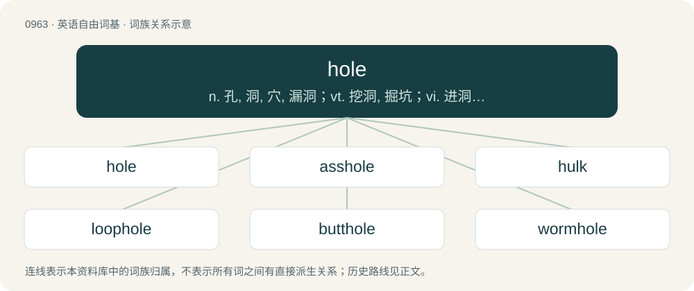

# 1037 · hole — n. 孔, 洞, 穴, 漏洞；vt. 挖洞, 掘坑；vi. 进洞, 凿洞

[总目录](../00_总目录_按常用程度.md)

**类型**：英语自由词基　｜　**来源语言**：见词源记录

## 核心含义与来源

- 核心含义：n. 孔, 洞, 穴, 漏洞；vt. 挖洞, 掘坑；vi. 进洞, 凿洞
- 英文含义：A hollow place or cavity; an excavation; a pit; a dent; a depression; a fissure.
- 词形：hole

**来源记录 1**（名词；A hollow place or cavity; an excavation; a pit; a dent; a depression; a fissure.）

Inherited from Middle English hole, hol, from Old English hol (“orifice, hollow place, cavity”), from Proto-West Germanic \*hol (“hole”), from Proto-Germanic \*hulą (“hollow space, cavity”), noun derivative of Proto-Germanic \*hulaz (“hollow”), which is of uncertain ultimate origin. Related to hollow. Cognate with Dutch, Faroese, and Icelandic hol (“hole”), Danish hul (“hole”), Faroese, Icelandic, and Norn hola (“hole”), Norwegian Bokmål hol (“depression, hole, cavern”), Swedish hål (“hole”), French houle (“swell of water”). Compare unrelated Finnish kolo (“hole”).

## 词族图

## 单词速览（常用到不常用）

| 单词 | 音标 | 释义 |
|---|---|---|
| [hole](#w-1) | 英 /həʊl/；美 /hoʊl/ | n. 孔, 洞, 穴, 漏洞；vt. 挖洞, 掘坑；vi. 进洞, 凿洞 |
| [asshole](#w-2) | 美 /æshoʊl/ | n. 屁眼儿, 肛门；令人讨厌的人 |
| [hulk](#w-3) | 英 /hʌlk/ | n. 船体, 笨重的船, 废然大物 |
| [loophole](#w-4) | 英 /ˈluːphəʊl/；美 /ˈluphoʊl/ | n. 枪眼, 小窗, 换气孔 |
| [butthole](#w-5) | 美 /ˈbʌtˌhoʊl/ | n. 屁眼 |
| [wormhole](#w-6) | 美 /ˈwɝmˌhoʊl/ | n. 蛀孔, 蛀洞 |
| [keyhole](#w-7) | 美 /ˈkiˌhoʊ̯l/ | n. 键孔, 栓孔, 锁眼；a. 显示内情的 |
| [arsehole](#w-8) | /ˈɑː(ɹ)s.hoʊl/ | n. 屁眼儿, 肛门 |
| [sinkhole](#w-9) | 美 /ˈsɪŋkˌhoʊl/ | n. 阴沟口, 污水坑；\[化\] 缩孔 |
| [manhole](#w-10) | 英 /ˈmænhəʊl/ | n. 人孔；\[化\] 人孔; 进人孔 |
| [pothole](#w-11) | /ˈpɒthəul/ | n. 壶穴 |
| [borehole](#w-12) | /ˈbɔːhəul/ | n. 地上凿洞 |
| [pinhole](#w-13) | 美 /ˈpɪnˌhoʊl/ | n. 针孔, 小孔, 蛀洞；\[机\] 针孔, 砂眼 |
| [porthole](#w-14) | /ˈpɔː(ɹ)t.həʊl/ | n. 舷窗, 炮门；\[化\] 窥视孔 |
| [waterhole](#w-15) |  | n. 水坑, 水眼 |
| [foxhole](#w-16) | /ˈfɒkshəul/ | n. 散兵坑 |
| [holing](#w-17) | /ˈhəuliŋ/ | \[采矿\]掏槽落煤法, \[建\]石板瓦钻孔 |
| [cornhole](#w-18) | 美 /ˈkɔɹnˌhoʊl/ | 【英文】A small room connected to a threshing floor. |
| [pigeonhole](#w-19) | 英 /ˈpɪdʒ(ɪ)nhəʊl/；美 /ˈpɪdʒənˌ(h)oʊl/ | n. 鸽棚, 鸽子出入孔, 分类架, 粗略分类, 鸽棚般的小房间；vt. 分类, 归档, 把...束之高阁 |
| [peephole](#w-20) | 英 /ˈpiːphəʊl/；美 /ˈpiːphoʊl/ | n. 窥视孔；\[化\] 窥孔; 观测孔 |
| [holey](#w-21) | 英 /ˈhəʊli/；美 /ˈhoʊli/ | a. 有穴的, 多洞的 |
| [blowhole](#w-22) | /ˈbləʊhəʊl/ | n. 喷水孔, 通风孔, 通气孔；\[机\] 气孔 |

## 逐词详解

### 1. hole

**词性**：名词　｜　**音标**：英 /həʊl/；美 /hoʊl/

**中文释义**：n. 孔, 洞, 穴, 漏洞；vt. 挖洞, 掘坑；vi. 进洞, 凿洞

**英文义项**：A hollow place or cavity; an excavation; a pit; a dent; a depression; a fissure. / An opening that goes all the way through a solid body, a fabric, etc.; a perforation; a rent.

**词源与演化**：

Inherited from Middle English hole, hol, from Old English hol (“orifice, hollow place, cavity”), from Proto-West Germanic \*hol (“hole”), from Proto-Germanic \*hulą (“hollow space, cavity”), noun derivative of Proto-Germanic \*hulaz (“hollow”), which is of uncertain ultimate origin. Related to hollow. Cognate with Dutch, Faroese, and Icelandic hol (“hole”), Danish hul (“hole”), Faroese, Icelandic, and Norn hola (“hole”), Norwegian Bokmål hol (“depression, hole, cavern”), Swedish hål (“hole”), French houle (“swell of water”). Compare unrelated Finnish kolo (“hole”).

**例句**：

> I played 18 holes yesterday. The second hole today cost me three strokes over par.

该用例对应义项：The part of a game in which a player attempts to hit the ball into one of the holes.

### 2. asshole

**词性**：名词　｜　**音标**：美 /æshoʊl/

**中文释义**：n. 屁眼儿, 肛门；令人讨厌的人

**英文义项**：The anus. / A jerk; an inappropriately or objectionably mean, inconsiderate, contemptible, immoral, obnoxious, intrusive, stupid, or rude person.

**构词拆分**：ass + hole

**词源与演化**：

First recorded in Middle English, as ers hole (Glouc. Cath. Manuscript 19. No. I., dated 1379, cited after OED), ars-hole (Bodleian Ashmole MS. 1396, dated ca. 1400, ed. Robert Von Fleischhacker as Lanfrank's "Science of Cirurgie", EETS 102, 1894, cited after OED.) Slang figurative usage dates to the 20th century; it was used of an uninviting place (compare shithole) in the 1920s, and then of an anti-social or despicable person from at least the 1950s (Harvard Advocate 137, March 1954). It is also used appositionally (as in "You're an asshole moralist", T. Chamales, 1957).

**例句**：

> That homemade hot sauce of yours got me twice, both coming and going. My asshole is still sore.

该用例对应义项：The anus.

### 3. hulk

**词性**：名词　｜　**音标**：英 /hʌlk/

**中文释义**：n. 船体, 笨重的船, 废然大物

**英文义项**：A non-functional but floating ship, usually stripped of equipment and rigging, and often put to other uses such as accommodation or storage. / A large structure with a dominating presence.

**构词拆分**：hole/hollow + -ock

**词源与演化**：

From Middle English hulk, hulke, holke (“hut; shed for hogs; type of ship; husk, pod, shell; large, clumsy person; a giant”) (probably reinforced by Middle Dutch hulk, huelc, and Middle Low German hulk, holk, hollek (“freighter, cargo ship, barge”)), from Old English hulc (“light ship; heavy, clumsy ship; cabin, hovel, hut”), from Proto-West Germanic \*huluk, \*hulik, from Proto-Germanic \*hulukaz, \*hulikaz (“something hollowed or dug out, cavity”), equivalent to hole/hollow + -ock. Cognate with Old High German holcho (“cargo or transport ship, barge”) (whence Middle High German holche, modern German Holk), Old Norse hólkr (“metal tube, ring”), dialectal Norwegian holk, hylke (“wooden barrel”), Middle English holken (“to dig out, gouge”). Relation to Medieval Latin hulcus (“ship”) is uncertain, as Old English may have borrowed from Latin or vice versa, but the form holcas rather points to borrowing from Ancient Greek ὁλκάς (holkás, “ship being towed; cargo ship, ship used for trading, holcad”) (compare Ancient Greek ἕλκω (hélkō, “to drag”), possibly from Proto-Indo-European \*selk- (“to draw, pull”)). See more at the Old English entry hulc. The verb is derived from the noun.

**例句**：

> Karl turned into a green humanoid named Hulk.

### 4. loophole

**词性**：名词　｜　**音标**：英 /ˈluːphəʊl/；美 /ˈluphoʊl/

**中文释义**：n. 枪眼, 小窗, 换气孔

**英文义项**：A method of escape, especially an ambiguity or exception in a rule or law that can be exploited in order to avoid its effect.

**构词拆分**：Middle English loupe (“opening in a wall”) + hole

**词源与演化**：

From Middle English loupe (“opening in a wall”) + hole, from a Germanic source. By surface analysis, loop + hole. Compare Medieval Latin loupa, lobia and Middle Dutch lupen (“to watch”).

**例句**：

> A loophole in the law allowed him to escape prosecution.

### 5. butthole

**词性**：名词　｜　**音标**：美 /ˈbʌtˌhoʊl/

**中文释义**：n. 屁眼

**英文义项**：The anus. / An objectionable person; a bastard; a jerk.

**构词拆分**：butt + hole

**词源与演化**：

From butt + hole.

**例句**：

> My butthole is on fire from that dang hot sauce of yours.

该用例对应义项：The anus.

### 6. wormhole

**词性**：名词　｜　**音标**：美 /ˈwɝmˌhoʊl/

**中文释义**：n. 蛀孔, 蛀洞

**英文义项**：A hole burrowed by a worm. / A hypothetical shortcut between two points in spacetime, permitting faster-than-light travel and sometimes time travel.

**构词拆分**：worm + hole

**词源与演化**：

First use appears c. 1594. From worm + hole. In the scientific sense, introduced by John Archibald Wheeler in 1957.

**例句**：

> William used the flamethrower again to push the aliens into the wormhole.

### 7. keyhole

**词性**：名词　｜　**音标**：美 /ˈkiˌhoʊ̯l/

**中文释义**：n. 键孔, 栓孔, 锁眼；a. 显示内情的

**英文义项**：The hole in a lock where the key is inserted and turns. / Any small opening resembling the hole for a key in shape or function; especially, one that gives a vista of, or access to, a space beyond.

**构词拆分**：key + hole

**词源与演化**：

From key + hole.

**用法示例／搭配（非完整句）**：

> laser keyhole welding

该用例对应义项：A transient column of vapor or plasma formed when using high energy beams, such as lasers, for welding or cutting.

### 8. arsehole

**词性**：名词　｜　**音标**：/ˈɑː(ɹ)s.hoʊl/

**中文释义**：n. 屁眼儿, 肛门

**英文义项**：The anus. / An inconsiderate, mean-spirited, or otherwise contemptible person. (Less offensive than fucker or cunt.)

**构词拆分**：arse + hole

**词源与演化**：

From Middle English arce-hoole, equivalent to arse + hole. Compare Old English ears-þyrel (“anus”, literally “arse-hole”).

**例句**：

> The moment I sat on the toilet, my crap immediately came out of my arsehole.

该用例对应义项：The anus.

### 9. sinkhole

**词性**：名词　｜　**音标**：美 /ˈsɪŋkˌhoʊl/

**中文释义**：n. 阴沟口, 污水坑；\[化\] 缩孔

**英文义项**：A hole formed in soluble rock by the action of water, serving to conduct surface water to an underground passage. / A depressed area in which waste or drainage collects.

**构词拆分**：sink + hole

**词源与演化**：

From Middle English sinkehole, sinkeholl, equivalent to sink + hole.

**例句**：

> A sinkhole formed under the National Corvette Museum and swallowed eight cars.

### 10. manhole

**词性**：名词　｜　**音标**：英 /ˈmænhəʊl/

**中文释义**：n. 人孔；\[化\] 人孔; 进人孔

**英文义项**：A hole in the ground used to access the sewers or other underground vaults and installations. / A hole providing access to the inside of a boiler, tank etc.

**构词拆分**：man + hole

**词源与演化**：

From man + hole.

**例句**：

> Tom was injured by a manhole cover explosion.

### 11. pothole

**词性**：名词　｜　**音标**：/ˈpɒthəul/

**中文释义**：n. 壶穴

**英文义项**：A shallow pit or other edged depression in a road's surface, especially when caused by erosion, weather or traffic. / A pit formed in the bed of a turbulent stream.

**构词拆分**：pot (“pit, hollow, cavity”) + hole

**词源与演化**：

From dialectal pot (“pit, hollow, cavity”) + hole. The "cave" senses, attested since at least 1809 (as pot-hole), may be from Middle English pot, potte (“a deep hole for a mine, or from peat-digging”), of uncertain origin; perhaps related to English pit, pote, or pot. Compare Scots pott, patt (“a pit dug in the ground; coalpit”).

**例句**：

> I got stuck in a pothole on my way to work.

### 12. borehole

**词性**：名词　｜　**音标**：/ˈbɔːhəul/

**中文释义**：n. 地上凿洞

**英文义项**：A hole bored into the ground to collect samples for analysis or to extract oil or water. / Any other hole that has been bored into something.

**构词拆分**：bore + hole

**词源与演化**：

From bore + hole.

**例句**：

> There were little boreholes in the oak beam, indicating that insects had once taken some interest in it.

该用例对应义项：Any other hole that has been bored into something.

### 13. pinhole

**词性**：名词　｜　**音标**：美 /ˈpɪnˌhoʊl/

**中文释义**：n. 针孔, 小孔, 蛀洞；\[机\] 针孔, 砂眼

**英文义项**：A small hole, of a size that could have been made by a pin / The aperture in a pinhole camera or camera obscura

**构词拆分**：pin + hole

**词源与演化**：

From pin + hole.

**例句**：

> You can build a pinhole camera with a shoe box.

### 14. porthole

**词性**：名词　｜　**音标**：/ˈpɔː(ɹ)t.həʊl/

**中文释义**：n. 舷窗, 炮门；\[化\] 窥视孔

**英文义项**：A circular window set in the hull of a ship. / A gunport; an opening in the hull of a ship through which cannons are fired.

**构词拆分**：port + hole

**词源与演化**：

From port + hole.

**例句**：

> When it began to rain, I paused and looked through the porthole.

### 15. waterhole

**词性**：名词

**中文释义**：n. 水坑, 水眼

**英文义项**：A depression in which water collects, especially one where wild animals come to drink. / A watering hole; a place where people meet to drink and talk.

**构词拆分**：water + hole

**词源与演化**：

\* water + hole. \* (astronomy): Coined by Bernard Oliver in 1971, in allusion to the idea that this part of the spectrum would be that used by extraterrestrial intelligence to communicate.

**例句**：

> Ziri was in the desert and stumbled upon a waterhole.

### 16. foxhole

**词性**：名词　｜　**音标**：/ˈfɒkshəul/

**中文释义**：n. 散兵坑

**英文义项**：The burrow in the ground where a fox lives. / A small pit dug into the ground as a shelter for protection against enemy fire.

**构词拆分**：fox + hole

**词源与演化**：

From Middle English foxhol, from Old English foxhol, equivalent to fox + hole.

**例句**：

> The soldier took shelter in the foxhole.

### 17. holing

**词性**：名词　｜　**音标**：/ˈhəuliŋ/

**中文释义**：\[采矿\]掏槽落煤法, \[建\]石板瓦钻孔

**英文义项**：undercutting in a bed of coal in order to bring down the upper mass.

**构词拆分**：hole + -ing

**词源与演化**：

From hole (“a hollow”) + -ing.

### 18. cornhole

**词性**：名词　｜　**音标**：美 /ˈkɔɹnˌhoʊl/

**英文义项**：A small room connected to a threshing floor. / A game similar to beanbag toss, popular in Ohio, in which a bag filled with corn feed is thrown into a hole.

**构词拆分**：corn + hole

**词源与演化**：

From corn + hole. (anus): From the old-fashioned practice of using dried corncobs instead of toilet paper in outdoor privies.

### 19. pigeonhole

**词性**：名词　｜　**音标**：英 /ˈpɪdʒ(ɪ)nhəʊl/；美 /ˈpɪdʒənˌ(h)oʊl/

**中文释义**：n. 鸽棚, 鸽子出入孔, 分类架, 粗略分类, 鸽棚般的小房间；vt. 分类, 归档, 把...束之高阁

**英文义项**：One of an array of open compartments for housing pigeons in a dovecote or pigeon loft. / One of an array of open compartments in a desk, set of shelves, etc., used for sorting or storing letters, papers, or other items.

**构词拆分**：pigeon + hole

**词源与演化**：

The noun is derived from pigeon + hole. The verb is derived from the noun.

**例句**：

> Fred was disappointed to find his pigeonhole empty except for bills and a flyer offering 20% off on manicures.

该用例对应义项：One of an array of open compartments for receiving mail and other messages at a college, office, etc.

### 20. peephole

**词性**：名词　｜　**音标**：英 /ˈpiːphəʊl/；美 /ˈpiːphoʊl/

**中文释义**：n. 窥视孔；\[化\] 窥孔; 观测孔

**英文义项**：A small hole, opening, or piece of glass, especially in a door, through which one can look without being seen.

**构词拆分**：peep + hole

**词源与演化**：

From peep + hole.

**例句**：

> Karl took a look through the peephole on the front door.

### 21. holey

**词性**：形容词　｜　**音标**：英 /ˈhəʊli/；美 /ˈhoʊli/

**中文释义**：a. 有穴的, 多洞的

**英文义项**：Having, or being full of, holes.

**构词拆分**：hole + -y

**词源与演化**：

From Middle English holy, holi, holly, holli (“holey, spongy, hollow”); equivalent to hole + -y. The e was inserted in Modern English to distinguish the word from holy (“hallowed, sacred”).

**例句**：

> Fred loved holey Dutch cheese.

该用例对应义项：Having, or being full of, holes.

### 22. blowhole

**词性**：名词　｜　**音标**：/ˈbləʊhəʊl/

**中文释义**：n. 喷水孔, 通风孔, 通气孔；\[机\] 气孔

**英文义项**：The spiracle, on the top of the head, through which cetaceans breathe. / A hole in sea ice where cetaceans and pinnipeds come to breathe.

**构词拆分**：blow + hole

**词源与演化**：

From blow + hole.
