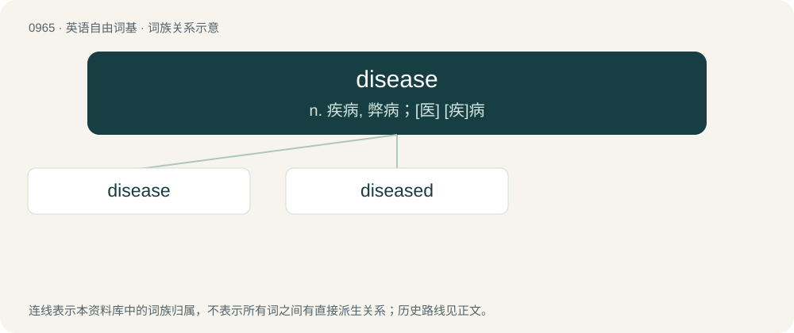

# 1038 · disease — n. 疾病, 弊病；\[医\] \[疾\]病

[总目录](../00_总目录_按常用程度.md)

**类型**：英语自由词基　｜　**来源语言**：见词源记录

## 核心含义与来源

- 核心含义：n. 疾病, 弊病；\[医\] \[疾\]病
- 英文含义：An abnormal condition of a human, animal or plant that causes discomfort or dysfunction; distinct from injury insofar as the latter is usually instantaneously acquired.
- 词形：disease

**来源记录 1**（名词；An abnormal condition of a human, animal or plant that causes discomfort or dysfunction; distinct from injury insofar as the latter is usually instantaneously acquired.）

From Middle English disese, from Anglo-Norman desese, disaise, from Old French desaise, from des- + aise. Displaced native Middle English adle, audle (“disease”) (from Old English ādl (“disease, sickness”), see adle), Middle English cothe, coathe (“disease”) (from Old English coþu (“disease”), see coath). By surface analysis, dis- + ease.

## 词族图

## 单词速览（常用到不常用）

| 单词 | 音标 | 释义 |
|---|---|---|
| [disease](#w-1) | 英 /dɪˈziːz/；美 /dɪˈziz/ | n. 疾病, 弊病；\[医\] \[疾\]病 |
| [diseased](#w-2) | 英 /dɪˈziːzd/；美 /dɪˈzizd/ | a. 害病的, 病态的, 不健全的 |

## 逐词详解

### 1. disease

**词性**：名词　｜　**音标**：英 /dɪˈziːz/；美 /dɪˈziz/

**中文释义**：n. 疾病, 弊病；\[医\] \[疾\]病

**英文义项**：An abnormal condition of a human, animal or plant that causes discomfort or dysfunction; distinct from injury insofar as the latter is usually instantaneously acquired. / Any abnormal or harmful condition, as of society, people's attitudes, way of living etc.

**词源与演化**：

From Middle English disese, from Anglo-Norman desese, disaise, from Old French desaise, from des- + aise. Displaced native Middle English adle, audle (“disease”) (from Old English ādl (“disease, sickness”), see adle), Middle English cothe, coathe (“disease”) (from Old English coþu (“disease”), see coath). By surface analysis, dis- + ease.

**例句**：

> The tomato plants had some kind of disease that left their leaves splotchy and their fruit withered.

该用例对应义项：An abnormal condition of a human, animal or plant that causes discomfort or dysfunction; distinct from injury insofar as the latter is usually instantaneously acquired.

### 2. diseased

**词性**：形容词　｜　**音标**：英 /dɪˈziːzd/；美 /dɪˈzizd/

**中文释义**：a. 害病的, 病态的, 不健全的

**英文义项**：Affected with or suffering from disease.

**构词拆分**：disease + -ed

**词源与演化**：

\* disease + -ed

**例句**：

> I am a sick man… I am a spiteful man. I am an unpleasant man. I think my liver is diseased.
